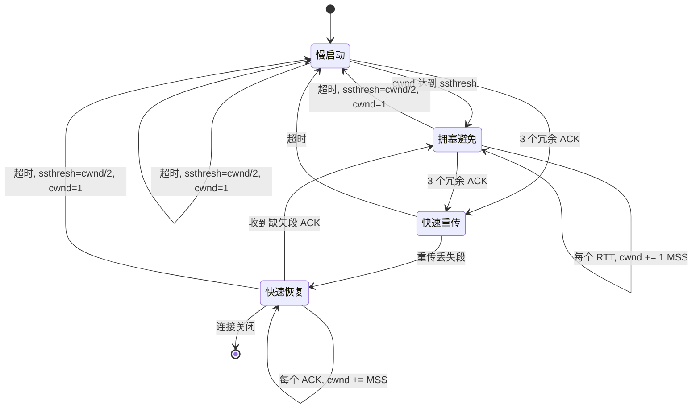

# TCP 的拥塞控制算法有哪些？

## 常见问题

- TCP 中常见的拥塞控制算法有哪些？
- TCP的拥塞控制具体是怎么实现的？UDP有拥塞控制吗？

## 概念索引

- 拥塞窗口 cwnd: 发送方估计网络能承受的在途数据量;
- 慢启动: 从小窗口快速探测可用带宽;
- 拥塞避免: 接近阈值后线性增长;
- 快速重传: 3 个冗余 ACK 立即重发;
- 快速恢复: 丢包后不回到慢启动;
- 算法: Tahoe、Reno、NewReno、CUBIC、BBR;

## 拥塞控制与流量控制有什么区别？

| 项 | 流量控制 | 拥塞控制 |
| --- | --- | --- |
| 保护对象 | 接收方缓存 | 整个网络 |
| 控制变量 | rwnd | cwnd |
| 依据 | 接收方剩余空间 | 丢包、延迟、带宽估计 |
| 目标 | 不压垮接收方 | 不压垮链路与路由器 |

- 发送约束: 在途未确认字节 ≤ min(rwnd, cwnd);
- rwnd 由接收方通告，cwnd 由发送方维护;
- 两者共同决定实际发送窗口;

## TCP 拥塞控制分哪几个阶段？

| 当前状态 | 事件 | 下一状态 | 窗口动作 |
| --- | --- | --- | --- |
| 慢启动 | 收到 ACK | 慢启动 | cwnd += MSS |
| 慢启动 | cwnd 达到 ssthresh | 拥塞避免 | 转入线性增长 |
| 慢启动 | 3 个冗余 ACK | 快速重传 | ssthresh = cwnd/2 |
| 慢启动 | 超时 | 慢启动 | ssthresh = cwnd/2, cwnd = 1 |
| 拥塞避免 | 收到 ACK | 拥塞避免 | cwnd += MSS × MSS/cwnd |
| 拥塞避免 | 3 个冗余 ACK | 快速重传 | ssthresh = cwnd/2 |
| 拥塞避免 | 超时 | 慢启动 | ssthresh = cwnd/2, cwnd = 1 |
| 快速重传 | 重传丢失段 | 快速恢复 | cwnd = ssthresh + 3MSS |
| 快速恢复 | 收到缺失段 ACK | 拥塞避免 | cwnd = ssthresh |
| 快速恢复 | 超时 | 慢启动 | ssthresh = cwnd/2, cwnd = 1 |

## 常见算法有哪些？

| 算法 | 核心思路 | 特点 |
| --- | --- | --- |
| Tahoe | 慢启动、拥塞避免、快速重传 | 丢包后回到慢启动，较保守 |
| Reno | Tahoe + 快速恢复 | 3 个冗余 ACK 后不完全回慢启动 |
| NewReno | 改进 Reno 的多个丢包恢复 | 一次恢复多个丢失段 |
| CUBIC | 用三次函数增长窗口 | 高带宽长距离下更稳定，Linux 长期默认 |
| BBR | 估计瓶颈带宽与最小 RTT | 不以丢包为主，适合高丢包链路 |
| Vegas | 用 RTT 变化判断拥塞 | 更早降速，依赖延迟信号 |

- Reno 是经典实现，很多教材以它为模型;
- CUBIC 在 Linux 中广泛使用，窗口增长与 RTT 解耦;
- BBR 由 Google 提出，按带宽与 RTT 建模，不以丢包为主要信号;
- 算法可切换: `sysctl net.ipv4.tcp_congestion_control`;
- 查看可用算法: `sysctl net.ipv4.tcp_available_congestion_control`;

## 拥塞信号有哪些？

| 信号 | 含义 | 反应 |
| --- | --- | --- |
| 超时 | 严重拥塞或丢包 | 大幅降窗，重新慢启动 |
| 3 个冗余 ACK | 中间段丢失，链路仍在传 | 快速重传与快速恢复 |
| ECN | 路由器标记拥塞但未丢包 | 发送方降速，避免丢包 |
| 延迟上升 | 队列变长 | BBR/Vegas 等据此调整 |

## UDP 有拥塞控制吗？

- UDP 本身没有: 不维护 cwnd、不重传、不按网络状况降速;
- 应用层可以自己实现: 视频、游戏、QUIC 都会做;
- QUIC: 在 UDP 上实现可靠传输、拥塞控制与多路复用;
- 不控速的 UDP: 可能挤占带宽，造成网络拥塞;
- 生产建议: 大流量 UDP 必须做 pacing 与拥塞控制;
