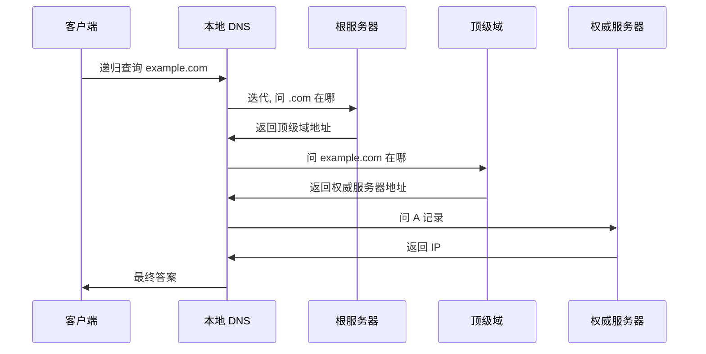

# DNS 如何完成一次域名解析，DNS 劫持又是什么？

## 常见问题

- DNS 查询服务器的基本流程是什么？DNS 劫持是什么？

## 概念索引

- 根域: 层次结构的顶端;
- 顶级域: `com`、`cn` 这一层;
- 权威服务器: 保存某域名正式记录的那台;
- 递归查询: 本地服务器替你问到最终答案;
- 迭代查询: 逐级问「下一步去问谁」;
- TTL: 记录的缓存存活秒数;
- 劫持: 让解析结果指向错误地址, 与正常缓存的差别在结果来源是否可信;

## DNS 的层次结构是怎样的？

| 角色 | 职责 | 例子 |
| --- | --- | --- |
| 根 DNS 服务器 | 返回顶级域服务器地址 | `.` |
| 顶级域服务器 | 返回权威服务器地址 | `com`、`org` |
| 权威服务器 | 返回域名到 IP 的记录 | `example.com` |
| 本地 DNS 服务器 | 代客户端查询并缓存 | ISP 或内网提供 |

- 本地服务器不属于层次结构, 它是客户端的代理;
- 记录类型: `A` 与 `AAAA` 是地址, `CNAME` 是别名, `MX` 是邮件, `NS` 是域名服务器;
- 运输层: 基于 UDP 53 端口, 响应过大时退回 TCP;

## 递归与迭代如何配合？

- 递归: 客户端只发一次, 结果由本地服务器负责;
- 迭代: 本地服务器逐个去问, 每步只拿到下一步的地址;
- 缓存: 每层都能缓存, 命中就直接返回, 不再向上问;

## 一次解析经过哪些步骤？

1. 浏览器查自身缓存与 hosts 文件;
2. 交给系统 resolver, 查本地 DNS 缓存;
3. 未命中则向本地 DNS 服务器发起递归查询;
4. 本地服务器按迭代查询拿到记录, 并按 TTL 缓存;
5. 浏览器用 IP 建立连接, 继续 TCP 与 TLS;

- 缓存顺序: 浏览器 → 系统 → 本地 DNS → 权威;
- TTL 决定改动多久生效, 迁移前要提前调小;
- 多 IP: 权威服务器可返回多个地址, 轮询或按地域分配;

## DNS 劫持有哪几种形态？

| 形态 | 做法 | 影响范围 |
| --- | --- | --- |
| hosts 篡改 | 改本机映射文件 | 只有这台机器 |
| 本地 DNS 污染 | 运营商或网关返回假结果 | 一片用户被导到假站 |
| 缓存投毒 | 向递归服务器注入伪造记录 | 该服务器的所有用户 |
| 域名劫持 | 篡改注册商处的 NS 记录 | 整个域名被接管 |

- 共同点: 解析结果不是域名真正的主人给的;
- 危险: 假站能拿到账号密码, 也能下发恶意内容;
- 表现: 证书报错、页面与预期不符、`ping` 到的 IP 明显异常;

## 如何防御 DNS 劫持？

- 加密查询: 用 DoH 或 DoT, 让链路中间看不到查询内容;
- 校验来源: DNSSEC 用签名保证记录未被改;
- 自有解析: App 用 HTTPDNS 直连自家接口取 IP, 绕开系统解析;
- 证书: 站点上 HTTPS, 证书不匹配时浏览器直接报警;
- 加固: 锁注册商账号、开注册锁、监控 NS 与解析变更;
