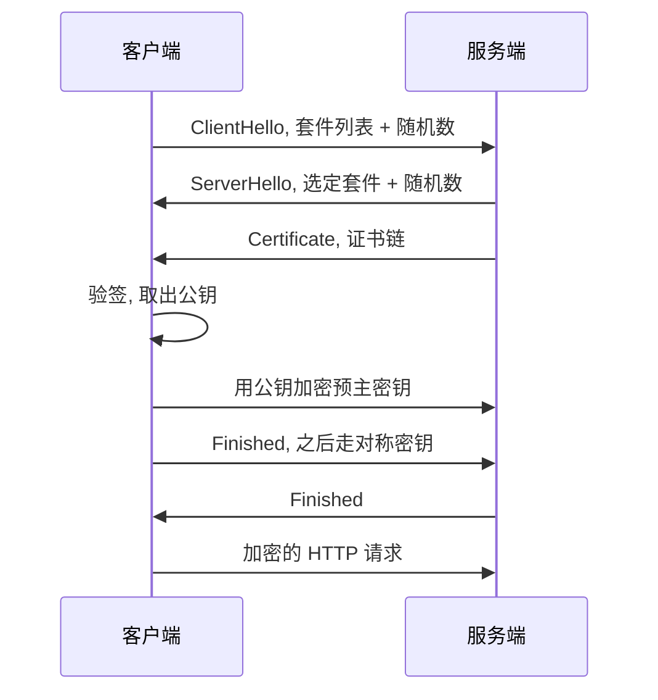

# HTTPS 如何完成加密、身份认证与防篡改？

## 常见问题

- HTTP 与 HTTPS 有哪些区别？
- 简述 HTTPS 的加密与认证过程
- 简述对称与非对称加密的概念
- 如何防止传输内容被篡改？
- SSL握手流程为什么要使用非对称秘钥？

## 概念索引

- 明文风险: 被窃听、被伪装、被篡改;
- 对称加密: 加密与解密用同一把密钥;
- 非对称加密: 公钥加密、私钥解密;
- 混合加密: 非对称换密钥, 对称传数据;
- 数字证书: CA 用私钥签名的公钥声明;
- 信任链: 浏览器内置根证书, 逐级验签;
- 完整性: MAC 或 AEAD 校验, 与加密一起覆盖整条记录;

## HTTP 与 HTTPS 有哪些区别？

| 项 | HTTP | HTTPS |
| --- | --- | --- |
| 传输 | 明文 | TLS 加密 |
| 端口 | 80 | 443 |
| 对端身份 | 不验证 | 证书验证服务端 |
| 完整性 | 无 | MAC 或 AEAD 校验 |
| 延迟 | 无握手开销 | 多一次 TLS 握手 |
| 能力 | — | 可上 HTTP/2、Service Worker |

- HTTPS 不是新协议, 是 HTTP 跑在 TLS 之上;
- TLS 位于应用层与运输层之间, 对 HTTP 透明;

## 对称与非对称加密有什么区别？

| 项 | 对称加密 | 非对称加密 |
| --- | --- | --- |
| 密钥 | 加解密同一把 | 公钥加密、私钥解密 |
| 速度 | 快, 适合大数据量 | 慢, 差几个数量级 |
| 典型算法 | AES、ChaCha20 | RSA、ECDHE、ECDSA |
| 弱点 | 密钥怎么安全送到对端 | 计算开销大, 密钥长 |
| 用途 | 传输正文 | 密钥交换与数字签名 |

- 对称加密的难点不在算法, 在密钥分发;
- 非对称加密不只保密, 还能证明身份: 私钥签的名, 只有对应公钥能验;

## 混合加密的流程是怎样的？

- 会话密钥: 由双方随机数与预主密钥导出, 每条连接不同;
- 数据阶段: 只用对称加密, 因为快;
- 握手阶段: 用非对称加密或密钥协商, 解决密钥分发;
- TLS 1.3: 简化为 1-RTT, 复访可 0-RTT, 只保留 AEAD 套件;

## 为什么握手必须用非对称密钥？

- 分发: 对称密钥本身没加密就不能在公网上传;
- 认证: 只有私钥持有者能生成签名, 对称密钥做不到「证明身份」;
- 前向保密: ECDHE 每次握手生成临时密钥, 服务器私钥泄露也解不开历史流量;
- 折中: 只在小数据上付非对称的代价, 大流量交给对称;

## 证书如何证明公钥属于该站点？

- 签发: 站点把域名与公钥交给 CA, CA 校验归属后用自己私钥对摘要签名;
- 内容: 域名、公钥、有效期、签发者、签名;
- 校验: 浏览器用内置根证书逐级验签, 直到找到可信根;
- 匹配: 再核对域名、有效期与吊销状态;
- 结论: 验签通过才相信这把公钥确实属于该域名;

## 如何防止传输内容被篡改？

- 摘要: 对报文算哈希, 改动任何一位都会让摘要不符;
- MAC: 用会话密钥参与计算, 攻击者改了内容也算不出新 MAC;
- AEAD: AES-GCM 与 ChaCha20-Poly1305 把加密与校验一次做完;
- 序号: 每条记录带序号, 重放与重排会被拒绝;
- 前提: 先靠证书保证密钥没被掉包, 后面的校验才成立;
