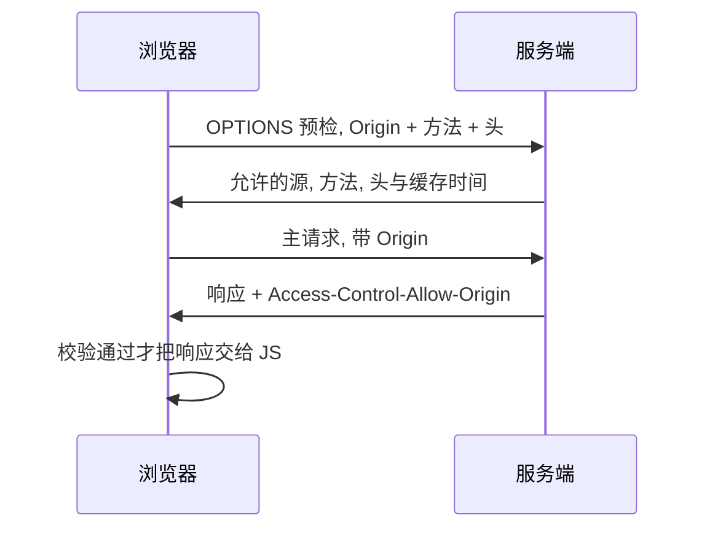

# 什么是跨域，CORS 与 JSONP 各怎么解决？

## 常见问题

- 什么是跨域，什么情况下会发生跨域请求？
- 什么是同源策略？
- 简述 CORS 的用途以及基本设置
- 简述 jsonp 的工作原理

## 概念索引

- 源: 协议 + 主机 + 端口, 三者任一不同即跨域;
- 同源策略: 浏览器限制跨源读写;
- CORS: 服务端声明允许哪些源;
- 预检: 非简单请求先发 OPTIONS 询问;
- 凭证: 跨源请求默认不带 cookie;
- JSONP: 借 script 标签绕开同源限制;
- 代理: 同源服务器转发, 与 JSONP 一样是绕行而非放行;

## 同源如何判定？

| 页面 | 目标 | 同源 | 原因 |
| --- | --- | --- | --- |
| `https://a.com/x` | `https://a.com/y` | 是 | 三项相同 |
| `https://a.com` | `http://a.com` | 否 | 协议不同 |
| `https://a.com` | `https://a.com:8443` | 否 | 端口不同 |
| `https://a.com` | `https://api.a.com` | 否 | 主机不同, 子域也算跨源 |

- 端口省略时按协议补默认值: 80 或 443;
- 路径不参与同源判定;
- 源只看协议、主机、端口, 与 IP 和证书无关;

## 同源策略限制了什么？

- 读: 脚本读不到别的源的 DOM、cookie、localStorage、IndexedDB;
- 发: `fetch` 与 XHR 默认不能发跨源请求, 除非对端放行;
- 嵌: iframe 不能访问非同源文档;
- 不限制: `script`、`img`、`link` 能加载任意源, 只是不给读;
- 目的: 防恶意站点借用户身份读取其它站的数据;

## CORS 的两种请求怎么走？



- 简单请求: 方法为 `GET`、`POST`、`HEAD`, 且头与 `Content-Type` 都在白名单内, 直接发;
- 非简单请求: 先预检, 通过后才发主请求;
- 关键: 放行由浏览器执行, 服务端只负责声明;

## CORS 的基本设置有哪些？

| 响应头 | 作用 |
| --- | --- |
| `Access-Control-Allow-Origin` | 允许的源, 可用 `*` |
| `Access-Control-Allow-Methods` | 允许的方法 |
| `Access-Control-Allow-Headers` | 允许的自定义请求头 |
| `Access-Control-Expose-Headers` | 允许 JS 读取的响应头 |
| `Access-Control-Max-Age` | 预检结果缓存秒数 |
| `Access-Control-Allow-Credentials` | 是否允许携带凭证 |

- 默认只有少数响应头能被 JS 读到, 其余要 `Expose-Headers`;
- 带凭证时 `Allow-Origin` 不能写 `*`, 必须是具体源;
- 服务端要处理 `OPTIONS`, 且错误响应也要带 CORS 头;

```js
// 简单请求: 服务端只需回一个头
res.setHeader("Access-Control-Allow-Origin", "https://app.example.com");
res.setHeader("Vary", "Origin");
```

## JSONP 的原理是什么？

```html
<script src="https://api.example.com/user?id=1&callback=handleUser"></script>
```

```js
function handleUser(data) {
  console.log(data.name);
}
```

- 原理: `script` 能跨源加载并执行, 服务端把数据包进回调函数名返回;
- 请求: 只能 `GET`, 参数全在 URL 上;
- 前提: 双方约定回调参数名与函数名;
- 局限: 读不到状态码、设不了请求头、不能 POST、有 XSS 风险;

## 还有哪些跨域方案？

| 方案 | 做法 | 适用 |
| --- | --- | --- |
| 开发代理 | 本地 dev server 转发到目标域名 | 开发联调 |
| 反向代理 | 同域路径下由网关转发 | 生产统一域名 |
| `postMessage` | 跨源窗口之间显式传消息 | iframe 通信 |
| WebSocket | 握手不受同源限制, 服务端自校验 `Origin` | 实时通信 |
| CORS | 对端声明放行 | 正规跨域 API |

- 代理与 JSONP 都是绕过浏览器检查, 不改变同源策略本身;
- 同源策略只约束浏览器脚本, 服务端与服务端调用不受影响;
