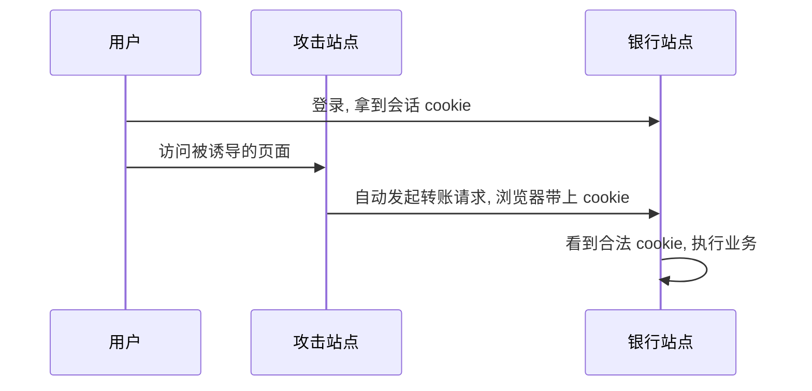

# XSS、CSRF、DDoS 与中间人攻击分别怎么发生，怎么防？

## 常见问题

- 简述 DDOS 攻击原理，如何防范它？
- 什么是中间人攻击？如何防止攻击？
- 简述什么是 XSS 攻击以及 CSRF 攻击？

## 概念索引

- 不可信输入: 一切来自客户端的数据;
- 主动攻击: 攻击者直接构造请求打应用;
- 被动攻击: 埋陷阱诱使用户触发;
- XSS: 让浏览器执行攻击者的脚本;
- CSRF: 借用户身份发请求, 读不到响应;
- DDoS: 用海量流量或请求压垮服务;
- MITM: 在链路中间窃听或改写, 与前几种按攻击位置区分;

## 攻击面如何划分？

| 类型 | 攻击者行为 | 典型手段 |
| --- | --- | --- |
| 主动攻击 | 直接访问应用并注入代码 | SQL 注入、命令注入 |
| 被动攻击 | 预设陷阱, 以用户为跳板 | XSS、CSRF、点击劫持 |

- 客户端校验只能当 UI 提示, 不能作为安全边界;
- 防御三板斧: 输入校验、输出转义、浏览器安全策略;

## XSS 有哪几种，怎么防？

| 类型 | 载荷位置 | 触发方式 |
| --- | --- | --- |
| 存储型 | 存进数据库 | 别人打开页面就执行 |
| 反射型 | URL 参数 | 服务端拼进 HTML 返回 |
| DOM 型 | 前端脚本取值 | 不经过服务端, 直接写进 DOM |

```js
// 危险: 把用户输入当 HTML
el.innerHTML = location.hash.slice(1);

// 安全: 当文本插入
el.textContent = location.hash.slice(1);
```

- 转义: 按输出位置转义, HTML、属性、JS、URL 各不相同;
- 收敛: 少用 `innerHTML` 与 `eval`, 用文本节点和受控模板;
- CSP: 用 `Content-Security-Policy` 限定脚本来源, 禁内联;
- Cookie: 加 `HttpOnly`, 脚本读不到会话;
- 富文本: 用白名单清洗, 不靠黑名单过滤;

## CSRF 是怎么发生的？



- 关键: 浏览器会自动带上目标站 cookie, 服务端分不清谁发起;
- 前提: 用户已登录, 且接口只靠 cookie 鉴权;
- 特点: 攻击者发得出请求, 但读不到响应;

## 如何防御 CSRF？

| 手段 | 做法 |
| --- | --- |
| CSRF token | 服务端下发随机 token, 请求必须带上并校验 |
| `SameSite` | cookie 设 `Lax` 或 `Strict`, 跨站不带 |
| 来源校验 | 检查 `Origin` 或 `Referer` |
| 二次确认 | 敏感操作要验证码或密码 |
| 换鉴权方式 | 改用 `Authorization` 头, 需脚本显式设置 |

- token 要绑定会话且一次性, 否则可被预置;
- `Lax` 仍允许顶层导航带 cookie, GET 接口不能有副作用;
- 防御要成对: token 挡伪造, `SameSite` 挡漏网;

## DDoS 的原理与防御是什么？

| 层次 | 手段 | 目标 |
| --- | --- | --- |
| 流量型 | UDP 反射、DNS 放大 | 堵满带宽 |
| 协议型 | SYN flood、ACK flood | 耗尽连接表 |
| 应用型 | HTTP flood、慢速请求 | 耗尽线程与数据库 |

- 反射放大: 伪造源 IP, 让小请求换回大响应;
- 防御: 清洗中心、anycast 分散、CDN 吸收、四层限速;
- 应用层: 限流、人机校验、连接超时、按账号与 IP 配额;
- 架构: 弹性扩容、降级开关、静态资源推给 CDN;

## 中间人攻击如何实施与防御？

- 手法: 攻击者在链路中间分别冒充双方, 转发并改写流量;
- 场景: 公共 Wi-Fi、ARP 欺骗、DNS 劫持、伪造证书;
- HTTPS: 证书校验让伪装暴露, 浏览器直接报警;
- 加固: 开 HSTS、校验证书链、不忽略证书错误;
- 客户端: 不装来源不明的根证书, 不用未知代理;

## XSS 与 CSRF 怎么区分？

| 项 | XSS | CSRF |
| --- | --- | --- |
| 攻击对象 | 用户浏览器 | 目标应用 |
| 能否读响应 | 能, 脚本就在页面内 | 不能 |
| 依赖 | 注入点 | 用户已登录 |
| 主要防御 | 转义、CSP、`HttpOnly` | token、`SameSite`、来源校验 |

- XSS 能直接偷 token, 所以 CSRF 防御挡不住 XSS;
- 两者都属被动攻击, 都把用户当跳板;
