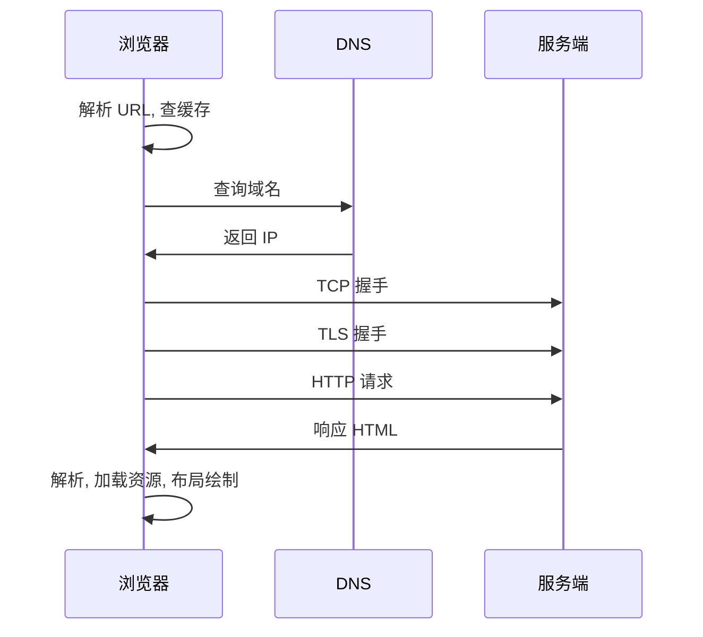

# 从输入 URL 到页面展现，中间发生了什么？

## 常见问题

- 从输入 URL 到展现页面的全过程
- 简述输入 URL 到浏览器显示的流程

## 概念索引

- URL 解析: 拆出协议、主机、端口、路径;
- 缓存查找: 先看本地有没有现成响应;
- DNS: 主机名换成 IP;
- TCP 与 TLS: 建可靠通道并协商密钥;
- HTTP: 一次请求与响应;
- 渲染: HTML 与 CSS 变成屏幕上的像素;
- 关键渲染路径: 从 HTML 到首屏像素的最短链路;

## 整体分几个阶段？

- 网络阶段: URL → 缓存 → DNS → TCP → TLS → HTTP;
- 服务端阶段: 负载均衡 → 应用 → 数据;
- 浏览器阶段: 解析 → 构建 → 布局 → 绘制 → 合成;

## 网络阶段发生了什么？

- URL: 拆出 scheme、host、port、path、query; 不像 URL 就交给搜索引擎;
- 缓存: 先查 Service Worker、内存缓存、磁盘缓存, 强缓存命中直接返回;
- DNS: 逐级查浏览器、系统、本地 DNS, 拿到 IP;
- 连接: TCP 三次握手, HTTPS 再跑 TLS 握手;
- 请求: 带上 `Host`、`Cookie`、`Accept` 等首部;
- 响应: 状态码、首部、正文, 长度未知时分块传输;

## 缓存与 HSTS 怎么省掉往返？

- HSTS: 命中预加载列表时, 浏览器直接把 `http` 改写成 `https`;
- 连接复用: 已有连接可直接发请求, 省掉握手与慢启动;
- 协商缓存: 带 `If-None-Match` 问一次, 回 `304` 就省掉正文;

## 服务端做了什么？

- 接入: CDN 或负载均衡按域名与路径选后端;
- 处理: 应用读缓存、查数据库、拼 HTML 或 JSON;
- 响应: 设置缓存头、压缩、带 `ETag`;
- 返回: 静态资源交给 CDN, 动态内容回源;

## 浏览器如何把 HTML 变成画面？

| 阶段 | 输入 | 产物 |
| --- | --- | --- |
| 解析 HTML | 字节流 | DOM 树 |
| 解析 CSS | 样式表 | CSSOM |
| 样式计算 | DOM 加 CSSOM | 带样式的渲染树 |
| 布局 | 渲染树 | 每个盒子的位置与大小 |
| 绘制 | 布局结果 | 分层后的绘制指令 |
| 合成 | 图层 | 屏幕像素 |

- 解析: HTML 边下边解析, `script` 默认阻塞解析;
- 阻塞: CSS 阻塞渲染, 也阻塞后面的脚本执行;
- 重排: 几何变化要重算布局; 重绘: 只改颜色则跳过布局;
- 合成: `transform` 与 `opacity` 可只走合成层, 最便宜;
- 预加载: 预解析器提前发现图片与脚本, 并发起请求;

## 每个阶段能优化什么？

| 阶段 | 手段 |
| --- | --- |
| DNS | 预解析、减少域名数 |
| 连接 | keep-alive、HTTP/2、TLS 1.3 |
| 请求 | 减少请求数、内联关键资源 |
| 响应 | 压缩、缓存、CDN、分块输出 |
| 渲染 | 关键 CSS 内联、`defer` 脚本、图片懒加载 |
| 交互 | 减少重排、用合成动画、按需加载 |

- 首屏: 先让关键 HTML 与 CSS 到达, 其余延后;
- 指标: TTFB 看服务端, FCP 看首屏, LCP 看主内容, INP 看交互延迟;
