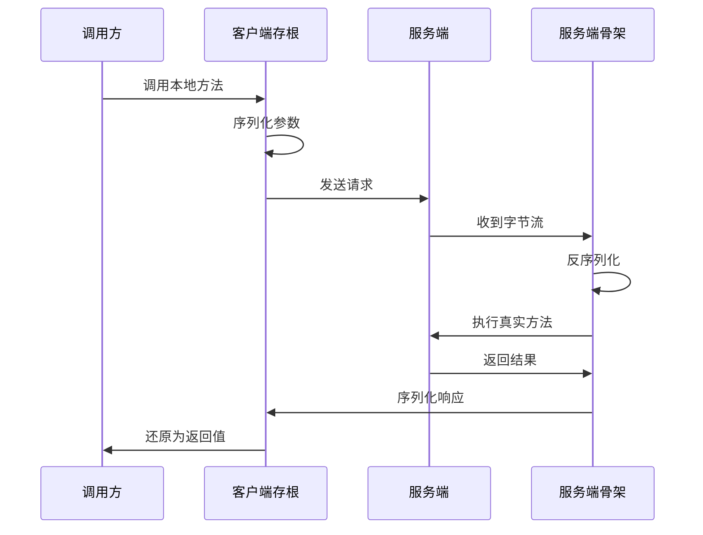

# RESTful 与 RPC 有什么区别，为什么需要序列化？

## 常见问题

- RestFul 是什么？RestFul 请求的 URL 有什么特点？
- RestFul 与 RPC 的区别是什么？RestFul 的优点在哪里？
- 简述 RPC 的调用过程
- 为什么需要序列化？有什么序列化的方式？

## 概念索引

- 资源: 接口操作的对象;
- 统一接口: 用方法表达动作, 用路径表达资源;
- 无状态: 每个请求自带解释它的上下文;
- RPC: 像调本地函数一样调远程方法;
- IDL: 接口描述文件, 用来生成客户端与服务端代码;
- 序列化: 把内存对象变成可传输的字节流;
- 反序列化: 把字节流还原成对象, 与序列化成对出现;

## REST 是什么，URL 有什么特点？

- 定义: 以资源为中心的架构风格, 不是协议也不是规范;
- 约束: 客户端服务端分离、无状态、可缓存、统一接口、分层系统;
- 统一接口: 路径标识资源, 方法表达动作, 状态码表达结果;
- 澄清: 返回 JSON 不等于 REST, 关键是资源怎么建模;

| 做法 | 例子 | 评价 |
| --- | --- | --- |
| 资源用名词复数 | `GET /users/42` | 好 |
| 动作塞进路径 | `GET /getUserById?id=42` | 差, 动作该用方法表达 |
| 版本放路径 | `GET /v1/users` | 常见 |
| 过滤用查询串 | `GET /users?role=admin&page=2` | 好 |
| 创建用 POST | `POST /users` | 好 |
| 整体替换用 PUT | `PUT /users/42` | 好 |

### URL 设计有哪些约定？

- 层级: 用 `/` 表达从属, 如 `/users/42/orders`;
- 幂等: `GET`、`PUT`、`DELETE` 幂等, `POST` 不幂等;
- 超媒体: 进阶约束 HATEOAS, 响应里带后续可做的操作链接;

## REST 与 RPC 有什么区别？

| 项 | REST | RPC |
| --- | --- | --- |
| 抽象 | 资源 | 方法或过程 |
| 表达 | 路径加方法 | 函数名加参数 |
| 协议 | 通常 HTTP 加 JSON | 框架自定义, 如 gRPC |
| 契约 | OpenAPI 等, 可选 | IDL 强约束, 生成代码 |
| 缓存 | 天然利用 HTTP 缓存 | 一般自己实现 |
| 调试 | 浏览器与 curl 直接看 | 需要工具与 schema |
| 适合 | 对外 API、资源型业务 | 内部服务、高频调用 |

- REST 优点: 通用、可读、易缓存、第三方易接入;
- RPC 优点: 调用直观、二进制紧凑、强类型;
- 常态: 内部高吞吐用 RPC, 对外开放用 REST, 两者可以并存;

## RPC 的调用过程是怎样的？

- 存根: 客户端代理, 把本地调用翻译成网络请求;
- 骨架: 服务端代理, 把请求翻译成方法调用;
- 传输: 还要连接管理、超时、重试与错误映射;
- 语义: 远程调用会超时、重复执行或结果未知, 与本地调用不同;

## 为什么需要序列化？

- 跨语言: 内存布局与类型系统各不相同, 需要共同格式;
- 跨机器: 链路上只能传字节, 指针与对象地址没有意义;
- 切分: 结构化数据要能界定边界、校验与版本演进;
- 复用: 同一格式可用于落盘、缓存与消息队列;

| 方式 | 特点 | 典型场景 |
| --- | --- | --- |
| JSON | 文本、可读、体积大 | Web API、配置文件 |
| Protocol Buffers | 二进制、紧凑、需 schema | gRPC、服务间调用 |
| Thrift | 二进制、自带 RPC 框架 | 内部服务 |
| MessagePack | 二进制 JSON, 体积更小 | 移动端与缓存 |
| Avro | 带 schema, 适合大数据 | 数据管道 |

### 怎么选序列化方式？

- 选型: 先看是否需要人眼可读, 再看体积与解析开销;
- 兼容: 字段编号与新增字段规则决定能否平滑演进;
- 安全: 反序列化不可信数据要限制类型与大小, 防止构造恶意对象;

## 幂等与错误处理要注意什么？

- 幂等键: 客户端生成请求 id, 服务端按 id 去重;
- 状态码: REST 用状态码, RPC 用错误码, 都要有稳定映射;
- 超时: 每个调用都要设截止时间, 避免线程被拖死;
- 重试: 只对幂等操作自动重试, 并加退避;
