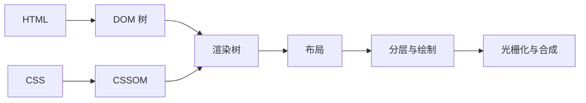

# 浏览器渲染过程中，重绘和重排各发生在哪一步？

## 常见问题

- 简述浏览器的渲染过程，重绘和重排在渲染过程中的哪一部分？
- 什么情况下引起重排和重绘？改变 color 会吗？改变 margin 会吗？

## 概念索引

- DOM 树: 解析 HTML 得到的节点树;
- CSSOM: 解析 CSS 得到的样式树;
- 渲染树: DOM 与 CSSOM 合并后只留可见节点;
- 布局: 计算每个节点的位置与大小, 重排就发生在这里;
- 绘制: 为图层生成像素填充指令, 重绘就发生在这里;
- 合成: GPU 把各图层拼成最终画面;
- 重排代价: 会推翻布局并连带重绘, 是三者中最贵的一环;

## 渲染分成哪几步？



- 解析: HTML 转 DOM, CSS 转 CSSOM, 两者并行;
- 合并: 渲染树只保留可见节点及其计算样式;
- 布局: 算出每个盒子的坐标与尺寸, 也叫 reflow;
- 绘制: 生成绘制指令再光栅化成像素, 也叫 repaint;
- 合成: 合成线程把图层拼起来交给 GPU 上屏;

## 重绘与重排分别在哪一步？

| 阶段 | 做什么 | 别名 | 相对代价 |
| --- | --- | --- | --- |
| 布局 | 计算几何信息 | 重排 reflow | 最高 |
| 绘制 | 生成像素 | 重绘 repaint | 中 |
| 合成 | 图层拼接 | composite | 最低 |

- 重排发生在布局阶段, 重绘发生在绘制阶段;
- 重排必然引起重绘, 重绘不一定引起重排;
- 只改颜色时布局结果不变, 浏览器跳过布局直接重绘;
- 合成层上的变换连绘制都能跳过, 只重做合成;

## 什么操作会引起重排？

- 几何属性: width、height、padding、margin、border、top、left;
- 结构变化: 增删节点、改字体、内容变长导致高度变化;
- 强制同步布局: 读 offsetTop、scrollHeight、getBoundingClientRect;
- 视口变化: 窗口缩放、旋转屏幕、字体大小调整;
- 伪类命中: 修改 hover 样式, 若几何变化同样重排;

```js
// 读写交替, 每轮都强制同步布局
for (const el of list) {
  el.style.width = el.offsetWidth + 10 + 'px' // 读一次, 写一次
}

// 先读后写, 只布局一次
const widths = list.map((el) => el.offsetWidth)
list.forEach((el, i) => (el.style.width = widths[i] + 10 + 'px'))
```

## 改 color 与改 margin 分别触发什么？

| 改动 | 布局 | 绘制 | 合成 |
| --- | --- | --- | --- |
| color | 否 | 是 | 是 |
| background-color | 否 | 是 | 是 |
| visibility | 否 | 是 | 是 |
| margin、padding、width | 是 | 是 | 是 |
| transform、opacity | 否 | 否 | 是 |
| display 由 none 变 block | 是 | 是 | 是 |

- 改变 color: 只重绘, 不影响任何几何量;
- 改变 margin: 重排加重绘, 还会挤压兄弟节点;
- 位移动画用 transform 代替 top/left, 可降到只合成;

## 怎么减少重排与重绘？

- 批量读写: 先把布局属性读完, 再统一写入;
- 离线修改: 用 DocumentFragment 或在 display:none 时改完再插回;
- 合成动画: 位移与透明度动画优先用 transform、opacity;
- 控制图层: will-change 只给真正频繁变化的元素;
- 长列表: 虚拟列表只渲染视口内的节点;
