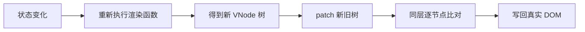

# 虚拟 DOM 和 diff 算法是怎么实现的？

## 常见问题

- 简述 diff 算法的实现机制和使用场景
- 简述虚拟 dom 实现原理

## 概念索引

- 虚拟 DOM: 用 JS 对象描述真实 DOM 的树;
- VNode: 记着类型、属性、子节点的普通对象;
- 渲染函数: 由模板编译或手写, 输出 VNode 树;
- patch: 比对新旧 VNode 并把差异写回真实 DOM;
- 同层比较: diff 只比同一层级的节点;
- key: 让 diff 认出同一节点, 决定复用还是重建;
- 最长递增子序列: 求最少移动次数, 让剩余节点原地不动;

## 虚拟 DOM 是什么？

```js
// h('div', { id: 'app' }, [h('span', null, 'hi')])
const vnode = {
  type: 'div',
  props: { id: 'app' },
  children: [{ type: 'span', props: null, children: 'hi' }],
}
```

- 描述: 一个 VNode 就是一段 UI 的 JS 快照;
- 生成: 模板编译成渲染函数, 或用 h、createElement 手写;
- 落地: 首次渲染把 VNode 转成真实 DOM, 之后只打差异;
- 收益: 声明式写法, 跨平台渲染, 合并多次更新;
- 代价: 多一层对象分配与比对, 极端场景不如手写 DOM;

## 一次更新怎么走完 patch？



- 触发: React 靠 setState, Vue 靠响应式依赖变化;
- 比对: 从根开始递归, 只在同一层级内比较;
- 复用: 类型相同就复用 DOM, 类型不同就整棵重建;
- 收尾: 把 patch 结果批量提交, 减少回流次数;

## 子节点 diff 有哪几种实现？

| 实现 | 策略 | 复杂度 |
| --- | --- | --- |
| React | 从左遍历, key 建 map, lastPlacedIndex 判断是否移动 | O(n) |
| Vue 2 | 四个指针双端收拢, 命中即复用 | O(n) |
| Vue 3 | 掐头去尾后对剩余节点求最长递增子序列 | O(n log n) |

- React: 只做一次从左到右的匹配, 剩下靠 map 查旧节点下标;
- Vue 2: 旧头新头、旧尾新尾、旧头新尾、旧尾新头四种比较;
- Vue 3: 只移动不在递增序列里的节点, 其余原地保留;
- 共同点: 都放弃最小编辑距离, 用启发式把 O(n³) 降到线性级;

## key 为什么重要？

```jsx
// 反例: 用下标做 key, 头部插入时整列复用错节点
items.map((item, i) => <Row key={i} data={item} />)

// 正例: 用稳定 id, diff 才能认出同一行
items.map((item) => <Row key={item.id} data={item} />)
```

- 作用: key 是节点身份, 相同 key 才尝试移动复用;
- 副作用: key 变了就销毁重建, 组件状态与动画都会重置;
- 反模式: 随机数或时间戳做 key, 等于每次都全量重建;
- 排序场景: 稳定 key 让 diff 只移动少数节点;

## 使用场景与代价是什么？

- 适用: 组件化 UI、频繁局部更新、需要跨端渲染;
- 适用: 列表增删排序, 靠 diff 保持 DOM 与数据一致;
- 不适用: 纯静态内容, 服务端渲染的 HTML 更直接;
- 不适用: 超长列表, 虚拟列表只保留可见区域;
- 实践: 先量再优化, 多数页面瓶颈在 JS 与资源而非 diff;
