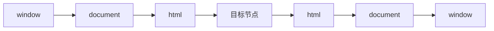

# DOM 该怎么操作，事件流又是怎么走的？

## 常见问题

- 简述 Dom 节点的不同操作方式
- 什么是 DOM 事件流？
- 简述 Javascript 事件冒泡和事件捕获原理

## 概念索引

- 节点查询: 用选择器或 id 取到元素;
- 节点创建: createElement、createTextNode、createDocumentFragment;
- 节点插入: append、insertBefore、replaceChild;
- 节点删除: remove、replaceWith;
- 批量写入: innerHTML、insertAdjacentHTML;
- 事件流: 捕获、目标、冒泡三个阶段;
- 事件委托: 把监听挂在父节点, 靠冒泡接管子节点事件;

## 查询节点有哪些方式？

| API | 返回 | 特点 |
| --- | --- | --- |
| getElementById | 单个元素 | 最快, 只按 id |
| querySelector | 首个匹配 | 支持任意 CSS 选择器 |
| querySelectorAll | 静态 NodeList | 结果不随 DOM 变化 |
| getElementsByClassName | 动态集合 | 实时更新, 遍历有开销 |
| closest | 最近的祖先 | 常配事件委托使用 |

- children: 只有元素节点;
- childNodes: 含文本与注释节点;
- nextElementSibling: 跳过文本节点找兄弟;

## 增删改节点怎么做？

```js
const ul = document.querySelector('#list')
const frag = document.createDocumentFragment()
for (const t of ['a', 'b', 'c']) {
  const li = document.createElement('li')
  li.textContent = t
  frag.append(li)
}
ul.append(frag) // 只触发一次重排
ul.firstElementChild.remove()
```

- DocumentFragment: 先在内存里拼好, 一次插入只重排一次;
- textContent: 不解析 HTML, 天然免疫 XSS;
- innerHTML: 解析字符串, 有 XSS 风险且会重建子树;
- insertAdjacentHTML: 按 beforebegin 等四个位置局部插入;
- cloneNode(true): 深拷贝, 但不复制事件监听;

## 事件流分几个阶段？



- 捕获: 从 window 向内传到目标, 由外到内;
- 目标: 事件到达目标节点, 捕获与冒泡监听都可能触发;
- 冒泡: 从目标向外传回 window, 由内到外;
- 注册: addEventListener 第三参数为 true 时走捕获阶段;

```js
const el = document.querySelector('#box')
window.addEventListener('click', () => console.log('捕获'), true)
el.addEventListener('click', () => console.log('目标'))
window.addEventListener('click', () => console.log('冒泡'))
// 点击 el: 捕获 → 目标 → 冒泡
```

## 冒泡与捕获有哪些细节？

| 方法 | 作用 | 是否影响同节点其他监听 |
| --- | --- | --- |
| stopPropagation | 停止继续传播 | 否 |
| stopImmediatePropagation | 停止传播并中断本节点后续监听 | 是 |
| preventDefault | 取消默认行为 | 否 |

- 冒泡: 由内向外, 事件委托依赖它;
- 捕获: 由外向内, 适合提前拦截;
- passive 为 true: 声明不会 preventDefault, 滚动更顺;
- once 为 true: 触发一次后自动移除;
- 不冒泡的事件: focus、blur、mouseenter, 对应 focusin、mouseover;

## 事件委托怎么用？

```js
document.querySelector('#list').addEventListener('click', (e) => {
  const li = e.target.closest('li')
  if (!li) return
  console.log(li.dataset.id)
})
```

- 优点: 一个监听管全部子节点, 动态新增的节点自动生效;
- 优点: 少挂监听, 内存与解绑成本都低;
- 限制: 依赖冒泡, 中间节点调用 stopPropagation 就收不到;
- 限制: 不冒泡的事件要改用捕获或直接监听;
