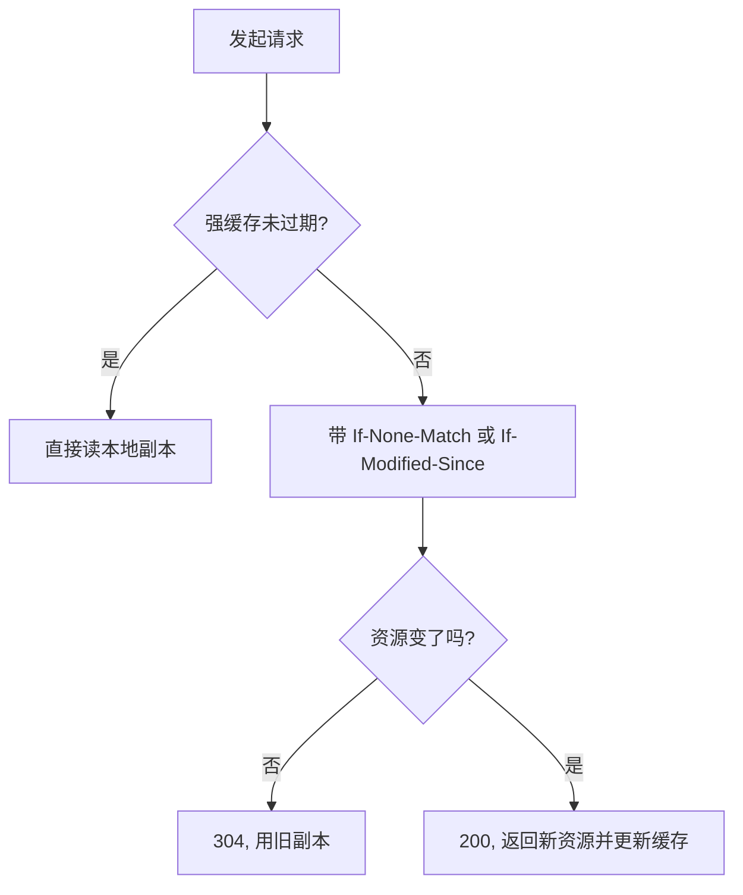

# 浏览器的缓存机制是什么，强缓存与协商缓存怎么选？

## 常见问题

- 简述浏览器的缓存机制
- 简述强缓存与协商缓存的区别和使用场景

## 概念索引

- 缓存位置: 内存缓存、磁盘缓存、Service Worker;
- 强缓存: 不访问服务器, 直接用本地副本;
- 协商缓存: 带验证字段问服务器, 304 就继续用旧副本;
- Cache-Control: 用相对时间表达强缓存策略;
- ETag: 资源内容哈希, 精度最高;
- Last-Modified: 资源最后修改时间, 精度到秒;
- 版本化 URL: 文件名带内容哈希, 让强缓存可以长期有效;

## 一次请求怎么命中缓存？



- 强缓存命中: 状态码仍是 200, 但来源显示 from disk cache;
- 协商缓存命中: 304 响应不带正文, 只更新缓存头;
- 未命中: 正常 200 响应, 新资源写入缓存;
- 缓存位置: 内存缓存随标签页销毁, 磁盘缓存可跨会话;

## 强缓存靠哪些字段？

| 字段 | 版本 | 含义 |
| --- | --- | --- |
| Expires | HTTP/1.0 | 绝对时间, 受本地时钟影响 |
| Cache-Control | HTTP/1.1 | 相对秒数, 优先级更高 |
| max-age | — | 有效期秒数 |
| s-maxage | — | 只对 CDN 等共享缓存生效 |
| public / private | — | 谁能缓存 |
| no-cache | — | 可以存, 但每次都要验证 |
| no-store | — | 完全不存 |
| immutable | — | 有效期内连刷新都不验证 |

```http
HTTP/1.1 200 OK
Content-Type: text/css
Cache-Control: public, max-age=31536000, immutable
ETag: "a1b2c3"
Last-Modified: Tue, 12 Nov 2026 08:00:00 GMT
```

- 优先级: Cache-Control 覆盖 Expires;
- 记忆: no-cache 是每次都验证, no-store 是彻底不存;

## 协商缓存怎么验证？

| 响应头 | 请求头 | 判定 | 结果 |
| --- | --- | --- | --- |
| ETag | If-None-Match | 值相同 | 304 |
| Last-Modified | If-Modified-Since | 时间之后未修改 | 304 |
| 两者都有 | 两者都带 | 以 ETag 为准 | 304 或 200 |

```http
GET /app.css HTTP/1.1
If-None-Match: "a1b2c3"
If-Modified-Since: Tue, 12 Nov 2026 08:00:00 GMT

HTTP/1.1 304 Not Modified
ETag: "a1b2c3"
Cache-Control: public, max-age=600
```

- ETag: 内容哈希, 内容变才变, 精度高;
- 弱 ETag: 前缀 W/, 语义等价即算命中;
- Last-Modified: 只到秒, 一秒内多次修改识别不了;
- 304 会写回新的 max-age, 重新开始计时;

## 强缓存与协商缓存怎么选？

| 项 | 强缓存 | 协商缓存 |
| --- | --- | --- |
| 是否通信 | 否 | 是, 拿到 304 才算省 |
| 数据新鲜度 | 期限内一定旧 | 每次都能确认 |
| 延迟 | 最低 | 多一个 RTT |
| 适合 | 静态资源、不常变的文件 | 频繁变化、要求准的资源 |

- 长期不变的静态资源: 强缓存配一年;
- 需要准时的内容: no-cache 加 ETag, 每次验证;
- 混合: 短 max-age 兜住突发流量, 过期后走 ETag;

## 版本化 URL 怎么配合缓存？

```text
入口 HTML:      /index.html                      Cache-Control: no-cache
带哈希的脚本:   /static/app.9f3c1a.js             Cache-Control: max-age=31536000, immutable
带哈希的样式:   /static/app.1b7d20.css            Cache-Control: max-age=31536000, immutable
```

- 内容变则文件名变: 新文件是新 URL, 不撞旧缓存;
- 旧 URL 可以永久缓存: 因为内容永远不会再变;
- HTML 不缓存: 每次拿到最新的引用列表;
- 发布流程: 先传新哈希文件, 最后替换 HTML;
- 回滚: 换回旧 HTML 即可, 旧文件仍在;
