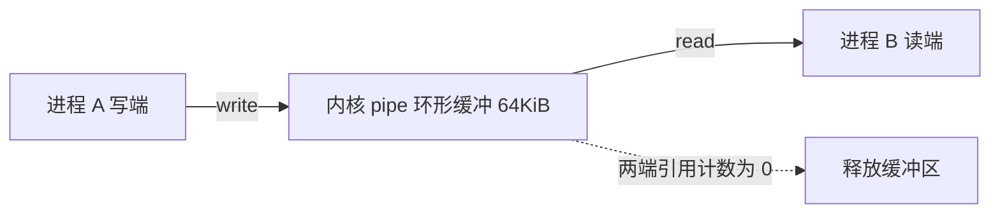

# 进程之间有哪些通信方式？

## 常见问题

- 进程间有哪些通信方式？
- 进程通信中的管道实现原理是什么？
- 共享内存是如何实现的？

## 概念索引

- IPC: 进程间传递数据与同步的统称;
- 管道: 内核维护的字节流环形缓冲区;
- 命名管道: 带路径名、无亲缘关系也能用的管道;
- 消息队列: 内核维护、带类型的消息链表;
- 共享内存: 多个进程的页表指向同一批物理页;
- 信号量: 给共享内存配的计数器，负责互斥与顺序;
- socket: 可跨主机的通用通道，也是本机 IPC 的一种;

## 进程间通信方式有哪些？

| 方式 | 主要接口 | 数据形态 | 是否跨主机 |
| --- | --- | --- | --- |
| 匿名管道 | `pipe` | 字节流 | 否，需亲缘关系 |
| 命名管道 | `mkfifo` | 字节流 | 否 |
| 消息队列 | `mq_open` | 带类型消息 | 否 |
| 共享内存 | `shm_open` + `mmap` | 任意结构 | 否 |
| 信号量 | `sem_open` | 计数 | 否 |
| 信号 | `kill` | 一个整数 | 否 |
| socket | `AF_UNIX` / `AF_INET` | 字节流或数据报 | 是 |

- 亲缘: 匿名管道只能用于有共同祖先的进程，如父子或兄弟;
- 效率: 数据量越大越该用共享内存，省掉内核来回复制;
- 同步: 共享内存与文件本身不带同步，必须配信号量或文件锁;
- 选型: 简单通知用信号，传数据用管道或 socket，大数据用共享内存;

## 管道在内核里如何实现？

- 结构: 一对 `struct file` 指向同一个 pipe inode 的环形缓冲区;
- 容量: 默认 64 KiB，即 16 个页，可用 `fcntl(F_SETPIPE_SZ)` 调整，见 [pipe(7)](https://man7.org/linux/man-pages/man7/pipe.7.html);
- 读写: 写满则写端阻塞，读空则读端阻塞，两端在同一缓冲区上推指针;
- 关闭: 写端全关后读端读到 EOF，读端全关后写端收到 `SIGPIPE`;
- 命名化: FIFO 只是把 pipe inode 挂到文件系统路径上，其余相同;
- 限制: 单向字节流，没有消息边界，且数据要复制两次;



## 共享内存如何实现？

- 映射: `shmget` 加 `shmat`，或 `shm_open` 加 `mmap`，把同一段物理页挂进进程;
- 原理: 内核让两个进程的页表项指向同一批物理页，读写不经过内核;
- 同步: 内核不管并发，必须自己配信号量、文件锁或原子变量;
- 回收: 挂载计数与引用都归零才真正释放，否则段会残留;
- 场景: 数据库缓冲区、大文件传输、多进程共享缓存;

```c
int id = shmget(IPC_PRIVATE, 4096, IPC_CREAT | 0600);
char *p = shmat(id, NULL, 0);          // 映射进本进程
strcpy(p, "hello");                    // 另一端 shmat 后可直接读到
shmdt(p);
shmctl(id, IPC_RMID, NULL);            // 标记删除，最后一个进程退出后回收
```

- 排查: `ipcs -m` 看残留段，`ipcrm -m` 清理;
