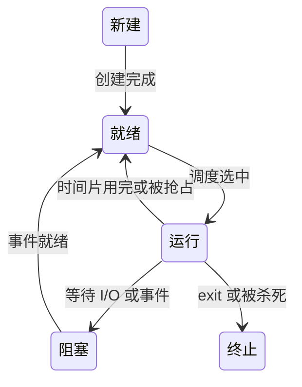

# 进程和线程分别有哪些状态，状态如何转换？

## 常见问题

- 线程有多少种状态，状态之间如何转换
- 进程有多少种状态？
- 什么情况下，进程会进行切换？

## 概念索引

- 就绪: 已具备运行条件，排队等 CPU;
- 运行: 正占用 CPU 执行指令;
- 阻塞: 等事件完成，调度器不再考虑它;
- 僵尸: 已退出但还没被父进程回收;
- 内核状态: Linux 用字母编码上述状态;
- 语言线程状态: Java 等语言层面的状态机;

## 进程有哪五种状态？

| 状态 | 含义 | 进入条件 |
| --- | --- | --- |
| 新建 | 已创建，尚未进入就绪队列 | `fork` 刚返回 |
| 就绪 | 可运行，等 CPU | 时间片用完、I/O 完成 |
| 运行 | 正占用 CPU | 被调度器选中 |
| 阻塞 | 等 I/O 或事件 | 发起 read、等锁、等信号量 |
| 终止 | 执行完毕或被杀死 | `exit` 或收到致命信号 |

- 要点: 阻塞不能直接变运行，必须先回到就绪队列;
- 要点: 就绪到运行只能由调度器发起，进程自己决定不了;

## Linux 里进程状态如何表示？

| 码 | 名称 | 含义 |
| --- | --- | --- |
| R | running | 正在运行或在运行队列中 |
| S | interruptible sleep | 可中断睡眠，等事件，最常见的 I/O 等待 |
| D | uninterruptible sleep | 不可中断睡眠，通常在等磁盘，`kill -9` 也杀不掉 |
| T | stopped | 被 `SIGSTOP` 暂停或被调试器跟踪 |
| Z | zombie | 已退出，等父进程 `wait` 回收 |
| I | idle | 空闲内核线程 |

- 查看: `ps -eo pid,stat,comm` 或 `ps aux` 的 STAT 列;
- 后缀: 尾部 `s` 表示会话首进程，`l` 表示多线程，`+` 表示前台;
- 大量 D: 通常是磁盘或 NFS 卡住，负载会虚高;
- 大量 Z: 父进程没回收，要查父进程代码或直接杀父进程;

## 线程状态与进程状态有何不同？

| Java 状态 | 含义 | 触发 |
| --- | --- | --- |
| NEW | 已创建，未 `start` | `new Thread()` |
| RUNNABLE | 可运行或在等 I/O | `start` 之后 |
| BLOCKED | 等监视器锁 | 进入 `synchronized` 失败 |
| WAITING | 无限期等通知 | `wait`、`join`、`park` |
| TIMED_WAITING | 限时等待 | `sleep`、`wait(ms)` |
| TERMINATED | 已结束 | `run` 返回 |

- 差异: 语言层把就绪与运行合并成 RUNNABLE，因为用户态看不到调度;
- 差异: 阻塞细分成等锁与等通知，便于排查死锁;
- 转换: BLOCKED 只由锁释放推动，WAITING 只由 `notify` 或 `unpark` 推动;

## 什么情况下进程会发生切换？

- 时间片耗尽: `scheduler_tick` 置位 `need_resched`，返回用户态前切换;
- 主动让出: 调用 `sleep`、等 I/O、等锁，直接进入阻塞;
- 更高优先级唤醒: 实时任务或交互任务就绪，立即抢占当前进程;
- 从内核返回: 系统调用或中断处理结束返回用户态，是检查调度的固定时机;
- 进程退出: `exit` 后调度器挑下一个，父进程还要负责回收;
- 边界: 只有内核能决定切换，用户态代码无法直接切走自己;

## 怎样观察上下文切换？

- 计数: `vmstat 1` 的 cs 列是每秒上下文切换次数，含线程;
- 明细: `pidstat -w -p <pid> 1` 给出自愿与非自愿切换次数;
- 非自愿高: 多半是 CPU 争抢，要查核数与负载;
- 自愿高: 多半是锁竞争或频繁阻塞唤醒，要查 I/O 与锁;
