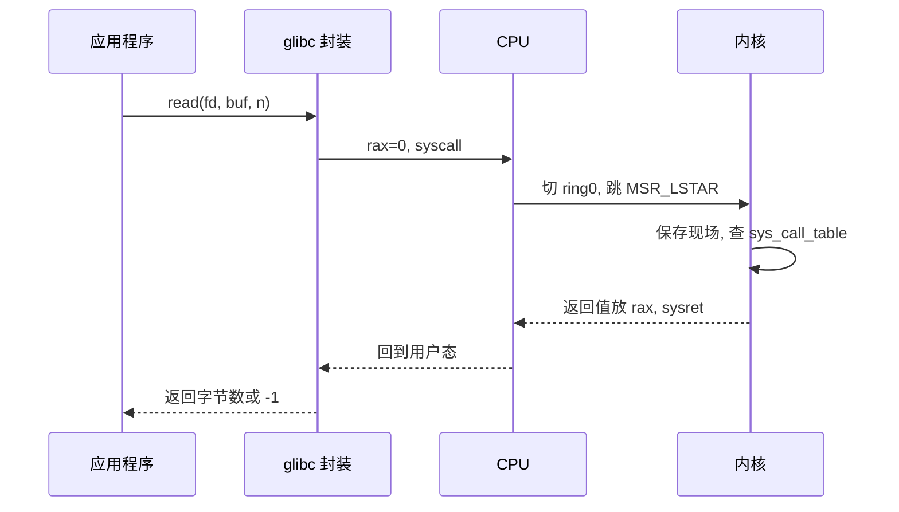

# 什么时候会从用户态陷入内核态？

## 常见问题

- 什么时候会由用户态陷入内核态？
- 简述 Linux 系统态与用户态，什么时候会进入系统态？
- 系统调用的过程是怎样的？操作系统是通过什么机制触发系统调用的？

## 概念索引

- 用户态: 受限执行环境，只能访问自己的地址空间;
- 内核态: 可执行全部指令、访问全部内存;
- 中断: 异步入口，来自时钟或外设;
- 异常: 同步入口，由当前指令引发;
- 系统调用: 用陷阱指令主动请求内核服务;
- 特权级切换: 由硬件在进入入口时改 CS 与栈;

## 用户态与内核态如何区分？

| 维度 | 用户态 | 内核态 |
| --- | --- | --- |
| 特权级 | x86 的 ring 3，CPL 为 3 | ring 0，CPL 为 0 |
| 可执行指令 | 不能执行 `hlt`、`cli`、改页表等特权指令 | 全部指令 |
| 可访问内存 | 只有本进程的用户地址空间 | 全部物理内存与内核空间 |
| 栈 | 用户栈 | 内核栈，每个线程一份 |
| 出错后果 | 触发 `SIGSEGV`，进程被杀 | 内核崩溃，`panic` 或 `oops` |

- 目的: 把「能拆掉系统的操作」集中到内核，用户程序只能请求;
- 依据: 处理器用 CPL 与页表项权限位同时做检查;
- 代价: 每次切换要保存现场、换栈，比函数调用贵上千倍;

## 有哪三类入口会进入内核态？

| 入口 | 同步性 | 例子 | 返回行为 |
| --- | --- | --- | --- |
| 中断 | 异步 | 时钟、网卡收包、磁盘完成 | 回到被打断的指令 |
| 异常 | 同步 | 缺页、除零、非法指令 | 修复后重试或杀进程 |
| 陷阱 | 同步 | `syscall`、`int 0x80` | 回到下一条指令 |

- 系统调用: 用陷阱主动进入，是用户程序请求内核服务的唯一正规途径;
- 缺页: 访问未映射页是故障类异常，内核补好映射后重新执行该指令;
- 时钟中断: 让内核有机会抢占当前进程，实现时间片调度;
- 分发: 中断与异常走 IDT，系统调用走 `MSR_LSTAR` 指向的入口;

## 系统调用的过程是怎样的？

1. 应用调用 `glibc` 封装函数，参数按 ABI 放进寄存器;
2. 系统调用号放进 `rax`，执行 `syscall` 指令;
3. CPU 从 `MSR_LSTAR` 取出内核入口地址，切到 ring 0 与内核栈;
4. 入口汇编保存用户寄存器，按 `rax` 在 `sys_call_table` 里取处理函数;
5. 内核执行真正的服务，返回值放回 `rax`;
6. 恢复现场并 `sysret` 返回用户态，返回值交给封装函数;

- 性能: 一次系统调用约几百纳秒到微秒，高频小写入要用缓冲;
- 旁路: `vDSO` 把 `gettimeofday` 这类只读调用放到用户态完成;
- 边界: `io_uring` 用共享环减少调用次数，但底层仍是内核服务;
