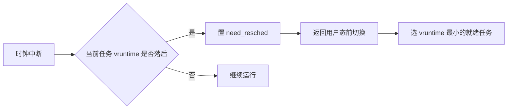

# Linux 如何调度进程，多级缓存起什么作用？

## 常见问题

- 简述 Linux 进程调度的算法
- 简述 CPU L1, L2, L3 多级缓存的基本作用

## 概念索引

- 调度类: 内核按优先级分层的一组调度策略;
- CFS: 以虚拟运行时间追求公平的调度器;
- EEVDF: 6.6 起取代 CFS 的公平调度算法;
- 实时策略: FIFO 与 RR，优先级高于普通任务;
- 时间片: 一次连续占用 CPU 的上限;
- 多级缓存: 用容量换速度的存储层次;
- 局部性: 缓存能生效的前提，决定调度迁移是否伤性能;

## Linux 有哪些调度策略？

| 策略 | 调度类 | 优先级 | 用途 |
| --- | --- | --- | --- |
| `SCHED_NORMAL` | fair | 动态 nice | 普通进程默认 |
| `SCHED_BATCH` | fair | 动态 nice | 批处理，减少唤醒抢占 |
| `SCHED_IDLE` | idle | 最低 | 有活才跑的兜底任务 |
| `SCHED_FIFO` | rt | 1 到 99 | 实时，跑完或阻塞才让出 |
| `SCHED_RR` | rt | 1 到 99 | 实时，同优先级轮转 |
| `SCHED_DEADLINE` | dl | 按截止期 | 周期性硬实时 |

- 结构: 调度类按 `stop > dl > rt > fair > idle` 的顺序取下一个任务;
- 查看: `chrt -p <pid>` 看策略，`nice` 调普通进程权重;
- 风险: 实时任务写死循环会饿死同核所有普通进程;

## 公平调度如何计算？

- 权重: `nice` 值映射成权重，每档相差约 1.25 倍;
- 虚拟时间: `vruntime = 实际运行时间 * 权重基准 / 权重`，记在 `/proc/<pid>/sched`;
- 选择: 每次挑 `vruntime` 最小的任务，权重大的跑得更多;
- 粒度: 目标延迟约 6 ms，最小抢占粒度约 0.75 ms;
- EEVDF: 6.6 起取代 CFS，在虚拟时间上加资格时间与虚拟截止期，见 [内核文档](https://docs.kernel.org/scheduler/sched-eevdf.html);
- 迁移: 负载均衡器按核队列长度搬任务，避免一核忙一核闲;

## L1、L2、L3 各起什么作用？

| 层级 | 典型容量 | 典型延迟 | 归属 |
| --- | --- | --- | --- |
| 寄存器 | 几百字节 | 1 周期 | 每核私有 |
| L1 | 32 到 64 KB，分指令与数据 | 4 到 5 周期 | 每核私有 |
| L2 | 256 KB 到 2 MB | 10 到 20 周期 | 每核私有 |
| L3 | 8 到 64 MB | 30 到 50 周期 | 同 socket 核共享 |
| 主存 | GB 级 | 上百周期 | 全机共享 |

- L1: 挡住绝大多数访问，命中率高时主存几乎不参与;
- L2: 承接 L1 不命中，容量大但延迟翻倍;
- L3: 让多核共享热数据，也是核间缓存一致性的汇聚点;
- 规律: 越靠近 CPU 越快越贵越小，逐层用容量换延迟;

## 缓存与进程调度有什么关系？

- 冷启动: 进程刚被调度上来，工作集不在缓存里，前几毫秒明显慢;
- 亲和性: 调度器倾向把任务留在原核，避免缓存与 TLB 作废;
- 迁移代价: 跨核迁移要重新预热 L1/L2，跨 NUMA 还要走远端内存;
- 伪共享: 两个核写同一缓存行的不同变量，会让该行来回失效;
- 实践: 线程绑定核、避免频繁短任务切换，比调优先级更有效;
