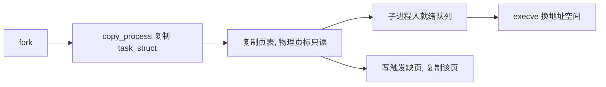

# 操作系统如何用虚拟内存管理进程的内存？

## 常见问题

- 简述操作系统如何进行内存管理
- 操作系统中，虚拟地址与物理地址之间如何映射？
- Linux 中虚拟内存和物理内存有什么区别？有什么优点？
- Linux 页大小是多少？
- 进程空间从高位到低位都有些什么？
- 简述创建进程的流程

## 概念索引

- 分页: 把地址空间切成固定大小的页;
- 页表: 记录虚拟页到物理帧的映射;
- MMU: 硬件地址翻译单元;
- TLB: 页表项的高速缓存;
- 缺页: 映射缺失或页不在内存时的异常;
- 虚拟内存: 每个进程私有的连续地址视图;
- 写时复制: 创建进程时先共享页，写时才复制;

## 内存管理由哪几层机制组成？

| 机制 | 解决什么 |
| --- | --- |
| 分段 | 按代码、数据、栈划分区域，给出权限与增长方向 |
| 分页 | 把区域切成 4 KiB 页，消除外部碎片 |
| 页表 | 把虚拟页映射到物理帧，实现隔离 |
| 缺页处理 | 按需把页从磁盘或文件调入 |
| 页面回收 | 内存不足时挑页换出或丢弃 |

- 分配: `brk` 与 `mmap` 只改虚拟地址空间的记账，物理页等访问时才给;
- 隔离: 页表项带权限位，越权访问直接触发异常;
- 共享: 多个进程的页表可以指向同一物理帧，如动态库与共享内存;

## 虚拟地址如何映射成物理地址？

- 切分: 32 位地址分成 10 位页目录、10 位页表、12 位页内偏移;
- 翻译: MMU 逐级查表得帧号，物理地址 = 帧号 * 页大小 + 偏移;
- 多级: 64 位用四级或五级页表，未用到的区间不必分配下级表;
- 缓存: TLB 缓存最近的映射，命中时跳过页表访问;

```text
虚拟地址 32 位: | 页目录 10 | 页表 10 | 偏移 12 |
物理地址     : |      帧号 20        | 偏移 12 |
```

- 大页: 2 MiB 大页省掉一级页表，也减少 TLB 缺失;
- 代价: 页命中要两次访存，切换进程还要刷新 TLB;

## 虚拟内存与物理内存有何区别？

| 项 | 虚拟内存 | 物理内存 |
| --- | --- | --- |
| 单位 | 页，进程私有 | 帧，全机共享 |
| 大小 | 可远大于物理内存，受地址位数限制 | 由内存条容量决定 |
| 连续性 | 进程看到连续地址 | 实际帧可以离散 |
| 内容位置 | 内存、交换区、文件都可能 | 只在内存条上 |
| 谁管理 | 内核加 MMU | 内核页框分配器 |

- 隔离: 进程拿不到别人的物理地址，越界只会打到自己;
- 超配: 多个进程的虚拟内存总和可以超过物理内存;
- 共享: 只读代码段与动态库在物理内存里只有一份;
- 简化: 程序不必关心加载地址，链接器按固定虚拟地址布局;

## Linux 页大小是多少？

- 默认: x86-64 上是 4 KiB，用 `getconf PAGE_SIZE` 可查;
- 大页: 透明大页 2 MiB，`hugetlbfs` 还支持 1 GiB，见 [transhuge](https://docs.kernel.org/admin-guide/mm/transhuge.html);
- 原因一: 页太小则页表项过多，页太大则内部碎片严重;
- 原因二: 4 KiB 与磁盘块、文件系统块大小衔接自然;
- 影响: 小文件多时 4 KiB 页更省内存，数据库更偏好大页;

## 进程空间从高位到低位有哪些区域？

| 区域 | 内容 | 增长方向 |
| --- | --- | --- |
| 内核空间 | 用户不可访问，映射在同一虚拟地址高位 | 固定 |
| 栈 | 局部变量、返回地址，每线程一份 | 向低地址 |
| 共享库与 mmap 区 | 动态库、文件映射、共享内存 | 由内核分配 |
| 堆 | `malloc` 得到的内存 | 向高地址 |
| BSS | 未初始化的全局与静态变量 | 固定 |
| 数据段 | 已初始化的全局与静态变量 | 固定 |
| 代码段 | 机器指令与只读常量 | 固定 |

- 布局: 代码段在最低处，栈在用户空间最高处，中间留给堆与映射;
- 随机化: `ASLR` 打乱栈、堆与库的基址，降低溢出利用成功率;
- 缺口: 堆与映射区之间留有大片未分配虚拟地址，按需 `mmap`;

## 创建进程的流程是怎样的？

1. 父进程调用 `fork`，进入内核 `_do_fork`;
2. `copy_process` 复制 `task_struct`、页表、文件表等描述符;
3. 页表只复制表项并标记只读，物理页共用，即写时复制;
4. 子进程被挂到就绪队列，返回用户态，`fork` 在两边各返回一次;
5. 子进程通常紧接着 `execve`，换掉整个地址空间，旧页被释放;



- 成本: 复制页表比复制内存便宜得多，所以 `fork` 快;
- 变体: `vfork` 与 `posix_spawn` 进一步减少复制;
