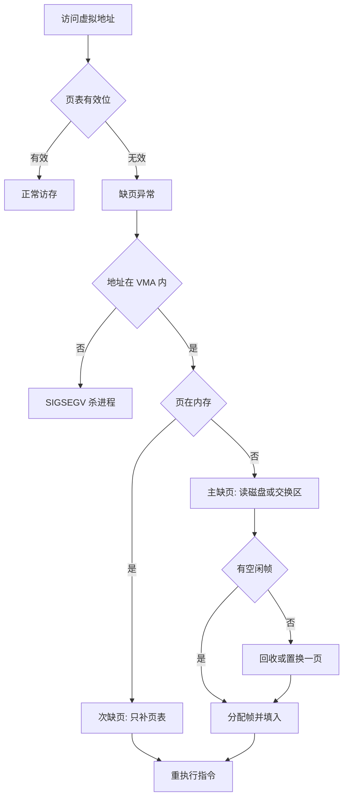

# 缺页中断如何工作，页面置换算法有哪些？

## 常见问题

- 简述操作系统中的缺页中断
- 简述 Linux 虚拟内存的页面置换算法

## 概念索引

- 缺页: 访问的页不在物理内存，触发故障类异常;
- 主缺页: 需要读磁盘才能补页;
- 次缺页: 页已在内存，只缺页表映射;
- 置换: 内存满时挑一页换出腾位置;
- 工作集: 进程近期实际访问的页集合;
- 双 LRU: Linux 用两队列近似 LRU 并区分冷热;

## 缺页异常有哪两类？

| 类型 | 需要的动作 | 典型场景 |
| --- | --- | --- |
| 主缺页 | 读磁盘或网络，进程睡眠 | 首次访问已换出的页、读文件 |
| 次缺页 | 只填页表项 | 写时复制、已缓存页首次映射 |

- 触发: 页表项有效位为 0，或权限不符，MMU 直接报异常;
- 区分: 内核查 `vm_area_struct` 才知道是合法映射还是非法访问;
- 非法: 落在任何 VMA 之外的地址直接 `SIGSEGV`;
- 计数: `/proc/vmstat` 的 `pgmajfault` 与 `pgfault` 分别记主次缺页;

## 缺页处理流程是怎样的？

1. CPU 访问虚拟地址，MMU 查页表发现无效，抛出缺页异常;
2. 内核保存现场，按地址在进程的 VMA 树里定位所属区域;
3. 判断合法性: 无 VMA 或权限不符则发 `SIGSEGV`;
4. 若为写时复制的私有页，分配新帧并复制内容，属次缺页;
5. 否则分配物理帧，从交换区或文件读入数据，属主缺页;
6. 更新页表项并置有效位，返回用户态重新执行那条指令;



- 代价: 主缺页是毫秒级，比一次内存访问慢六个数量级;
- 优化: 预读与透明大页能显著削减缺页次数;

## 常见置换算法如何比较？

| 算法 | 规则 | 优点 | 缺点 |
| --- | --- | --- | --- |
| OPT | 换出未来最久不用的页 | 缺页率理论最低 | 需要预知未来，只能做基准 |
| FIFO | 换出最早进入的页 | 实现简单 | 会把热页换走，有 Belady 异常 |
| LRU | 换出最久未使用的页 | 贴近局部性 | 精确实现代价高 |
| Clock | 用环形队列加访问位，扫一圈清零 | 近似 LRU 且便宜 | 精度取决于扫描频率 |
| LFU | 换出访问次数最少的页 | 适合稳定热点 | 新页易被饿死 |
| 工作集 | 按最近一段时间访问过的页定界 | 抗抖动 | 需持续采样 |

- Belady 异常: FIFO 增加物理帧反而缺页更多，LRU 类算法不会;
- 抖动: 物理帧不足时反复换入换出，CPU 利用率骤降;
- 现实: 通用内核都用 Clock 一类近似算法，很少精确 LRU;

## Linux 用什么算法回收页？

- 双队列: 每类页维护 active 与 inactive 两条 LRU 链表;
- 冷热: 页首次访问进 inactive 头部，再次访问才升到 active;
- 回收: 从 inactive 尾部取页，干净页直接丢弃，脏页先回写;
- 区分: 文件页可直接丢弃重读，匿名页必须先写交换区;
- 顺序: 先丢弃干净的文件页，再回写脏页，最后才换出匿名页;

## 内存水位如何触发回收？

- 触发: 空闲页低于低水位唤醒 `kswapd`，低于最低水位才同步回收;
- 压力: 回收跟不上就触发 OOM killer，按 `oom_score` 杀进程;

```text
分配路径: 空闲页 > 高水位   直接分配
          低水位 < 空闲页   唤醒 kswapd 后台回收
          空闲页 < 最低水位 分配者同步回收, 仍不够则 OOM
```

- 观察: `/proc/zoneinfo` 看各级水位，`/proc/meminfo` 看 active 与 inactive;
- 调参: `vm.swappiness` 决定回收匿名页还是文件页的倾向;
