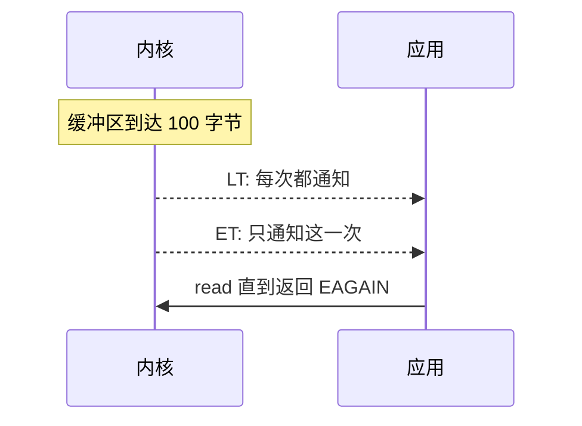

# select、poll、epoll 有什么区别，五种 I/O 模型如何工作？

## 常见问题

- 简述 select, poll, epoll 的使用场景以及区别，epoll 中水平触发以及边缘触发有什么不同？
- 简述 Linux 的 I/O模型
- BIO、NIO 有什么区别？怎么判断写文件时 Buffer 已经写满？简述 Linux 的 IO模型

## 概念索引

- 阻塞 I/O: 调用后一直睡到数据就绪并复制完成;
- 非阻塞 I/O: 没数据立刻返回错误码，由应用轮询;
- I/O 多路复用: 一次等待多个描述符，谁就绪处理谁;
- 信号驱动: 就绪时内核发信号通知;
- 异步 I/O: 内核完成复制后回调，全程不阻塞;
- 边缘触发: 只在状态变化时通知一次;
- 缓冲区: 用户态与内核之间搬运数据的载体，读写的计量单位;

## 五种 I/O 模型分别怎么工作？

| 模型 | 第一阶段等数据 | 第二阶段复制 | 典型接口 |
| --- | --- | --- | --- |
| 阻塞 | 进程睡 | 进程睡 | `read` |
| 非阻塞 | 轮询 | 进程睡 | `read` + `O_NONBLOCK` |
| 多路复用 | `select` 睡 | 进程睡 | `select`、`poll`、`epoll` |
| 信号驱动 | 立刻返回，等信号 | 进程睡 | `SIGIO` |
| 异步 | 立刻返回 | 内核完成才通知 | `io_uring`、POSIX AIO |

- 关键: 前四种都是同步 I/O，因为复制阶段仍由进程自己等;
- 异步: 只有内核把数据放进用户缓冲区后才回调，才算真异步;
- 演进: 多路复用把「等」合并，异步 I/O 把「复制」也交给内核;

## select、poll、epoll 有什么区别？

| 项 | select | poll | epoll |
| --- | --- | --- | --- |
| 描述符上限 | `FD_SETSIZE`，默认 1024 | 无固定上限 | 无固定上限 |
| 数据传递 | 位图每次全量复制 | 数组每次全量复制 | 注册一次，内核保存 |
| 就绪判断 | 内核遍历全部 fd，`O(n)` | 同 select | 就绪链表直接返回，`O(1)` |
| 返回内容 | 修改位图，应用要重扫 | 填 `revents` | 只返回就绪的 fd |
| 触发方式 | 水平 | 水平 | 水平或边缘 |

- 结构: `epoll` 用红黑树存关注的 fd，就绪事件挂到链表，`epoll_wait` 直接取，见 [epoll(7)](https://man7.org/linux/man-pages/man7/epoll.7.html);
- 场景: 连接数少且跨平台用 `select`，连接多且长连接用 `epoll`;
- 陷阱: `epoll` 的优势在 fd 多而活跃少，活跃比例高时未必更快;

```c
int ep = epoll_create1(0);
struct epoll_event ev = {.events = EPOLLIN, .data.fd = fd};
epoll_ctl(ep, EPOLL_CTL_ADD, fd, &ev);
struct epoll_event evs[64];
int n = epoll_wait(ep, evs, 64, -1);   // -1 表示永久阻塞
```

## 水平触发与边缘触发有什么不同？

- 水平触发: 只要缓冲区还有数据，每次 `epoll_wait` 都会通知;
- 边缘触发: 只在状态由无变有那一刻通知一次，之后不再提醒;
- 要求: 边缘触发必须配非阻塞 fd，并循环读到 `EAGAIN` 为止;
- 风险: 边缘触发下少读一次，数据就永远留在缓冲区且不再有事件;
- 选择: 水平触发写起来简单，边缘触发减少系统调用次数;



- 例外: `EPOLLONESHOT` 让事件只报一次，多线程下配合重新注册;

## BIO 与 NIO 有什么区别？

- BIO: 一个连接一个线程，读不到就阻塞，线程数随连接数线性增长;
- NIO: 一个线程用选择器管上千连接，只在就绪时处理;
- 数据形态: BIO 面向流，NIO 面向缓冲区加通道;
- 复制: `FileChannel.transferTo` 走零拷贝，比流式复制少两次搬运;
- 代价: NIO 代码要自己处理半包、粘包与状态机，复杂度高;

## 怎么判断写文件时 Buffer 已经写满？

- 三值: `capacity` 是总容量，`position` 是写到的位置，`limit` 是可写上限;
- 判满: `position == limit` 或 `!buffer.hasRemaining()` 即为满;
- 写前: 检查 `remaining()`，不够就 `flip` 后先 `write` 再 `compact`;
- 写时: `channel.write` 返回 0 表示内核缓冲区满，要注册写事件稍后再写;
- 异常: 直接 `put` 超界抛 `BufferOverflowException`，读超界抛 `BufferUnderflowException`;

```java
ByteBuffer buf = ByteBuffer.allocate(4096);
while (in.read(buf) != -1) {
  buf.flip();                 // 切换到读模式
  while (buf.hasRemaining()) {
    out.write(buf);           // 可能只写一部分
  }
  buf.compact();              // 保留残余，回到写模式
}
```

- 要点: `flip` 把 `limit` 设为 `position` 并归零 `position`，写读模式靠它切换;
