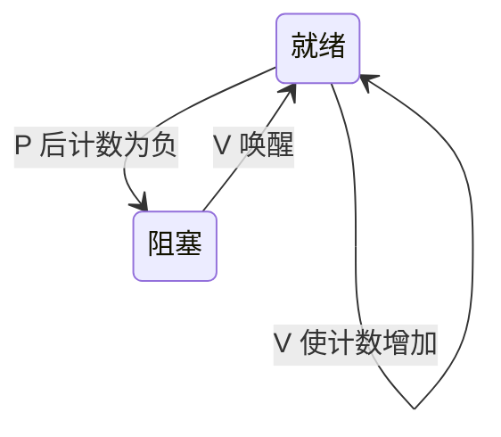

# 自旋锁、互斥锁和信号量分别用在什么场景？

## 常见问题

- 简述自旋锁与互斥锁的使用场景
- 简述同步与异步的区别，阻塞与非阻塞的区别
- 信号量是如何实现的？

## 概念索引

- 临界区: 必须互斥执行的代码段;
- 自旋锁: 抢不到就忙等，不睡眠;
- 互斥锁: 抢不到就睡眠，让出 CPU;
- 原子指令: 硬件保证不可分割的读改写;
- 信号量: 带计数的同步原语;
- 阻塞: 调用方是否被挂起;
- 同步: 调用方是否等待结果;

## 自旋锁与互斥锁有什么区别？

| 项 | 自旋锁 | 互斥锁 |
| --- | --- | --- |
| 抢不到时 | 循环检测，忙等 | 睡眠，进等待队列 |
| 上下文切换 | 无 | 有，两次 |
| 适合临界区 | 极短，几十条指令 | 较长或可能阻塞 |
| 能否睡眠 | 不能，持锁期间不可睡眠 | 可以 |
| 典型开销 | 空转耗 CPU | 切换开销大 |
| 使用环境 | 内核中断上下文、多核 | 用户态、可睡眠上下文 |

- 判据: 临界区短于两次上下文切换的时间就用自旋;
- 判据: 单核上自旋毫无意义，持有者根本没机会跑;
- 实现: 自旋锁靠 `CMPXCHG` 或 `XCHG` 原子指令改状态;
- 实现: 互斥锁先尝试原子改，失败才进内核 `futex` 队列睡眠;
- 变体: 读写锁、乐观锁、无锁队列都是在这两者之间做取舍;

```c
// 自旋锁的最小实现，需要硬件原子交换
while (atomic_exchange(&lock, 1)) {
  while (atomic_load(&lock)) { }   // 只读自旋，减少总线压力
}
// 临界区
atomic_store(&lock, 0);
```

- 风险: 自旋锁持有时被抢占，会让其它核白转，内核里要关抢占;

## 同步与异步、阻塞与非阻塞如何区分？

| 组合 | 含义 | 例子 |
| --- | --- | --- |
| 同步阻塞 | 调用后等结果，期间不能干别的 | `read` 阻塞读文件 |
| 同步非阻塞 | 立刻返回，自己轮询结果 | 非阻塞 `read` 返回 `EAGAIN` |
| 异步非阻塞 | 提交后立刻返回，完成后回调 | `io_uring` 提交队列 |
| 异步阻塞 | 提交后等回调，少见 | 用条件变量等异步结果 |

- 同步异步: 看结果由谁通知，调用方主动等还是被动收;
- 阻塞非阻塞: 看调用期间线程是否被挂起，与结果何时到无关;
- 常见混淆: 非阻塞不等于异步，轮询仍是同步;
- 组合: 同步阻塞最简单，异步非阻塞吞吐最高也最难写;

## 信号量是如何实现的？

- 语义: 一个整数计数器，`P` 减一并在 0 时阻塞，`V` 加一并唤醒等待者;
- 内核: `struct semaphore` 含计数与等待队列，`down` 与 `up` 分别对应 P 与 V;
- 用户态: `sem_wait` 与 `sem_post`，底层用 `futex` 只在竞争时才进内核;
- 计数: 上限为 1 时等价互斥锁，大于 1 表示可用资源数;

```text
P(sem):  sem-- ; if (sem < 0) 睡眠等待
V(sem):  sem++ ; if (sem <= 0) 唤醒一个等待者
```



## 信号量用起来有什么坑？

- 顺序: 用两个信号量可以强制「先写后读」这类先后关系;
- 对比: 互斥锁关心「谁拥有」，信号量只关心「还剩几个」;
- 陷阱: 信号量没有所有权，任何线程都能 `V`，容易写出难以排查的错;
