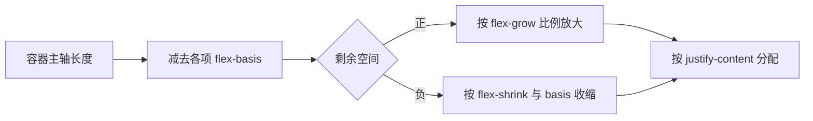

# Flex 布局的原理是什么, 如何用它实现两栏与三列布局？

## 常见问题

- 简述 Flex 布局的原理和使用场景
- flex 常用的属性有哪些？flex: 1 1 0 是什么意思？
- 如何使用 flex 实现两栏布局？
- CSS 实现两列布局
- CSS 实现三列布局
- 实现自适应两栏布局
- 如何实现自适应布局？

## 概念索引

- 主轴: item 依次排布的方向;
- 交叉轴: 与主轴垂直的方向;
- 容器与项目: 容器由 `display: flex` 建立, 直接子元素即项目;
- 剩余空间: 主轴长度减去各项基准尺寸;
- flex-grow 与 flex-shrink: 前者分剩余空间, 后者分摊溢出;
- flex-basis: 放大收缩前的基准尺寸, 决定 grow 从哪个起点开始分配;

## Flex 布局的原理是什么？

- 一维布局: 只沿主轴排布, 换行后每行独立计算;
- 两步分配: 先按 basis 定基准, 再放大剩余空间或压缩溢出空间;
- 剩余空间: 容器主轴长度减去所有 item 的 basis 之和;
- 对齐分工: `justify-content` 管主轴, `align-items` 管交叉轴;
- 适用场景: 导航条、表单行、卡片列表、两栏三栏、垂直居中;
- 规范: 见 [Basic concepts of flexbox](https://developer.mozilla.org/en-US/docs/Web/CSS/CSS_flexible_box_layout/Basic_concepts_of_flexbox);



## flex 常用属性有哪些, flex: 1 1 0 是什么意思？

| 属性 | 作用对象 | 说明 |
| --- | --- | --- |
| `display: flex` | 容器 | 建立弹性格式化上下文 |
| `flex-direction` | 容器 | 主轴方向, `row` 或 `column` |
| `flex-wrap` | 容器 | 是否换行 |
| `justify-content` | 容器 | 主轴对齐 |
| `align-items` | 容器 | 交叉轴对齐 |
| `gap` | 容器 | 项间距 |
| `flex-grow` | item | 放大比例 |
| `flex-shrink` | item | 收缩比例 |
| `flex-basis` | item | 基准尺寸 |
| `align-self` | item | 单独覆盖交叉轴对齐 |
| `order` | item | 排列顺序 |

- `flex: 1 1 0`: grow 为 1, shrink 为 1, basis 为 0, 基准归零后平分全部空间;
- `flex: 1` 等价 `1 1 0%`: 各 item 最终等宽, 与内容多少无关;
- `flex: auto` 等价 `1 1 auto`: 先按内容定基准, 再分剩余空间;
- `flex: none` 等价 `0 0 auto`: 不放大也不收缩;

```css
.row { display: flex; gap: 8px; }
.row > * { flex: 1 1 0; min-width: 0; }
```

- `min-width: 0` 的原因: item 默认 `min-width: auto`, 长文本会拒绝收缩;

## 如何用 flex 实现两栏布局？

- 目标: 侧栏定宽, 主区吃满剩余宽度;
- 写法: 容器 `display: flex`, 侧栏 `flex: 0 0 240px`, 主区 `flex: 1`;
- 顺序: 主区写在前面也能用 `order` 把侧栏排到右侧;
- 变体: 两侧定宽加中间 `flex: 1`, 就是三栏;

```html
<div class="layout">
  <aside class="side">side</aside>
  <main class="main">main</main>
</div>
```

```css
body { margin: 0; font: 14px/1.6 sans-serif; }
.layout { display: flex; gap: 8px; min-height: 100vh; }
.side { flex: 0 0 240px; background: #eef; }
.main { flex: 1; min-width: 0; background: #fee; }
```

## 如何实现两列与三列布局？

- 三列: 左右 `flex: 0 0 200px`, 中间 `flex: 1`;
- 两列等宽: 两个 item 都写 `flex: 1 1 0`;
- 圣杯布局: 三栏外加页眉页脚, 外层纵向 flex, 主体再横向三栏;
- 浮动方案: 左右 `float`, 中间用 `margin` 留位, 容器建 BFC 兜住浮动;
- 绝对定位方案: 左右 `position: absolute`, 中间 `margin` 留位, 但容器要定高;

| 方案 | 左右定宽 | 中间自适应 | 注意 |
| --- | --- | --- | --- |
| flex | `flex-basis` | `flex: 1` | 首选, 无需清除浮动 |
| float | `width` | `margin` 让位 | 需清浮动 |
| absolute | 定位偏移 | `margin` 让位 | 必须定高 |
| grid | 轨道宽度 | `1fr` | 二维场景更合适 |

```html
<div class="cols">
  <nav class="l">left</nav>
  <section class="c">center</section>
  <aside class="r">right</aside>
</div>
```

```css
.cols { display: flex; gap: 8px; }
.l, .r { flex: 0 0 200px; background: #eef; }
.c { flex: 1; min-width: 0; background: #efe; }
```

## 如何实现自适应布局？

- 断点式: 媒体查询在小屏把 `flex-direction` 改成 `column`;
- 折行式: `flex-wrap: wrap` 加子项 `min-width`, 空间不足自动换行;
- 网格式: `repeat(auto-fit, minmax(220px, 1fr))` 一行算出列数;
- 卡片列表: `flex: 1 1 220px` 让每行填满且不留半格;
- 字号: 容器变化时用 `clamp()` 限制最小与最大字号;

```html
<div class="cards"><div>1</div><div>2</div><div>3</div><div>4</div></div>
```

```css
.cards { display: flex; flex-wrap: wrap; gap: 12px; }
.cards > * { flex: 1 1 220px; background: #eef; padding: 12px; }
@media (max-width: 640px) {
  .layout { flex-direction: column; }
  .side { flex: 0 0 auto; }
}
```

- 换算思路: 折行阈值 = 子项 `flex-basis` + `gap`, 按这个值设计断点;

## 多列布局与 flex 有什么区别？

- 多列: 同一段内容被切成若干栏, 文字像报纸一样流动;
- `column-count`/`column-width`: 定列数或定期望列宽;
- `column-gap` 与 `column-rule`: 栏间距与分隔线;
- `break-inside: avoid`: 防止卡片被拆到两栏;
- 区别: 多列切的是同一内容流, flex 排的是多个独立 item;

```css
.article { column-count: 3; column-gap: 24px; column-rule: 1px solid #ddd; }
.article figure { break-inside: avoid; }
```