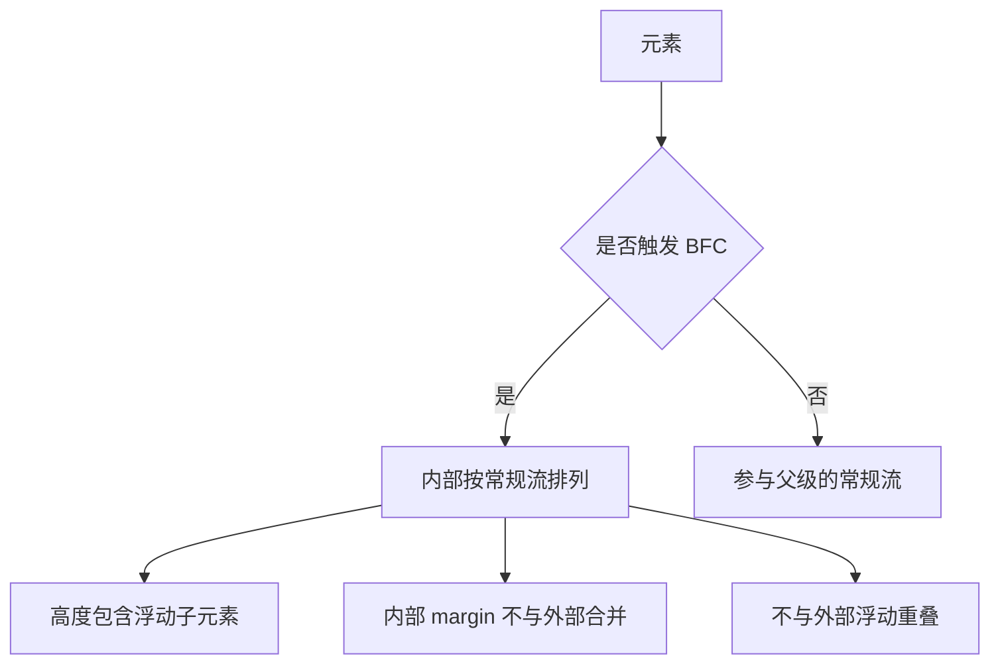

# BFC 是什么, 能解决哪些布局问题？

## 常见问题

- 简述 BFC 的原理及其使用场景

## 概念索引

- 格式化上下文: 一块按特定规则排布子盒的区域;
- BFC: 块级格式化上下文, 内部按块级规则从上往下排;
- 浮动隔离: BFC 的高度算入内部浮动, 外部浮动也挤不进来;
- margin collapse: 常规流中相邻块的外边距合并;
- flow-root: 专为建立 BFC 而设计的 display 值;
- 自适应两栏: 利用 BFC 不与浮动重叠的特性, 让主区自动占满剩余宽度;

## BFC 是什么？

- 定义: 块级格式化上下文, 一块独立的块级布局区域;
- 内部: 子盒按常规流从上到下依次排列, 与外部互不干扰;
- 边界: 高度包含内部的浮动元素, 外部浮动无法侵入;
- 隔离: 内部的 `margin` 不与外部合并, 外部的布局也影响不到内部;
- 家族: 它与 IFC、FFC、GFC 同属格式化上下文, 区别只在内部规则;



## 如何触发 BFC？

| 属性 | 取值 |
| --- | --- |
| `float` | 非 `none` |
| `position` | `absolute` 或 `fixed` |
| `display` | `flow-root`、`inline-block`、`table-cell`、`flex`、`grid` |
| `overflow` | 非 `visible`/`clip`, 如 `hidden`、`auto` |
| `contain` | `layout`、`paint`、`content` |

- 首选 `display: flow-root`: 只为建 BFC 而生, 不带其他副作用;
- `overflow: hidden`: 老办法, 会裁掉溢出内容, 还会破坏内部 `position: sticky`;
- 现代做法: 直接用 flex 或 grid 容器, 它本身就是独立的布局上下文;
- 规范: 见 [Block formatting context](https://developer.mozilla.org/en-US/docs/Web/CSS/CSS_display/Block_formatting_context);

## BFC 能解决哪些问题？

- 清除浮动: 父元素高度塌陷时, 给父元素建 BFC 就能包住浮动子元素;
- 阻断塌陷: 父子 `margin` 合并时, 让父元素成 BFC 即可隔开内外边距;
- 自适应两栏: 侧栏浮动, 主区建 BFC 后不与浮动重叠, 自动占满剩余宽度;
- 避免文字环绕: 图文混排里让段落成 BFC, 文字就不再贴着浮动图片流动;
- 隔离内外: 内部浮动不外溢, 外部也不会挤进内部;

```html
<div class="wrap">
  <div class="pic">float</div>
  <p class="text">这段文字不会绕着浮动盒子排, 而是整块让开。</p>
</div>
```

```css
.wrap { display: flow-root; }            /* 包住浮动, 高度不再塌陷 */
.pic { float: left; width: 120px; height: 80px; background: #eef; }
.text { display: flow-root; background: #efe; } /* 不与浮动重叠 */
```

## BFC 与 margin 塌陷是什么关系？

- 塌陷条件: 常规流中相邻的块级盒, 在块轴方向的外边距会合并;
- 三种场景: 相邻兄弟之间、父子之间、空元素的自身上下;
- 合并规则: 同正取大, 同负取小, 一正一负相加;
- 阻断方式: BFC、浮动、绝对定位、`padding`、`border`、`overflow` 都能隔开;
- 注意: 同一个 BFC 内的相邻子元素之间照样会合并;

```css
.a { margin-bottom: 20px; }
.b { margin-top: 30px; } /* 实际间距 30px, 不是 50px */
```

### 父子塌陷怎么处理？

- 成因: 父元素没有 `padding`/`border` 时, 子元素的 `margin-top` 会顶穿父元素;
- 取舍: 现代布局用 flex 或 grid 的 `gap`, 从结构上避开这类问题;