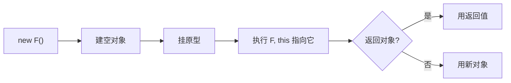

# 原型、原型链、new 与 instanceof 如何配合?

## 常见问题

- 简述 Javascript 原型以及原型链
- new 和 instanceof 的内部机制
- new 一个函数的过程发生了什么？

## 概念索引

- prototype: 函数自带的对象, 充当其实例的原型;
- [[Prototype]]: 每个对象内部的隐式原型指针;
- 原型链: 由 [[Prototype]] 串起来的属性查找路径;
- new: 建对象、挂原型、执行构造函数、按返回值定结果;
- instanceof: 沿原型链比对构造函数原型的判定;
- Symbol.hasInstance: 自定义 instanceof 的入口, 可以整条绕过原型链;

## prototype 与 [[Prototype]] 是什么关系?

| 项 | prototype | [[Prototype]] |
| --- | --- | --- |
| 归属 | 只有函数有, 箭头函数除外 | 每个对象都有 |
| 指向 | 一个普通对象 | 创建它的构造函数的 prototype |
| 访问 | `F.prototype` | `obj.__proto__` |
| 作用 | 给实例共享方法 | 属性查找的下一站 |

- 互指: `p.__proto__ === Person.prototype` 为 true;
- 回指: `Person.prototype.constructor === Person` 为 true;
- 共享: 同一构造函数的所有实例指向同一个 prototype 对象;

## 原型链长什么样?


- 查找: 先查自身, 再沿 __proto__ 逐层向上, 到 null 还没就得到 undefined;
- 写: 赋值只改自身, 原型上的同名属性会被实例属性遮蔽;
- 函数也是对象: `Person.__proto__ === Function.prototype`;
- 终点: `Object.prototype.__proto__ === null`, 这是链条唯一尽头;

```js
function Person() {}
const p = new Person();
p.__proto__ === Person.prototype;                // true
Person.prototype.__proto__ === Object.prototype; // true
```

## new 一个函数发生了什么?

- 第一步: 建一个空对象, 把它的原型指向构造函数的 prototype;
- 第二步: 用这个对象当 this, 执行构造函数体;
- 第三步: 看返回值, 是对象就用它替换, 否则用第一步的对象;
- 记忆: 建对象、挂原型、执行、判返回;



```js
function myNew(Ctor, ...args) {
  const obj = Object.create(Ctor.prototype);   // 建 + 挂
  const ret = Ctor.apply(obj, args);           // obj 当 this 执行
  return ret !== null && typeof ret === "object" ? ret : obj; // 判返回
}

function Point(x) { this.x = x; }
myNew(Point, 3).x; // 3
```

- 边界: 返回原始值或 null 都被忽略, 最终仍然是新对象;
- 类的限制: class 只能用 new 调用, 直接 apply 执行会抛 TypeError;

## instanceof 的内部机制?

- 第一步: 查 `Ctor[Symbol.hasInstance]`, 有就直接用它的返回值;
- 第二步: 取 `obj.__proto__` 与 `Ctor.prototype` 比较;
- 第三步: 不等就再上一层, 到 null 仍未命中则返回 false;
- 等价写法: `Ctor.prototype.isPrototypeOf(obj)`;
- 关键: 构造函数本身不参与判断, 只看它的 prototype;

```js
function myInstanceof(obj, Ctor) {
  if (obj === null || (typeof obj !== "object" && typeof obj !== "function")) return false;
  let proto = Object.getPrototypeOf(obj);
  while (proto) {
    if (proto === Ctor.prototype) return true;
    proto = Object.getPrototypeOf(proto);
  }
  return false;
}
```

- 原始值: 一律返回 false, 因为原始值没有原型链可走;
- 自定义: 定义 `static [Symbol.hasInstance](obj)` 可按形状判断, 与继承无关;

## 改写原型会带来什么后果?

- 现象: 先 new 出实例, 再整体替换 `F.prototype`, 旧实例仍指向旧原型;
- 结果: 旧实例拿不到新方法, 连 `instanceof F` 也变成 false;
- 原因: 实例只保存创建时那份原型引用, 换掉的是构造函数那侧的指针;
- 做法: 创建实例之前定义好全部方法, 或往原型上追加而不是替换;

```js
function F() {}
const p = new F();
F.prototype = { hi() {} };
p.hi();         // TypeError; p 还指着旧原型
p instanceof F; // false
```

- 特例: `Object.create(null)` 造出的对象没有原型, 连 toString 都没有;
