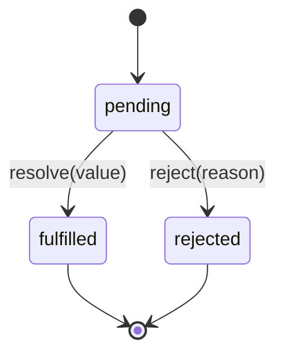

# Promise 的状态与异步编程方案的原理是什么？

## 常见问题

- promise 有哪些状态？简述 promise.all 的实现原理
- 简述常见异步编程方案 (promise, generator, async) 的原理
- Promise 有哪些潜在的问题？

## 概念索引

- 状态机: Promise 只有三种状态, 且只能单向迁移一次;
- 微任务: Promise 回调进入的队列, 在本轮同步代码之后清空;
- Promise.all: 全部成功才成功, 结果按输入顺序排列;
- 回调与生成器: 前者嵌套难管, 后者可暂停并被执行器驱动;
- async/await: 生成器加自动执行器再加 Promise 的语法糖;
- 不可取消: 创建后无法从外部中止, 是多数潜在问题的共同根因;

## Promise 有哪三种状态？



- 三态: `pending`、`fulfilled`、`rejected`, 后两者合称 settled;
- 单向: 一旦离开 `pending`, 再调 `resolve`/`reject` 都无效;
- 值冻结: 成功值或失败理由确定后不再改变;
- 时机: executor 同步执行, 状态切换后回调才被排进微任务队列;
- 链式: `then` 返回新 Promise, 每一环独立结算;

```js
const p = new Promise((resolve) => { resolve(1); resolve(2); });
p.then((v) => console.log(v)); // 1, 第二次 resolve 被忽略
```

- 内部状态: 规范用 `[[PromiseState]]` 与 `[[PromiseResult]]` 表示;

## Promise.all 的实现原理是什么？

- 输入: 任意可迭代对象, 元素可以是 Promise 或普通值;
- 归一化: 每个元素过一遍 `Promise.resolve`, 统一成 Promise;
- 保序: 结果按下标写入数组, 所以与完成先后无关;
- 完成: 计数到长度就 `resolve`, 空数组立即成功;
- 短路: 任一失败立刻 `reject`, 其余任务仍在跑但结果被丢弃;

```js
const all = (iterable) =>
  new Promise((resolve, reject) => {
    const list = Array.from(iterable);
    const results = new Array(list.length);
    let done = 0;
    if (list.length === 0) return resolve(results);
    list.forEach((item, i) => {
      Promise.resolve(item).then((value) => {
        results[i] = value;
        if (++done === list.length) resolve(results);
      }, reject);
    });
  });
```

### 与其它组合方法有什么区别？

- 对照: `all` 失败即结束, `allSettled` 等全部, `race` 取第一个结算, `any` 取第一个成功;
- 共同点: 组合方法都不会取消其余 Promise, 只是不再收集结果;

## 三种异步方案各自解决什么问题？

| 方案 | 表达方式 | 解决的问题 | 弱点 |
| --- | --- | --- | --- |
| 回调 | 传入函数 | 拿到异步结果 | 嵌套深, 错误处理重复 |
| Promise | 返回 thenable | 链式扁平, 错误集中 | 仍是回调, 无法取消 |
| 生成器 | `yield` 交出控制权 | 用同步写法表达异步 | 要自己写执行器 |
| async/await | `await` 等待 | 同步写法加自动执行 | 有传染性, 易写成串行 |

- 演进线索: 回调 → Promise 链 → 生成器加执行器 → async/await;
- 共同目标: 让异步结果回到线性代码里, 而不是层层嵌套;
- 生成器: 函数体可以暂停, `yield` 把值交出去, 外部调 `next` 恢复;
- async: 引擎内置了执行器, 不再需要第三方库;

```js
function* gen() {
  const a = yield Promise.resolve(1);
  const b = yield Promise.resolve(a + 1);
  return a + b;
}

function run(genFn) {
  const it = genFn();
  return new Promise((resolve, reject) => {
    const step = (fn, arg) => {
      let r;
      try { r = fn.call(it, arg); } catch (e) { return reject(e); }
      if (r.done) return resolve(r.value);
      Promise.resolve(r.value).then((v) => step(it.next, v), (e) => step(it.throw, e));
    };
    step(it.next);
  });
}

run(gen).then(console.log); // 3
```

- 等价关系: `async` 把函数体包成生成器, `await` 等价 `yield`, 由引擎负责恢复;

## Promise 有哪些潜在问题？

- 无法取消: 没有 `cancel`, 只能加标志位忽略结果, 或靠 `AbortController`;
- 错误易吞: 漏写 `catch` 只会变成一条未处理拒绝, 进程照常跑;
- 单值: 只能带一个结果, 多值得自己包对象或数组;
- 无进度: 只有成功与失败, 没有中间进度事件;
- 立即执行: executor 同步跑, 创建即开始, 无法真正延后;
- 组合不取消: `all`/`race` 结束后其余任务继续消耗资源;

```js
// 只能"假装"取消
let cancelled = false;
fetchData().then((data) => { if (cancelled) return; render(data); });
```

### 链上还有哪些坑？

- 异常: `then` 里抛错会跳过后续所有 `then`, 直到遇到 `catch`;
- 开销: 每个 `then` 都新建 Promise 并排一个微任务, 超长链有额外成本;
- 误用: 在 `new Promise` 里包一个已有 Promise, 多一层且丢失取消能力;

## 异步任务怎么控制并发？

- 一次全发: `map` 生成数组再用 `Promise.all`, 简单但可能压垮后端;
- 限流: 维护运行计数与等待队列, 完成一个补一个;
- 保序: 结果按任务下标写入, 与完成先后无关;
- 失败策略: 单个失败是否中断整批, 设计时就要定清楚;
- 超时: 用 `Promise.race` 拼一个到点即拒绝的计时器;

```js
const limit = (max) => {
  const queue = [];
  let running = 0;
  const next = () => {
    if (!queue.length || running >= max) return;
    const { task, resolve, reject } = queue.shift();
    running++;
    task().then(resolve, reject).finally(() => { running--; next(); });
  };
  return (task) => new Promise((resolve, reject) => {
    queue.push({ task, resolve, reject });
    next();
  });
};

const send = limit(3);
await Promise.all(urls.map((u) => send(() => fetch(u))));
```

- 注意: 这种写法下 `Promise.all` 会等全部任务, 只有三个在同时跑;