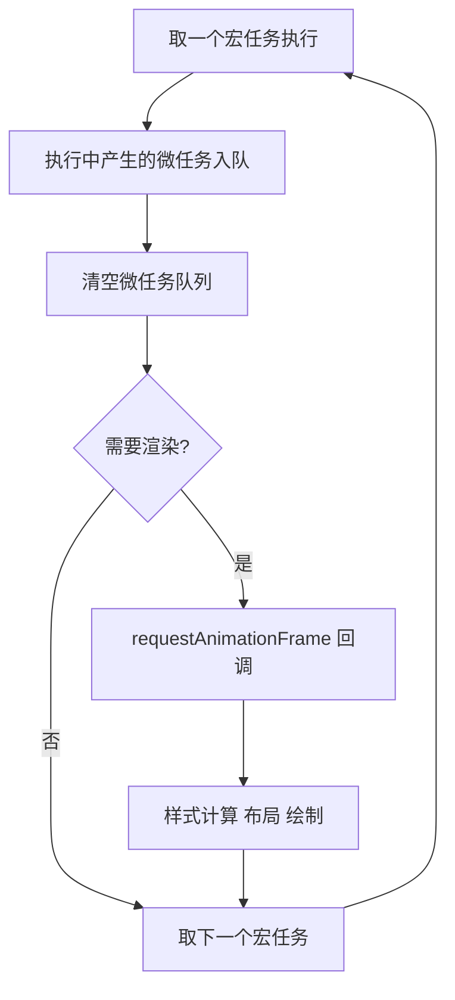
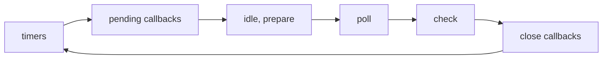

# JavaScript 事件循环是怎么工作的？

## 常见问题

- 简述 JavaScript 事件循环机制
- 简述浏览器的 Event Loop 机制
- 简述 Node.js 事件循环机制
- 简述 Node.js 异步单线程原理
- 前端如何解决线程安全和进程安全的问题？

## 概念索引

- 调用栈: 同步代码执行的位置;
- 任务队列: 宿主把回调排队等待主线程执行的地方;
- 宏任务: 一轮事件循环只取一个执行;
- 微任务: 本轮末尾整队清空, 包括过程中新产生的;
- 渲染时机: 微任务清空之后、下一个宏任务之前;
- 线程安全: 默认无共享内存, 靠消息传递, 共享时用 Atomics;
- 事件循环: 取任务、清微任务、按需渲染、再取任务的循环, Node 里换成阶段轮转;

## 为什么单线程还要异步？

- 单线程原因: 主要职责是操作 DOM, 多线程同时改 DOM 需要复杂的同步机制;
- 阻塞风险: 一个长任务就会卡住渲染与交互;
- 分工: 网络、计时、文件等耗时操作交给宿主在别的线程做;
- 回传: 完成后把回调排进队列, 主线程空了再取出执行;
- 结果: 单线程加事件循环, 得到的是"不阻塞"的并发外观;

## 浏览器事件循环怎么跑？



| 类别 | 来源 | 时机 |
| --- | --- | --- |
| 宏任务 | `script`、`setTimeout`、`setInterval`、I/O、事件回调 | 每轮取一个 |
| 微任务 | `then`/`catch`/`finally`、`queueMicrotask`、`MutationObserver`、`await` 恢复 | 每轮清空 |

- 顺序: 同步代码 → 清空微任务 → 渲染 → 下一个宏任务;
- 饥饿: 微任务里再产生微任务也在本轮清空, 递归微任务会饿死渲染;
- 帧对齐: `requestAnimationFrame` 在渲染前执行, 早于绘制, 与刷新率同步;
- 渲染不是每轮都做: 有变化才绘制, 没事就空转;

## 输出顺序怎么读？

```js
console.log("1");
setTimeout(() => console.log("2"));
Promise.resolve().then(() => console.log("3"));
console.log("4");
```

- 答案: `1 4 3 2`;
- 步骤: 同步打印 `1` 与 `4`, `then` 进微任务, 清空微任务打印 `3`, 最后取宏任务打印 `2`;

```js
async function f() {
  console.log("a");
  await null;
  console.log("b");
}
console.log("start");
f();
Promise.resolve().then(() => console.log("c"));
console.log("end");
```

- 答案: `start a end b c`;
- 关键: `await` 之前的同步部分立即执行, 之后的部分整体进微任务队列;
- 先后: `await` 的恢复先入队, 所以排在后面注册的 `then` 之前;
- 例外: 经过 Babel 等转译的代码可能多让出一层, 顺序会变, 以原生引擎为准;

## Node.js 事件循环有哪些阶段？



| 阶段 | 执行的回调 |
| --- | --- |
| timers | `setTimeout`、`setInterval` 的到期回调 |
| pending callbacks | 上一轮被推迟的系统级回调, 如 TCP 错误 |
| idle, prepare | libuv 内部使用, JS 不直接接触 |
| poll | I/O 回调, 队列空时在这里等待事件 |
| check | `setImmediate` 的回调 |
| close callbacks | `close` 事件回调 |

- poll 的停等: 没有到期定时器也没有 `setImmediate` 时, 在这里等 I/O 事件;
- 微任务: 每个阶段回调之后都会先清 nextTick 队列, 再清 Promise 微任务队列;
- 顶层顺序不定: `setTimeout` 与 `setImmediate` 谁先跑取决于是否已超时;
- I/O 回调内固定: `setImmediate` 早于 `setTimeout`, 因为下一步就是 check;

```js
setTimeout(() => console.log("timeout"), 0);
setImmediate(() => console.log("immediate"));
process.nextTick(() => console.log("tick"));
Promise.resolve().then(() => console.log("promise"));
console.log("sync");
// sync → tick → promise → timeout 与 immediate (后两者顺序不定)
```

- 环境差异: 上面的顺序按 CommonJS 实测; ESM 顶层求值本身是一个微任务, 实测会变成 `promise` 先于 `tick`;

## 浏览器与 Node 的事件循环有什么不同？

| 项 | 浏览器 | Node.js |
| --- | --- | --- |
| 任务划分 | 宏任务加微任务 | 六个阶段加 nextTick 加微任务 |
| nextTick | 没有 | 有, 且优先于 Promise |
| 渲染 | 每轮可能渲染 | 没有渲染阶段 |
| setImmediate | 没有 | 有, 在 check 阶段执行 |
| 饥饿风险 | 递归微任务卡住渲染 | 递归 nextTick 卡死 I/O |
| 定时器 | 与其它宏任务同一队列 | 单独在 timers 阶段处理 |

- 兼容写法: 需要"下一轮再执行"时两边都写 `setTimeout(fn, 0)` 最稳;
- 排查: Node 里用 `perf_hooks` 的 `monitorEventLoopDelay` 观察循环延迟;
- 文档: [Node 事件循环](https://nodejs.org/en/learn/asynchronous-work/event-loop-timers-and-nexttick);

## Node.js 单线程如何做到异步？

- 主线程: 只执行 JS, 不亲自做 I/O;
- 事件循环: 由 libuv 提供, 负责收集就绪事件并调度回调;
- 网络 I/O: 交给操作系统的非阻塞接口, 如 epoll、kqueue、IOCP, 不占线程;
- 文件与 DNS: 默认放进 libuv 线程池, 池大小 4, 可用 `UV_THREADPOOL_SIZE` 调整;
- 回传: 结果就绪后回调被放进对应阶段, 主线程回来执行;

### 单线程的边界在哪里？

- 结论: "单线程"指 JS 执行线程只有一个, 不是整个进程只有一个线程;
- 代价: CPU 密集任务照样阻塞, 要用 `worker_threads` 或子进程;
- 例子: `fs.readFile` 在线程池里读, `net.connect` 走操作系统事件通知;

## 前端所说的线程安全与进程安全指什么？

- 前提: JS 常规代码只有一个执行线程, 不存在多线程同时改同一变量的竞争;
- 引入并发: Web Worker 与 Service Worker 才是真正的并行, 默认不共享内存;
- 传递: `postMessage` 走结构化克隆, 得到的是副本, 天然隔离;
- 共享内存: `SharedArrayBuffer` 要求跨源隔离响应头, 竞争用 `Atomics` 的原子操作处理;
- 进程隔离: 浏览器按站点分进程, 一个渲染进程崩溃不会带走整页;
- 边界: 所谓"进程安全"是宿主的隔离保证, 业务代码能做的是不跨线程直接改共享状态;
