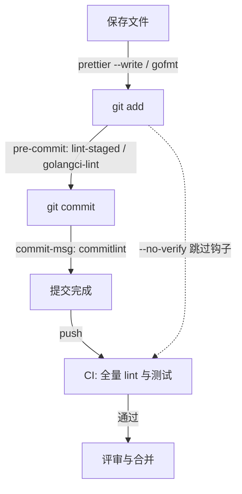

# js/ts 与 go 的代码质量闸门差在哪, 怎样拼成同一条门禁链？

## 常见问题

- 代码检查、格式化、提交信息、Git 钩子分别解决什么问题;
- 装了 Git 钩子, 为什么 CI 还要再跑一遍同样的检查;
- 从改代码到合并, 一条典型的门禁链长什么样;
- 单元, 集成, 端到端测试各自抓什么缺陷;

## 概念索引

- 规则检查: 查语义缺陷与团队约定, 输入源码加配置, 输出问题列表;
- 格式化: 只改排版, 幂等, 没有错误只有 diff;
- 类型检查: 查类型不匹配与缺失字段, Go 由编译器代劳;
- 测试: 让代码真跑, 分单元, 集成, 端到端三层;
- 提交信息: 机器可解析的变更说明, 喂 changelog 与语义化版本;
- 门禁链: 钩子与 CI 越早越便宜地串起各层;

## 一条典型的门禁链链路

| 层 | 做什么 |
| --- | --- | 
| 规则检查 | 代码风格化 lint | 
| 格式化 | 代码格式化 format| 
|类型检查|代码类型静态分析 build|
| 代码测试 | 验证行为 test|
|提交信息|commit/changlog|
| Git 钩子 | husky / lefthook / pre-commit, 语言无关 |

## 类型检查: 独立一步还是编译期？

- 类型: TS 类型只活在编译期, Go 静态类型, 不通过即报错;

## 代码测试: 哪一层能证明代码真的对？

- 层级: 单元抓函数分支与边界, 集成抓模块拼接, 端到端抓真实链路;
- 金字塔: 单元最多, 集成居中, 端到端最少, 倒过来堆端到端就是冰淇淋;

```sh
npx vitest run --coverage        # CI 一次跑全量
go test -race -count=1 -cover ./...   # 查竞态, 关缓存, 出覆盖率
go test -tags=integration ./...  # 隔离慢用例
```

## 工具名录: 两栈各有哪些名字？

| JS/TS | Go | 作用 |
| --- | --- | --- |
| ESLint / oxlint / Biome | golangci-lint | 规则检查 |
| Prettier / oxfmt | gofmt / gofumpt / gci | 格式化与 import 分段 |
| tsc | go vet / staticcheck | 类型与可疑构造 |
| vitest / jest | go test | 跑测试与覆盖率 |
| commitlint | — | 校验提交信息 |
| husky / lint-staged | lefthook / pre-commit | 装钩子, 筛暂存文件 |

## 钩子与 CI: 为什么两处都要跑？

- 本地环境和 CI/CD 运行时环境不同;
- 分工: pre-commit 只查暂存文件, commit-msg 校信息, pre-push 跑测试;
- 预算: 单个钩子压到十秒内, 失败只重跑失败段, 超时就有人 --no-verify 绕过;

## 代价链与典型链路

| 时机 | 反馈 | 修复成本 | 两栈各跑什么 |
| --- | --- | --- | --- |
| 编辑器 | 秒级 | 改当前这一行 | prettier --write / gofmt |
| pre-commit | 几秒 | 改完重新提交 | eslint --fix / golangci-lint run --fix |
| CI | 几分钟 | 修复、推送、等重跑 | 全量 lint 加 vitest / go test -race |
| 评审 | 小时到天 | 人读 diff 再走一轮 | 只看设计与边界 |



- 顺序: 编辑器 < pre-commit < CI < 评审, 越晚越贵;
- 兜底: 钩子拦高频低级错误, CI 不可绕过才叫门禁;

