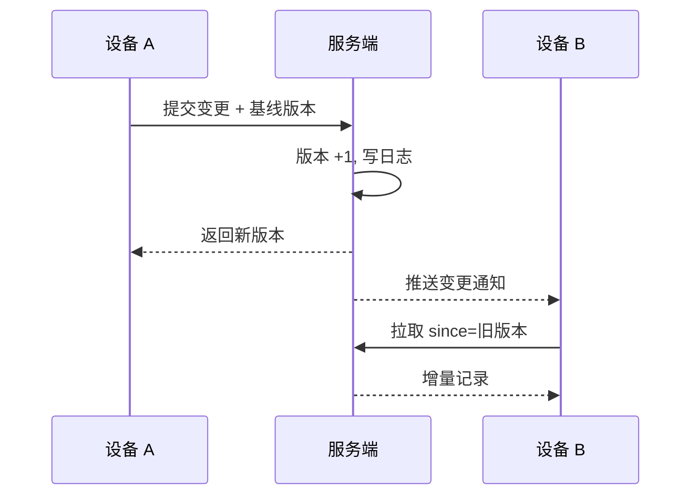

# 前端项目怎样打包发布, 多终端的数据又怎样保持一致？

## 常见问题

- 简述项目打包和发布的流程
- 如何实现多终端同步功能？

## 概念索引

- 产物: 构建后可直接部署的静态文件;
- 内容哈希: 文件名里带内容摘要, 内容变名才变;
- 灰度: 只让一部分用户先访问新版本;
- 回滚: 把流量切回上一个可用产物;
- 增量同步: 只传输发生变化的记录;
- 冲突: 增量同步时同一字段被两端并发写;

## 发布流程有哪些步骤？

- 版本: 用语义化版本或提交 SHA 标识一次发布;
- 构建: 注入环境变量, 静态资源文件名带 contenthash;
- 校验: 检查产物体积预算、sourcemap 是否上传、有无明文密钥;
- 上传: 先传新文件再切入口, 避免用户拿到缺失的资源;
- 灰度: 按用户 ID 或 cookie 分流, 观察错误率与核心指标;
- 回滚: 保留上一版本目录, 切换只改指针, 秒级生效;

## 缓存策略怎么配？

| 资源 | 缓存 | 原因 |
| --- | --- | --- |
| index.html | no-cache | 必须每次校验, 否则拿不到新资源表 |
| JS/CSS | 一年 + immutable | 文件名带 hash, 内容变则 URL 变 |
| 图片字体 | 一年 | 同上, 且体积大适合长缓存 |
| API 响应 | 按业务定 | 需要明确的失效与版本策略 |

- 原则: 入口不缓存, 指纹资源长缓存;
- 陷阱: 只改文件名不加 hash, 用户会长期拿到旧代码;

## 多端同步要解决什么？

- 场景: 同一账号在手机、桌面、网页上看到一致的数据;
- 在线: 一端写入后, 通过 WebSocket 或 SSE 通知其他端;
- 离线: 本地先写队列, 联网后按顺序补传, 每条带客户端生成的 ID;
- 拉取: 各端记录最后同步的版本号, 只拉 `updated_at > 游标` 的记录;
- 幂等: 服务端按客户端 ID 去重, 重传不会产生两条;

## 冲突怎么解决？

| 策略 | 做法 | 适用 |
| --- | --- | --- |
| 后写覆盖 | 比较时间戳取新 | 单人编辑、冲突少 |
| 版本校验 | 提交带基线版本, 不一致则拒绝 | 表单、配置 |
| 字段合并 | 按字段各自取新 | 资料页 |
| CRDT | 数据结构自带合并规则 | 协同编辑、清单 |

- 时间戳: 依赖客户端时钟不可靠, 服务端要重新打时间;
- 拒绝: 冲突时返回冲突字段, 让用户选择而不是静默丢弃;
- 删除: 用墓碑标记而不是直接删行, 否则离线端会复活数据;

## 工程上的边界在哪？

- 一致性: 多端最终一致即可, 强一致会让离线不可用;
- 带宽: 只同步差异, 大文件走对象存储直传;
- 顺序: 同一实体的变更按版本串行应用, 跨实体可并行;
- 安全: 每端都要鉴权, 增量接口不能靠游标越权读他人数据;
