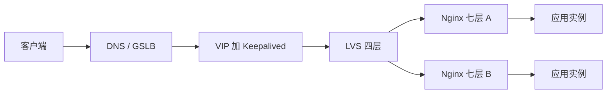

# 负载均衡如何分配流量, 四层与七层有什么区别?

## 常见问题

- 简述常见的负载均衡算法
- 简述在四层和七层网络协议中负载均衡的原理

## 概念索引

- 负载均衡: 把请求分散到多个后端实例;
- 健康检查: 按存活与就绪状态摘除故障实例;
- 分层: L4 按 IP 与端口转发连接, L7 按 URL 与头部路由;
- 轮询: 依次分配, 加权后按容量分配;
- 最少连接: 按当前负载分配;
- 会话亲和: 靠哈希把同一用户固定到同一后端, 是轮询的反面取舍;

## 四层与七层各自转发什么?

| 项 | 四层 L4 | 七层 L7 |
| --- | --- | --- |
| 观察信息 | 源目 IP、端口、连接 | 主机名、路径、Header、Cookie |
| 转发单位 | TCP/UDP 连接 | 单个 HTTP 请求 |
| 是否解密 | 不需要 | 需终止 TLS 才能读内容 |
| 典型实现 | LVS、F5、云 NLB | Nginx、HAProxy、Envoy、云 ALB |
| 开销 | 低, 内核态即可转发 | 高, 要解析与缓冲 |
| 能做 | 连接级分发 | 按路径路由、灰度、改写、限流 |

- 四层: 收到 SYN 后按算法选后端, 后续报文都走这条连接;
- 七层: 读完请求行与头部再决定后端, 可按 URL 路由到不同微服务;
- LVS 的 DR 模式只改 MAC 不改 IP, 回包由后端直接回客户端;
- 选型: 只要连接级分发就用 L4, 要按内容分流就用 L7;

## 常见算法怎么挑?

| 算法 | 依据 | 风险 |
| --- | --- | --- |
| 轮询 | 依次轮转 | 默认各机能力相同 |
| 加权轮询 | 权重比例 | 权重要随容量维护 |
| 随机 / 加权随机 | 概率分配 | 小样本下分布不均 |
| 最少连接 | 活动连接数 | 连接数不等于工作量 |
| 最短响应时间 | 延迟加负载 | 观测滞后, 容易抖动 |
| 源地址哈希 | 客户端 IP | 出口 NAT 后会集中到少数机 |
| 一致性哈希 | 请求键 | 热点键仍压在单机 |

- 平滑加权轮询: 每轮把权重加到当前值, 选最大者再减总权重, 避免连续打同一台;
- 一致性哈希: 键与节点都映射到环上, 节点增减只迁移相邻区间;
- 虚拟节点: 每台机器映射多个环上位置, 缓解数据倾斜;
- 有状态: 会话亲和靠哈希, 但扩缩容与故障时要迁移状态;
- 观测反馈: 用 P99 与错误率校正权重, 比固定权重更能跟上真实负载;

## 入口自身怎么避免成为单点?

- 冗余: 至少两个入口, 主备用 VRRP 漂移 VIP, 双活走 ECMP 或 DNS;
- 健康检查: 只探端口会把半死实例留在池里, 要探业务 readiness;
- 排空: 下线先从注册中心摘除, 等长连接自然结束再停进程;
- 容量: WebSocket 要按连接数与内存估, 不能只用 QPS 换算;
