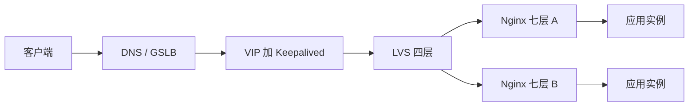

# 负载均衡如何分配流量, 四层与七层有什么区别?

## 常见问题

- 简述常见的负载均衡算法
- 简述在四层和七层网络协议中负载均衡的原理

## 概念索引

- 负载均衡: 把请求分散到多个后端实例;
- 健康检查: 按存活与就绪状态摘除故障实例;
- 分层: L4 按 IP 与端口转发连接, L7 按 URL 与头部路由;
- 轮询: 依次分配, 加权后按容量分配;
- 最少连接: 按当前负载分配;
- 会话亲和: 靠哈希把同一用户固定到同一后端, 是轮询的反面取舍;

## 四层与七层各自转发什么?

| 项 | 四层 L4 | 七层 L7 |
| --- | --- | --- |
| 观察信息 | 源目 IP、端口、连接 | 主机名、路径、Header、Cookie |
| 转发单位 | TCP/UDP 连接 | 单个 HTTP 请求 |
| 是否解密 | 不需要 | 需终止 TLS 才能读内容 |
| 典型实现 | LVS、F5、云 NLB | Nginx、HAProxy、Envoy、云 ALB |
| 开销 | 低, 内核态即可转发 | 高, 要解析与缓冲 |
| 能做 | 连接级分发 | 按路径路由、灰度、改写、限流 |

- 四层: 收到 SYN 后按算法选后端, 后续报文都走这条连接;
- 七层: 读完请求行与头部再决定后端, 可按 URL 路由到不同微服务;
- 选型: 只要连接级分发就用 L4, 要按内容分流就用 L7;

## 常见算法怎么挑?

| 算法 | 依据 | 风险 |
| --- | --- | --- |
| 轮询 | 依次轮转 | 默认各机能力相同 |
| 加权轮询 | 权重比例 | 权重要随容量维护 |
| 随机 / 加权随机 | 概率分配 | 小样本下分布不均 |
| 最少连接 | 活动连接数 | 连接数不等于工作量 |
| 最短响应时间 | 延迟加负载 | 观测滞后, 容易抖动 |
| 源地址哈希 | 客户端 IP | 出口 NAT 后会集中到少数机 |
| 一致性哈希 | 请求键 | 热点键仍压在单机 |

- 平滑加权轮询: 每轮把权重加到当前值, 选最大者再减总权重, 避免连续打同一台;
- 一致性哈希: 键与节点都映射到环上, 节点增减只迁移相邻区间;
- 虚拟节点: 每台机器映射多个环上位置, 缓解数据倾斜;
- 有状态: 会话亲和靠哈希, 但扩缩容与故障时要迁移状态;
- 观测反馈: 用 P99 与错误率校正权重, 比固定权重更能跟上真实负载;

## 入口自身怎么避免成为单点?

| 手段 | 解决哪一层的单点 |
| --- | --- |
| 多 A 记录 + 解析健康检查 | 单台入口机器 |
| 多可用区 + GSLB | 机房、区域级故障 |
| VIP + VRRP 主备 | 同机房单机故障 |
| BGP + ECMP 双活 | 单机容量上限与备机闲置 |

- DNS: 只解析到一家服务商时, 服务商故障等于全站失联, 重要业务配两家;
- 健康检查: 只探端口会把半死实例留在池里, 要探业务就绪;
- 排空: 下线先摘流量, 等长连接自然结束再停进程, 别硬断;
- 容量: conntrack 表、端口范围与文件句柄常比 QPS 先见顶;
- 演练: 主备切换与摘除要真跑过, 没练过的切换等于没有;

## 术语: DNS、VIP、VRRP、ECMP、GSLB 各指什么?

| 术语 | 全称 | 作用 | 关键点 |
| --- | --- | --- | --- |
| DNS | 域名系统 | 把域名解析成 IP, 决定请求先去哪 | 结果被各级缓存, TTL 决定切换速度 |
| VIP | 虚拟 IP | 一组机器共享的地址, 客户端只认它 | 谁持有 VIP 由 VRRP 或 ECMP 决定 |
| VRRP | 虚拟路由冗余协议 | 主备选主, 主机挂了备机接管 VIP | keepalived 实现, 心跳断了会双主 |
| ECMP | 等价多路径 | 同一 VIP 多条路由, 按流哈希分摊 | 单条长连接仍落一台, 粒度是流 |
| GSLB | 全局负载均衡 | 跨机房按地域、延迟、健康选机房 | 多靠智能 DNS, 受缓存拖到分钟级 |

- 分层: DNS 与 GSLB 选机房, VIP 与 VRRP/ECMP 选入口机器, L4 与 L7 选后端实例;
- 关系: VIP 只是一个地址, VRRP 与 ECMP 是持有它的两种办法;
- 取舍: 主备省机器但备机闲置, 双活利用率高但要路由分摊;
- 速度: VRRP 秒级接管, ECMP 等路由收敛, GSLB 受 DNS 缓存影响最慢;