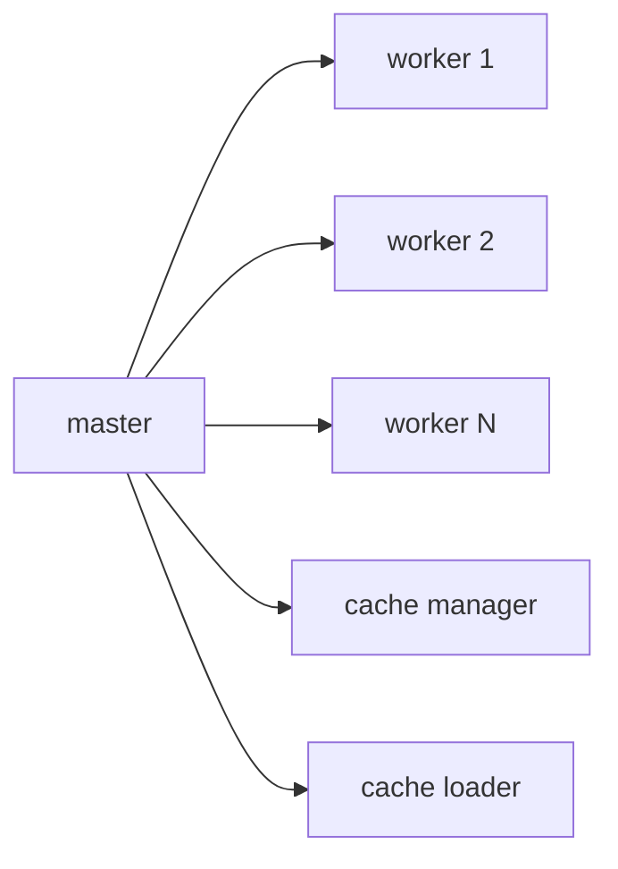

# Nginx 的工作模型是什么, 为什么它性能高?

## 常见问题

- 简述 Nginx 的工作模型，为什么 Nginx 性能如此高？

## 概念索引

- master 进程: 读配置、管 worker、做平滑升级;
- worker 进程: 真正处理连接的进程;
- 事件驱动: 一个进程用 epoll 管上万连接;
- 多路复用: epoll 一次返回就绪 fd, 配合非阻塞 IO 不空等;
- 零拷贝: sendfile 让数据不进用户态;
- 惊群: 多个 worker 抢同一条连接, 是这套模型要额外处理的问题;

## 进程模型是怎样的?



- master: 不处理请求, 只解析配置、fork worker、转发信号;
- worker 数: 一个 CPU 核一个, `worker_processes auto` 即按核数;
- reload: 新 worker 起来接管新连接, 老 worker 处理完存量连接再退出;
- 共享内存: 连接数、限流计数、缓存元数据放在 shared zone, 进程间可见;

## 一个 worker 怎么扛上万连接?

```c
epoll_fd = epoll_create1(0);
epoll_ctl(epoll_fd, EPOLL_CTL_ADD, listen_fd, &ev);
for (;;) {
  n = epoll_wait(epoll_fd, events, MAX_EVENTS, -1);
  for (i = 0; i < n; i++) handle(events[i]);
}
```

- 单线程事件循环: 没有线程创建与切换, 没有锁;
- 每个连接抽象为若干可中断步骤的状态机: 读头部、读体、回源、回写;
- 每连接成本: 一个 fd 加少量内存, 所以连接数上限由 fd 而非线程决定;

### epoll 的事件循环机制

- epoll: fd 注册一次进内核红黑树, 关心的事件类型也一起记住;
- 就绪链表: 内核发现可读可写就把 fd 挂进去, 不等应用来问;
- epoll_wait: 只返回就绪的那几个, 成本与总连接数解耦;
- 空闲时: epoll_wait 不返回，挂起线程, 不占线程也不烧 CPU;

### 这套模型的边界在哪?

- 单核: 一个循环只吃一个核, 多核靠多 worker 加 SO_REUSEPORT;
- 阻塞: 一次同步 DNS、磁盘读或 sleep 会拖住全部连接;
- 密集计算: TLS 握手、压缩、大对象序列化要交给线程池;
- 惊群: 多 worker 同听一个 listen fd, 一个新连接唤醒多个 worker，用 EPOLLEXCLUSIVE 或 reuseport;
- 内核上限: somaxconn、fd 上限与 socket 内存不够时, 改配置也无效;

## 高性能还来自哪些设计?

- 内存池: 按连接与请求分配, 减少 malloc 与 free;
- 连接复用: upstream 配置 keepalive, 省掉反复握手与慢启动;
- 零拷贝: `sendfile on` 让静态文件从页缓存直接进网卡;
- 头部解析: 用长度与首字符先做快速判断, 少做字符串比较;
- 模块裁剪: 编译期只留需要的模块, 减少分支与内存;

## 关键参数怎么配?

| 参数 | 作用 | 经验值 |
| --- | --- | --- |
| worker_processes | worker 数 | auto, 等于核数 |
| worker_connections | 单 worker 连接数 | 1024 到 4096 |
| worker_rlimit_nofile | 进程 fd 上限 | 不低于连接数的两倍 |
| keepalive_timeout | 空闲长连接回收 | 30 到 75 秒 |
| client_max_body_size | 请求体上限 | 按业务设, 默认 1m |

- 最大并发: worker 数乘以 worker_connections;
- 做反向代理时: 每条客户端连接还占一条后端连接, 按除以 2 估算;
- 系统层: 同时调 `ulimit -n` 与 `net.core.somaxconn`, 否则配置改了也无效;
- 瓶颈判断: 只做静态资源时, 通常先撞带宽而不是连接数;
