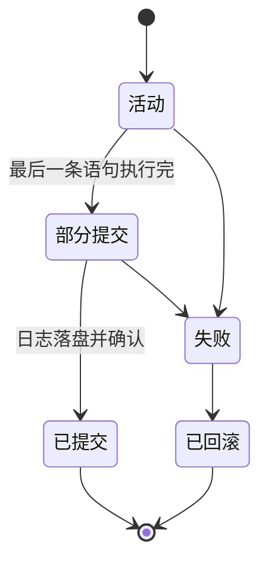

# 数据库事务是什么，为什么 MySQL 默认用 InnoDB？

## 常见问题

- 什么是数据库事务，MySQL 为什么会使用 InnoDB 作为默认选项
- 简述数据库中的 ACID 分别是什么？
- 简述事务的四大特性
- 简述数据库事务复制原理

## 概念索引

- 事务: 一组操作共享同一个提交边界;
- ACID: 事务对外承诺的四条性质;
- InnoDB: MySQL 默认的事务型存储引擎;
- 事务复制: 按事务边界把变更投递到副本, 是 ACID 跨节点的延伸;

## 事务解决了什么问题？

- 转账例子: 扣款与入账两步更新, 只能一起生效;
- 提交边界: 事务内的修改要么全部可见, 要么全部不可见;
- 隔离: 并发事务看不到对方未提交的中间状态;
- 边界: 发短信、调用外部支付不会被数据库回滚;
- 保存点: `SAVEPOINT` 支持局部回滚, 但它不是嵌套事务;

## ACID 各自由什么机制保证？

| 性质 | 含义 | 实现手段 |
| --- | --- | --- |
| 原子性 A | 修改一起生效或一起撤销 | undo log 反向回滚 |
| 一致性 C | 提交前后满足已定义约束 | 主键、唯一、外键、检查约束加应用校验 |
| 隔离性 I | 并发事务互相干扰受限 | 锁加 MVCC, 由隔离级别决定强度 |
| 持久性 D | 已确认提交在故障下不丢 | redo log 先写日志再刷数据页 |

- 措辞: 事务四大特性就是 ACID, 中英文只是同一组性质;
- 一致性: 数据库只执行写出来的约束, 业务规则漏写不能靠 ACID 补足;
- 顺序: 先记日志再改页, 是持久性与崩溃恢复的前提;

## 事务的生命周期怎么走？

- 活动: 正在执行读写与约束校验;
- 部分提交: 语句跑完, 落盘工作尚未全部确认;
- 失败: 约束冲突、死锁或磁盘错误让事务无法沿原路提交;
- 回滚不等于没发生: 自增值与外发消息都不会退回;

## MySQL 为什么默认用 InnoDB？

- 版本: 从 5.5 起 InnoDB 取代 MyISAM 成为默认引擎;
- 事务: 只有它提供完整事务与崩溃自动恢复;
- 并发: 行锁加 MVCC, 读写不互相阻塞到表级;
- 外键: 支持 `FOREIGN KEY` 引用完整性约束;
- 聚簇索引: 主键即数据, 主键查询少一次跳转;
- 代价: 内存与磁盘占用更大, 全表扫描不如 MyISAM 轻;

## 事务复制是怎么走的？

- 定义: 主库把已提交事务按事务边界写入 binlog, 副本重放;
- 线程: 主库 dump 线程读 binlog, 副本 I/O 线程写 relay log;
- 重放: 副本的 SQL 线程按事务顺序执行 relay log;
- 原子性: 一个事务在 binlog 中以 `BEGIN` 到 `COMMIT` 整体记录;
- 同步程度: 异步不等副本, 半同步要等一个副本写盘, 用延迟换少丢事务;
- 手册: 线程与复制流程见 [复制实现](https://dev.mysql.com/doc/refman/8.0/en/replication-implementation.html), 日志分工见 [二进制日志](https://dev.mysql.com/doc/refman/8.0/en/binary-log.html);