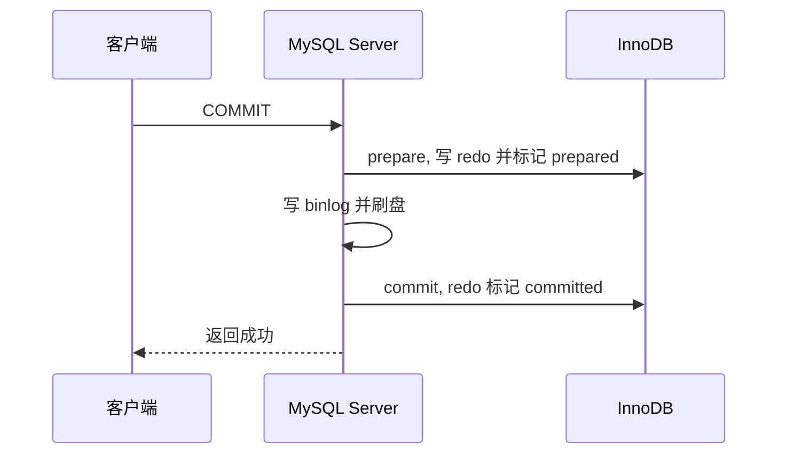

# redo log、undo log 与 binlog 各解决什么问题？

## 常见问题

- 简述 MySQL 三种日志的使用场景
- 简述 undo log 和 redo log 的作用

## 概念索引

- redo log: 记录数据页改动的物理日志, 保证崩溃可恢复;
- undo log: 记录行的旧版本, 支撑回滚与快照读;
- binlog: 记录逻辑变更, 用于复制与按时间点恢复;
- WAL: 先写日志再刷数据页;
- 两阶段提交: 让 binlog 与 redo log 的提交结果一致;
- 崩溃恢复: 用 redo 补已提交的页, 用 undo 撤未提交的事务;

## 三种日志分别记什么？

| 日志 | 归属 | 内容 | 用途 |
| --- | --- | --- | --- |
| redo log | InnoDB | 数据页的物理改动 | 崩溃恢复、WAL |
| undo log | InnoDB | 行的旧版本与回滚信息 | 回滚、MVCC |
| binlog | Server 层 | 语句或行级变更事件 | 复制、PITR、审计 |

- 区别: 前两个属于引擎, binlog 属于整个实例, 所有引擎共用;
- 顺序: 事务提交先写 redo 与 binlog, 数据页随后异步刷盘;
- 分工: redo 保已提交不丢, undo 保未提交可撤, binlog 保变更可重放;

## redo log 为什么能保证持久性？

- WAL: 改页前先顺序追加日志, 比随机刷页便宜得多;
- 循环写: 日志文件环形复用, 容量可按需配置, 写满后从头覆盖;
- 检查点: 已刷盘的页对应日志可被覆盖, 刷盘慢就会把日志写满;
- 恢复: 重启时重放检查点之后的 redo, 把已提交改动补回;
- 版本: 8.0.30 之前固定两个日志文件, 之后改由 `innodb_redo_log_capacity` 管理;

## undo log 有什么用？

- 回滚: 事务失败或执行 `ROLLBACK` 时按 undo 反向执行;
- 版本链: 每行带回滚指针, 指向 undo 里的旧版本;
- 一致性读: 快照读靠 undo 重建可见版本;
- 回收: 没有快照再需要时由 purge 线程清理, 空间才能复用;
- 风险: 长事务让 undo 无法清理, 回滚段与表空间持续膨胀;

## binlog 记什么，有哪几种格式？

- 内容: 语句或行级变更, 按事务边界整体写入;
- 格式: `STATEMENT` 记 SQL, `ROW` 记行的前后镜像, `MIXED` 自动选;
- 刷盘: `sync_binlog=1` 每次提交都同步, 最安全也最慢;
- 保留: 过期时间与容量都要设, 否则磁盘会被写满;
- 用途: 主从复制、按时间点恢复、数据订阅与审计;

## 两阶段提交怎么走？

- 崩在 binlog 之前: 事务未完成, 重启用 undo 回滚;
- 崩在 binlog 之后: binlog 完整, 重启时按 binlog 补提交;
- 目的: 主库数据与 binlog 一致, 副本不会多一个或少一个事务;
- 前提: InnoDB 默认开启 XA 两阶段提交, 保证两者同步;

## 日志相关的常见故障有哪些？

- 磁盘涨: binlog 没设过期时间, 或者副本长期延迟;
- 写变慢: 刷盘策略过严, 或日志空间不足触发强制检查点;
- 恢复慢: redo 太多, 或长事务留下巨大的 undo;
- 复制断: binlog 被提前清理, 副本找不到位点;
- 手册: 机制见 [redo 日志](https://dev.mysql.com/doc/refman/8.0/en/innodb-redo-log.html), [undo 日志](https://dev.mysql.com/doc/refman/8.0/en/innodb-undo-logs.html) 与 [二进制日志](https://dev.mysql.com/doc/refman/8.0/en/binary-log.html);