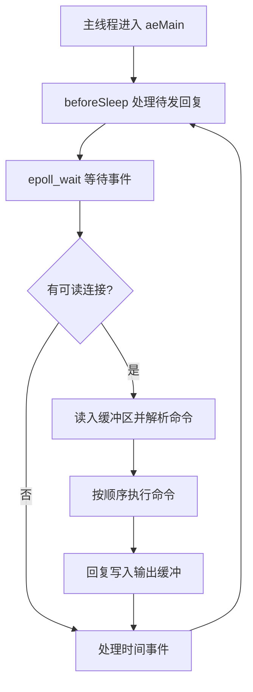

# 为什么 Redis 单线程还这么快, 它的线程模型是怎样的？

## 常见问题

- 为什么 Redis 在单线程下能如此快？
- 简述 Redis 的线程模型以及底层架构设计
- 简述 Redis 的通信模型

## 概念索引

- 单线程: 命令的执行由主线程串行完成;
- 事件循环: 用 IO 多路复用驱动读写与定时任务;
- IO 线程: 6.0 起把读写与协议解析分摊到多个线程;
- 命令队列: 主线程按顺序取事件处理, 天然无锁;
- pipeline: 一次发送多条命令, 省掉每条命令的往返;
- 慢命令: 排在队列里的命令只能等, 一条慢命令拖住整条流水线;

## 单线程到底指哪部分？

- 执行单线程: 命令的解析与执行只在主线程里跑;
- IO 线程: 6.0 起读写 socket 与协议解析可以多线程;
- 后台线程: 关闭文件、惰性释放、AOF fsync 用 bio 线程;
- 子进程: bgsave 与 AOF 重写靠 fork 出来的进程;
- 独立进程: 哨兵与集群节点各自是独立进程;
- 结论: 单线程指的是命令执行这一层;

## 为什么单线程还能这么快？

- 纯内存: 绝大多数命令不碰磁盘, 延迟在微秒级;
- 无锁: 单线程执行, 不需要加锁, 也没有线程切换开销;
- IO 多路复用: 一个线程用 epoll 管住上万连接;
- 结构高效: SDS、listpack、跳表都为常见操作做了优化;
- 命令够轻: 单条命令的 CPU 时间短, 调度开销占比低;
- 代价: 速度上限就是单核, 且会被慢命令拖住;

## 事件循环是怎么跑的？



- 文件事件: 连接可读可写时触发, 对应客户端请求;
- 时间事件: 定期任务, 如过期扫描与持久化检查;
- 顺序: 单个事件循环内命令按到达顺序执行, 不会交叉;
- 输出缓冲: 回复先攒着, 事件循环末尾统一写出去;

## 6.0 的 IO 多线程怎么开？

```text
io-threads 4
io-threads-do-reads yes
```

- threads 只分担读 socket、解析与写 socket, 命令仍串行;
- 建议: 四核用 2 到 3 个, 八核用 6 个, 再加线程收益就低了;
- 不能热改: io-threads 只能改配置文件重启生效, 参数说明见 [redis.conf](https://github.com/redis/redis/blob/7.2/redis.conf);
- 限制: 开 TLS 时该特性不可用;
- 判断: 单核打满且网络是瓶颈才值得开;

## 通信模型是什么样的？

```text
client: *3\r\n$3\r\nSET\r\n$1\r\nk\r\n$1\r\nv\r\n
server: +OK\r\n
```

- RESP: 长度前缀加类型字符, 解析简单, `telnet` 就能手工发;
- 请求响应: 默认一问一答, 客户端要等回复再发下一条;
- pipeline: 批量发多条再统一收, 省掉每条的往返;
- 输出限制: 慢客户端会撑大缓冲, 用 client-output-buffer-limit 兜底;
- 订阅连接: 进入订阅后只能收推送, 不能发普通命令;

## 单线程带来哪些限制？

- 慢命令: `KEYS`、大集合的 `SMEMBERS` 会卡住全部请求;
- 大 key: 删除或迁移大 key 要占主线程时间, 4.0 起可用 UNLINK 异步释放;
- fork 停顿: 持久化与全量同步时 fork 会短暂阻塞;
- 单核上限: 吞吐上不去时先看分片, 而不是无限加 IO 线程;
- 排查: 用 SLOWLOG 与 LATENCY 找阻塞源;
