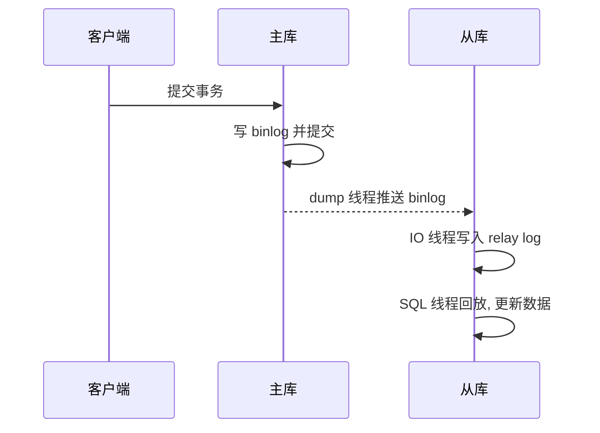

# MySQL 的主从复制怎么工作, 读写分离后怎么保证数据一致？

## 常见问题

- 简述 MySQL 的主从同步机制，如果同步失败会怎么样？
- 数据库的读写分离的作用是什么？如何实现？
- 简述主从复制以及读写分离的使用场景
- 如何解决主从不一致的问题？

## 概念索引

- binlog: 主库按顺序记录变更的日志;
- dump 线程: 主库按位点把 binlog 推给从库;
- relay log: 从库先把收到的日志落到本地;
- 回放线程: 从库按顺序应用 relay log 改数据;
- 复制延迟: 从库落后主库的位点与时间差;
- 半同步: 至少一个从库确认收到, 主库才回成功;
- 读写分离: 架在半同步或异步复制之上, 写走主库读走从库;

## 复制链路是怎么走的？



- 主库两个动作: 提交本地事务, 再把 binlog 发给从库;
- 从库两个线程: IO 线程收日志, SQL 线程回放日志;
- 位点: binlog 文件名加偏移量, 决定从哪里接着传;
- GTID: 每个事务有全局编号, 切换主库时不必算位点;
- 并行回放: 多线程按库或按组提交回放, 减少延迟;

## 同步模式有哪几种？

| 模式 | 主库何时回成功 | 风险 |
| --- | --- | --- |
| 异步 | 本地提交完就回 | 主库崩溃会丢未传出的日志 |
| 半同步 | 至少一个从库确认收到 | 从库全挂时退化成异步或阻塞 |
| 全同步 | 所有从库应用完 | 延迟高, 少用 |
| 组复制 | 多数派确认后提交 | 部署与运维复杂 |

- 半同步: 确认的是写进 relay log, 不是已经回放;
- 超时参数: rpl_semi_sync_master_timeout 到了就退回异步;
- 一致性代价: 越强的确认, 写延迟越高;

## 同步失败了会怎样？

- 网络抖动: IO 线程自动重连, 从 relay log 断点续传;
- 主键冲突 1062: SQL 线程停下, 通常是双写或人工改过从库;
- 记录不存在 1032: 从库缺数据, 回放不下去;
- 日志被清: 主库 purge 掉了旧 binlog, 只能全量重建;
- 磁盘写满: 从库直接停, relay log 写不进去;
- 定位: 看 `SHOW REPLICA STATUS` 的两个 Running 与 Last_Error;

```sql
SHOW REPLICA STATUS\G
-- Replica_IO_Running / Replica_SQL_Running 都为 Yes 才算正常
-- 关注 Seconds_Behind_Source 与 Last_SQL_Error
```

- 跳过: 用 GTID 或 sql_slave_skip_counter 只能救急, 会留下数据差异;
- 重建: 用备份加位点重新 CHANGE REPLICATION SOURCE, 最稳;

## 读写分离怎么实现？

- 作用: 把只读查询分散到从库, 主库专心承担写入;
- 中间件: ShardingSphere-Proxy、MyCat、ProxySQL 在代理层路由;
- 客户端: 数据源路由组件按注解或方法名区分读写;
- 事务内: 同一事务里的读也走主库, 避免读到未提交前的旧值;
- 强制走主: 写后立刻要读的场景用 hint 覆盖路由;
- 前提: 从库延迟可接受, 否则分离出来的读会读到旧数据;

## 主从不一致怎么解决？

- 半同步: 缩小丢失窗口, 但不能保证从库已回放;
- 读己之写: 写完的一段时间内把该用户读请求打到主库;
- 位点等待: 记下写事务的 GTID, 读之前等从库追上;
- 关键读走主: 余额、库存这类判断不要依赖从库;
- 缓存配合: 缓存与数据库的一致性另有专门做法, 这里不展开;
- 监控: 延迟突增时自动摘除从库, 避免把旧数据放大;

## 什么场景该用主从与读写分离？

- 读多写少: 查询占八九成时收益最明显;
- 备份与报表: 在从库跑重查询, 不打扰主库;
- 高可用: 配合切换工具, 主库故障时提升从库;
- 异地多活: 组复制或多主, 但要处理写冲突;
- 反例: 写瓶颈与单表过大, 加从库解决不了, 要考虑分片;

## 复制、备份与分片是什么关系？

- 复制: 同一份数据存多份, 解决读扩展与故障接管;
- 备份: 保存历史恢复点, 误删也能救, 复制救不了误删;
- 分片: 不同数据分开放, 解决单机容量与写入瓶颈;
- 混用: 每个分片内部再做一主多从, 是常见组合;
