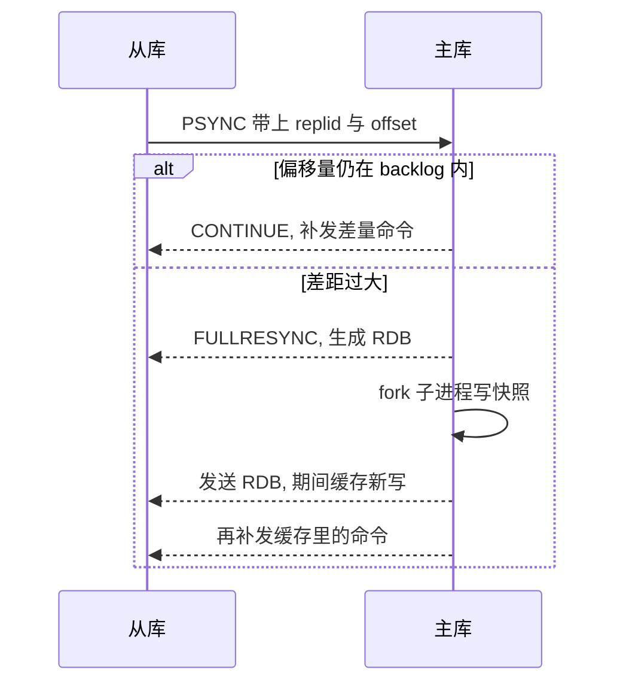
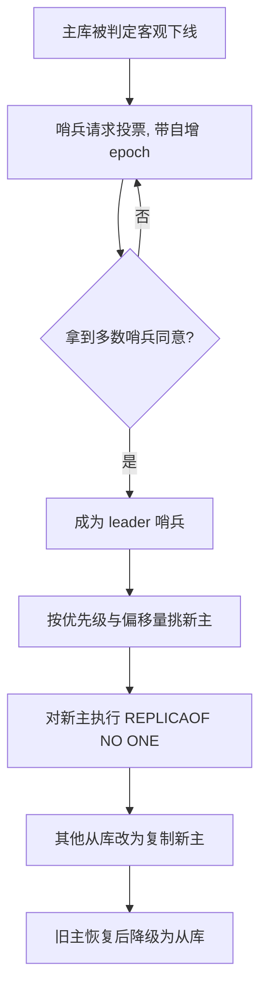

# Redis 如何实现高可用, 哨兵与集群有什么区别？

## 常见问题

- 简述 Redis 的哨兵机制
- 简述 Redis 集群配置以及基础原理
- Redis 如何实现高可用？
- Redis 中，sentinel 和 cluster 的区别和适用场景是什么？
- 简述 Redis 哨兵的选举过程
- Redis 如何实现主从同步？
- 假设 Redis 的 master 节点宕机了，你会怎么进行数据恢复？

## 概念索引

- 主从复制: 一主多从, 异步传播写命令;
- 部分重同步: 断线后按偏移量补发差量;
- 哨兵: 独立进程负责监控、选主与切换;
- 客观下线: 足够多哨兵一致认为主库不可用;
- 槽: 集群把键空间切成 16384 份分给主库;
- 集群故障转移: 从库拿到多数主库投票后接管槽;
- 数据恢复: 故障转移之后的下一步, 先确认丢了多少写再补数据;

## 主从同步是怎么做的？



- replid: 数据集历史的标识, 切换主库后会变, 变了就只能全量;
- offset: 复制流的字节偏移, 决定从哪里补;
- backlog: 固定大小的环形缓冲, 默认 1 MB, 太小时只能全量;
- 无盘复制: repl-diskless-sync 直接走 socket, 省一次落盘;
- 异步: 默认不等待从库确认, 需要时可显式 WAIT;

## 哨兵是怎么监控和判断故障的？

```text
sentinel monitor mymaster 10.0.0.1 6379 2
sentinel down-after-milliseconds mymaster 5000
```

- 三条通道: 每秒 PING、每两秒走发布订阅、每十秒 INFO 拉拓扑;
- 主观下线: 单个哨兵在超时时间内没收到有效回复;
- 客观下线: 同意下线的哨兵数达到 quorum, 才认定主库真的挂了;
- quorum 只用于判活, 不参与决定谁来做切换;
- 重要区分: 判活用 quorum, 执行切换用多数票;

## 哨兵的选举与切换过程是什么？



- leader: 只有一个哨兵执行切换, 靠 epoch 保证同一轮只有一票;
- 挑新主: 先比 replica-priority, 再比复制偏移量, 最后比 runid;
- 客户端: 从哨兵查询当前主库地址, 感知不到切换细节;
- 旧主: 恢复后会被改成从库, 期间写入的数据可能冲突;
- 限制: 哨兵不解决容量, 数据仍在一台主库上;

## 集群是怎么分片的？

```text
slot = CRC16(key) mod 16384
集群最少 3 主 3 从, 每主负责一部分槽
访问错节点返回 -MOVED 16384 10.0.0.2:6379
迁移中返回 -ASK, 客户端先发 ASKING 再请求
```

- 槽位: 固定 16384 个, 节点用位图声明自己负责哪些;
- 代理: 集群无代理, 客户端缓存槽表, 按 MOVED 纠偏;
- hash tag: `{user1001}` 里的内容参与计算, 让相关键落在同一槽;
- 总线: 节点间用 gossip 交换状态, 端口默认是服务端口加 10000;
- 限制: 多键命令要求所有键在同一槽, 跨槽事务不可用;

## 集群的故障转移靠什么？

- 判定: 多数主库都标记某主库 pfail 后转成 fail, 才算真挂;
- 投票: 需要 size/2+1 个有槽主库支持, 从库才能晋升;
- 选择: 复制偏移量最大、数据最新的从库优先;
- 参数: cluster-node-timeout 决定多久算失联;
- 覆盖: cluster-require-full-coverage 为 no 时, 缺槽仍可服务其余键;
- 风险: 异步复制下, 已确认的写可能还没到从库;

## 哨兵与集群怎么选？

| 项 | 哨兵 | 集群 |
| --- | --- | --- |
| 解决的问题 | 故障自动切换 | 分片加故障切换 |
| 数据量 | 单机内存装得下 | 超过单机内存 |
| 写入吞吐 | 受单主库限制 | 多主库并行写 |
| 客户端 | 普通客户端即可 | 需支持集群协议 |
| 运维 | 简单 | 槽迁移与扩容更复杂 |
| 适用 | 中小规模、要简单 | 大容量、高并发 |

## master 宕机后怎么恢复数据？

- 有高可用: 哨兵或集群自动切换, 先看日志确认切换是否成功;
- 算损失: 对比新旧主库偏移量, 估算未同步的写命令条数;
- 有持久化: 用最近 RDB 加 AOF 起的实例, 尾部残缺用 redis-check-aof 修;
- 无持久化: 只能从旧主磁盘抢救内存快照, 或从业务库回灌;
- 防再发: 开 AOF everysec、加从库、必要时用 WAIT 等确认;
- 复盘: 丢的数据按业务补偿, 不能直接接受静默丢失;

## 三种方案怎么叠加？

- 复制: 保副本, 是哨兵与集群的共同底座;
- 哨兵: 保切换, 不改数据分布;
- 集群: 保容量, 自带切换, 不再需要哨兵;
- 结论: 三者是叠加与替代并存, 选型先看容量再看运维;
