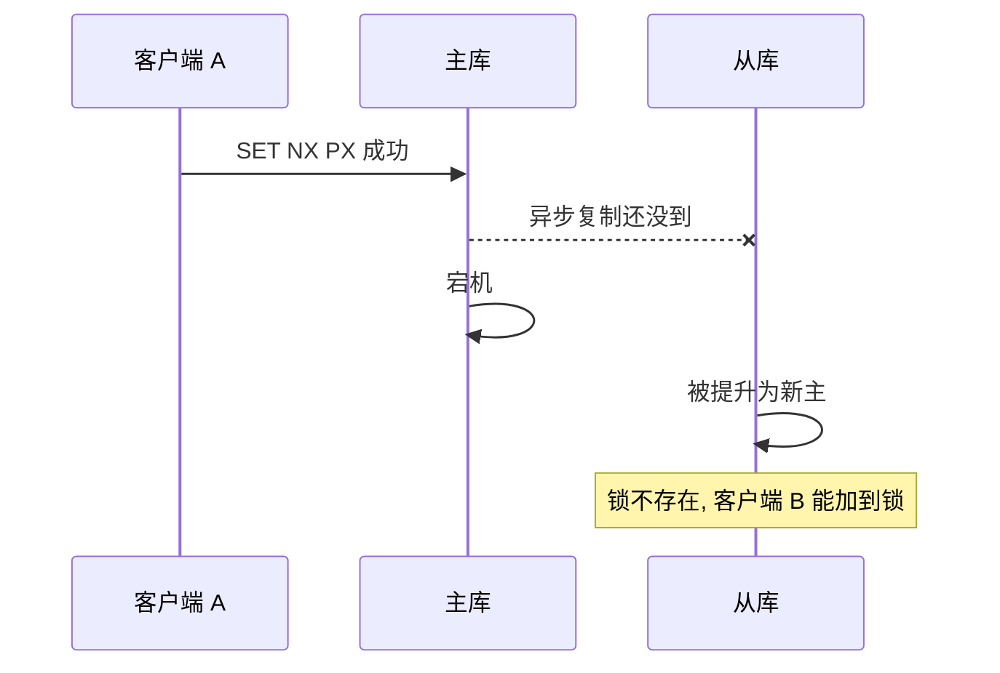

# Redis 如何实现分布式锁？

## 常见问题

- Redis 如何实现分布式锁？

## 概念索引

- 加锁: 用一条 SET 原子完成互斥与过期;
- 唯一令牌: 值是请求标识, 保证只有持锁者能释放;
- 释放脚本: 比对令牌再用 Lua 删除, 避免误删;
- 续期: 到期前延长 TTL, 防止业务没跑完锁就没了;
- 主从切换: 主库没同步就宕机, 同一把锁可能出现两个持有者;
- fencing token: 主从切换丢锁的兜底, 让下游拒绝过期持有者;

## 最小的正确写法是什么？

```text
SET lock:order:1001 <token> NX PX 30000
```

- NX: 键不存在才设置, 这就是抢锁;
- PX 30000: 同时设 30 秒过期, 防止持有者崩溃后死锁;
- 必须是同一条命令: 先 SETNX 再 EXPIRE 中间可能崩, 锁就没有过期时间;
- 值用随机 token: 例如 UUID, 不要用固定字符串;
- 失败返回空: 客户端按业务决定重试还是快速失败;

```java
String token = UUID.randomUUID().toString();
String ok = jedis.set("lock:order:1001", token, SetParams.setParams().nx().px(30_000));
if (!"OK".equals(ok)) {
    throw new BusyException("锁被占用");
}
```

## 为什么释放必须用 Lua？

```lua
if redis.call("GET", KEYS[1]) == ARGV[1] then
  return redis.call("DEL", KEYS[1])
else
  return 0
end
```

- 问题: 先 GET 比对再 DEL 是两步, 两步之间锁可能已过期并被别人拿到;
- 解决: Lua 在服务端原子执行, 比对与删除不会被打断;
- 令牌: 只有自己的 token 匹配才删, 避免删掉别人的锁;
- 注意: 脚本要短, 大脚本会阻塞单线程;

## 业务没跑完锁过期了怎么办？

- 估算 TTL: 过期时间要大于正常执行时间, 留出余量;
- 续期: 后台线程在 TTL 的三分之一处延长, 业务结束后停止;
- Redisson 看门狗: 默认 30 秒过期, 每 10 秒续一次, 直到 unlock;
- 别续太久: 续期掩盖了卡死, 要设最大续期次数;
- 兜底: 无论如何都可能过期, 关键写操作要有幂等或版本校验;

## Redisson 还额外做了什么？

- 可重入: 用 hash 存 token 与重入次数, 同线程再次加锁只加计数;
- 等待策略: 基于发布订阅的阻塞等待, 避免空轮询;
- 公平锁: 用队列维护等待顺序, 减少饥饿;
- 联锁与红锁: 一次锁多个键, 或对多个独立主库多数派加锁;
- 代价: 封装越厚, 越要看清它到底保证到哪一层;

## 为什么主从切换会丢锁？



- 根因: 复制是异步的, 加锁成功不等于已落到从库;
- 缓解: WAIT 命令等从库确认, 但会增加延迟且不保证切换时仍成立;
- 红锁: 对 5 个独立节点多数派加锁, 仍受时钟与进程暂停影响, 有争议;
- 争议: 见 [Kleppmann 对 Redlock 的分析](https://martin.kleppmann.com/2016/02/08/how-to-do-distributed-locking.html);

## 什么时候不该用 Redis 锁？

- 强一致场景: 金融扣减这类操作, 用数据库唯一约束或行锁更可靠;
- 长事务: 持锁时间远超 TTL 时, 续期与 fencing 都很难做对;
- 需要严格互斥: ZooKeeper 临时顺序节点或 etcd 租约更稳;
- 只是防重复: 幂等键加唯一索引, 比分布式锁简单;
- 组合用法: 锁只减少并发, 真正的正确性交给 fencing token 与幂等;

## 落地时要检查哪些点？

- 加锁与设过期是一条命令;
- 值是唯一 token, 释放走 Lua 比对;
- TTL 有上限, 续期有退出条件;
- 关键路径带版本号或幂等键, 不假设锁绝对可靠;
