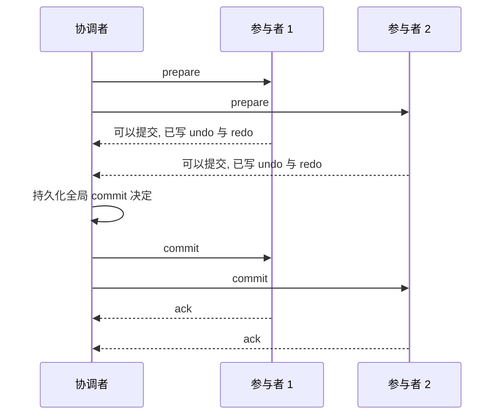

# 两阶段提交是怎么做的, 它为什么会阻塞？

## 常见问题

- 简述什么是两阶段提交？

## 概念索引

- 分布式事务: 一个业务动作要改多个数据库;
- 协调者: 收集参与者投票并作出最终决定;
- 准备阶段: 参与者确认能提交并锁定资源;
- 提交阶段: 按全局决定真正提交或回滚;
- 阻塞: 参与者投赞成票后只能等协调者;
- 补偿事务: 为避开阻塞而放弃原子提交, 改用反向操作事后修复;

## 为什么跨库提交这么难？

- 单库: 一条日志就能保证原子性与崩溃恢复;
- 跨库: 参与者可能崩溃, 网络可能丢消息;
- 不确定态: 参与者超时了, 却不知道别人是否已提交;
- 目标: 所有参与者作出同一个提交决定;
- 两种路线: 原子提交协议, 或分步提交后补偿;

## 两个阶段分别做什么？



- 准备: 参与者执行事务但不提交, 记录 undo 与 redo 并锁定资源;
- 投票: 全部赞成才提交, 任一反对或超时就中止;
- 决定: 协调者把 commit 或 abort 写进自己的日志, 这一步是分界点;
- 完成: 参与者按决定提交或回滚, 然后释放锁;
- 恢复: 参与者重启后向协调者询问缺失的决定;

## 为什么会阻塞？

- 已准备: 参与者投了赞成票, 资源被锁住, 自己不能单方面提交或回滚;
- 协调者失联: 参与者只能一直等, 锁和连接都被占着;
- 同步复制: 协调者日志写成功前, 谁都不敢动作;
- 最坏情况: 协调者持久化后崩溃且日志丢失, 全体卡死;
- 影响: 长事务会放大阻塞, 拖垮连接池与吞吐;

## 三阶段提交能解决问题吗？

```text
canCommit -> preCommit -> doCommit
多一个预提交阶段, 让参与者知道大家都已通过检查
```

- 改进: 参与者超时后可按预设策略继续提交, 缩短不确定期;
- 前提: 依赖同步网络与有限延迟, 分区下给出的保证会减弱;
- 现实: 仍不能同时满足原子性与不停机;
- 结论: 多一阶段不是免费的高可用;

## 生产上更常用什么？

| 方案 | 思路 | 代价 |
| --- | --- | --- |
| 本地消息表 | 业务与消息同库提交, 定时投递并重试 | 最终一致, 要幂等 |
| 事务消息 | 先发半消息, 本地提交后再确认 | 依赖消息中间件 |
| Saga | 每步本地事务, 失败执行补偿 | 中间态可见, 要写补偿 |
| TCC | 预留、确认、取消三段 | 侵入业务, 幂等与空回滚要处理 |

- 选择: 强一致要求极高且能忍受延迟才用 2PC;
- 常规做法: 拆小事务, 用最终一致加幂等与对账;
- 关键点: 补偿动作本身也要能重试, 失败要有兜底入口;

## 两阶段提交和数据库内的事务是什么关系？

- 范围不同: 2PC 是跨资源的协议, 单库事务靠本地日志;
- 复用: MySQL 的 XA 就是在 2PC 之上实现的;
- 代价: XA 事务期间锁住行, 长事务会阻塞其他写入;
- 监控: 要盯住处于 prepared 状态的事务数量与耗时;
