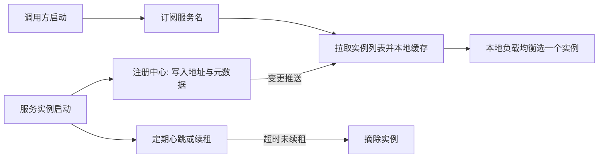
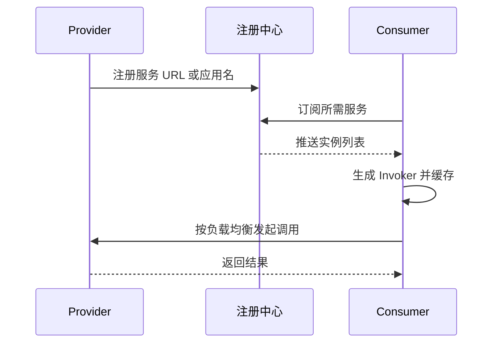
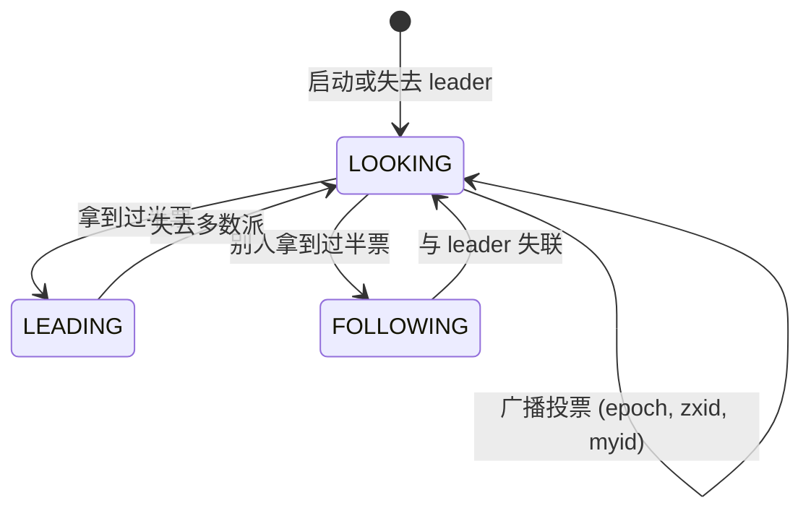

# 服务发现怎么实现, ZooKeeper 又凭什么当注册中心？

## 常见问题

- 有哪些实现服务发现的方法？
- 微服务中如何实现服务发现
- 简述 Dubbo 服务注册与发现的过程
- 简述 Zookeeper 基础原理以及使用场景
- 简述 ZooKeeper 选举机制

## 概念索引

- 服务注册: 实例启动后把地址写进注册中心;
- 服务发现: 调用方拿到可用实例列表并选一个;
- 客户端发现: 调用方自己选实例, 进程内做负载均衡;
- 服务端发现: 由网关或代理选实例, 调用方只认一个入口;
- 健康检查: 心跳或探活不通过的实例被摘除;
- znode: ZooKeeper 树上的节点, 兼作存储与通知单位;
- 过半写: znode 的写要多数节点确认, 所以只适合小体量元信息;

## 有哪几种服务发现方式？

| 方式 | 谁来选实例 | 优点 | 缺点 |
| --- | --- | --- | --- |
| DNS | 客户端按返回顺序 | 通用, 无需 SDK | 缓存导致摘除慢 |
| 客户端发现 | 调用方 | 少一跳, 灵活 | 每种语言都要 SDK |
| 服务端发现 | 网关或代理 | 调用方简单 | 多一跳, 代理要冗余 |
| 配置下发 | 配置中心 | 可灰度可管控 | 变更要推送通道 |

- 组合: 注册中心存列表, 客户端或代理负责选实例;
- DNS 边界: 普通轮询不带健康检查, 托管 DNS 可以额外做探活;

## 微服务里怎么落地？



- 注册: 写服务名、IP、端口、版本、权重与机房等元数据;
- 保活: 心跳或租约, 超时没有续租就视为下线;
- 订阅: 拉取全量加监听增量, 本地缓存避免每次调用都问注册中心;
- 下线: 先摘流量再注销, 避免请求打到正在关闭的实例;
- 兜底: 注册中心不可用时用本地缓存继续调用;

## Dubbo 的注册与发现怎么走？



- 接口级: 2.x 把带参数的 URL 全量注册, 实例多时数据量大;
- 应用级: 3.x 按应用注册, 元数据单独存, 规模更省;
- 变更: 注册中心推送后, Consumer 在本地刷新 Invoker 列表;
- 容错: 注册中心挂了不影响已有调用, 只是拿不到新实例;
- 治理: 路由规则、权重与超时都通过注册中心下发;

## ZooKeeper 的基本原理是什么？

```text
/
├── app
│   ├── provider-0000000001   临时顺序节点
│   └── provider-0000000002
└── config
    └── db.url                 持久节点
```

- 数据模型: 树形 znode, 每个节点存少量数据, 单节点上限 1 MB;
- 节点类型: 持久、临时、顺序, 临时节点随会话消失;
- 会话: 客户端与服务器保持 session, 超时后临时节点被删除;
- watch: 一次性通知, 触发后要重新注册;
- 写: 由 leader 提出, 过半 follower 落盘后返回成功;
- 读: 任意节点可读, 可能读到旧值, 需要时用 sync 追平;

## ZooKeeper 怎么选主？



- 投票内容: 逻辑时钟 epoch、事务号 zxid、服务器 id;
- 优先规则: 先比 zxid 大的, 相同再比 myid 大的;
- 过半: 票数超过总节点一半才当选, 避免两个 leader;
- epoch: 每轮选举自增, 防止旧 leader 的消息被当成新提议;
- 部署: 用奇数台, 3 台容 1 台, 5 台容 2 台;
- 恢复: 新 leader 先同步数据, 再对外提供服务;

## ZooKeeper 适合什么、不适合什么？

- 适合: 配置中心、命名服务、选主、分布式锁、集群成员管理;
- 适合: 读多写少、数据量小、要求强一致的元数据;
- 不适合: 高频写, 每次写都要过半确认, 吞吐有上限;
- 不适合: 海量数据, 全量常驻内存, 节点数也有压力;
- 不适合: 当普通数据库或消息队列用;
- 替代: 大规模服务发现常用 Nacos、Eureka, 选主也可用 etcd;

## 注册中心怎么选？

| 产品 | 一致性 | 特点 |
| --- | --- | --- |
| ZooKeeper | CP | 强一致, 写慢, 要自己处理会话 |
| Eureka | AP | 自我保护, 短时间容忍旧列表 |
| Nacos | 可切换 | 支持 AP 与 CP, 兼顾配置中心 |
| Consul | CP | 带健康检查与多数据中心 |
| etcd | CP | Raft, 常用于 Kubernetes |

- 服务发现偏 AP: 宁可拿到稍旧的列表, 也不要整体不可用;
- 配置与选主偏 CP: 宁可短暂不可用, 也不能读到错的值;
