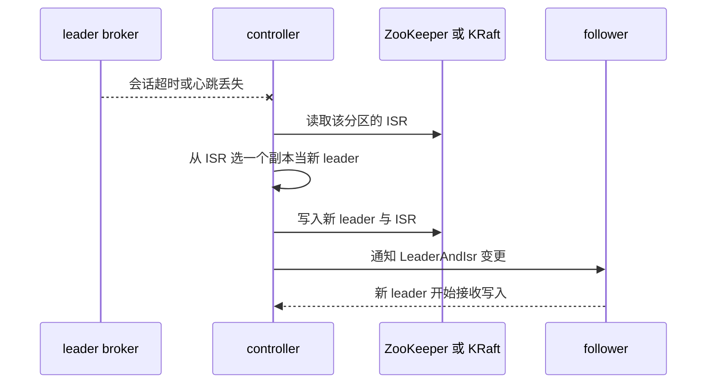

# Paxos、ZAB 与 Kafka 的选举各自解决什么问题？

## 常见问题

- ZooKeeper 的 ZAB 算法与 Paxos 的区别是什么？
- 简述 Kafka 的选举过程

## 概念索引

- 共识: 多数派就同一个值或同一顺序达成一致;
- 提案编号: Paxos 用它区分新旧提案, 防止旧提议覆盖新结果;
- zxid: ZooKeeper 的事务号, 高 32 位是 epoch, 低 32 位是计数;
- ZAB: 主备模式的原子广播, 只有 leader 能提案;
- 控制器: Kafka 中负责分配分区 leader 的 broker;
- ISR: 与 leader 保持同步的副本集合;
- KRaft: 取代 ZooKeeper 的仲裁组, 用 Raft 重做上面那套选主;

## Paxos 在解决什么问题？

```text
prepare(n)   提案者请求: 编号 n 的提案, 请承诺不再接受更小的
promise      多数派回复: 已接受过的最大编号提案值
accept(n,v)  提案者用看到的最大值 v 发起接受
accepted     多数派接受后, 这个值就被确定
```

- 目标: 在节点会宕机、消息会丢的模型下, 让多数派对同一个值达成一致;
- 编号: 单调递增, 保证新提案不会被旧提案顶掉;
- 多数派: 任意两个多数派必有交集, 交集节点带着上一轮的值;
- 局限: 一次只定一个值, 实际系统用 Multi-Paxos 选 leader 减少往返;
- 门槛: 理解成本高, 实现细节比论文多;

## ZAB 的两个阶段是什么？

- 阶段一 发现与同步: 选出 epoch 最大的节点当 leader, 再把 follower 补齐;
- 阶段二 广播: leader 把写请求编号成事务, 过半确认后提交;
- 顺序: 所有节点按 zxid 顺序应用, 保证状态机一致;
- 提交点: leader 收到过半 ack 就提交, 并把 commit 广播出去;
- 恢复: 崩溃节点重启后先同步, 追上 leader 再参与投票;
- 特性: 只要多数派可用, 就能继续服务;

## ZAB 与 Paxos 有什么区别？

| 项 | Paxos | ZAB |
| --- | --- | --- |
| 模式 | 对称, 任意节点可提案 | 主备, 只有 leader 提案 |
| 目标 | 对一个值达成一致 | 对一组有序事务达成一致 |
| 阶段 | prepare 与 accept | 发现同步与广播 |
| 顺序 | 不强调全局顺序 | 强调全序与主备一致 |
| 编号 | 提案号 | zxid, 含 epoch 与计数 |
| 工程 | 需 Multi-Paxos 才能批量化 | 天生适合复制状态机 |

- 本质: ZAB 借鉴了 Paxos 的多数派思想, 但协议是为主备复制设计的;
- 场景差异: Paxos 更通用, ZAB 更贴近日志复制;
- 易错点: 不能说 ZAB 是 Paxos 的特例, 两者阶段与角色都不同;

## Kafka 有哪几类选举？

| 选举 | 谁参与 | 产出 |
| --- | --- | --- |
| 控制器选举 | 所有 broker | 一个 controller 负责元数据 |
| 分区 leader 选举 | controller 从 ISR 中挑 | 每个分区一个 leader |
| 消费组协调 | 组内消费者 | 一个组协调者与分区分配 |
| 元数据仲裁 | controller quorum | KRaft 下的 active controller |

- ZK 模式: broker 抢先在 ZooKeeper 创建 /controller 临时节点, 成功者当选;
- controller 职责: 监听 broker 上下线, 分配分区 leader, 维护 ISR;
- 分区 leader: 由 controller 从 ISR 里选, 通常选回原来的首选副本;
- 消费组: 由 GroupCoordinator 主持, 第一加入的消费者成为 leader 算分配;

## 分区 leader 挂了会怎样？



- ISR 收缩: 落后太多的副本被移出 ISR, 不再算同步;
- 安全前提: unclean.leader.election.enable 为 false 时只从 ISR 选, 不会丢已提交消息;
- 允许脏选举: 打开后可从非 ISR 副本选, 换来可用性但会丢数据;
- 写入保障: acks=all 加 min.insync.replicas 等于要求至少 N 个副本在 ISR;
- 观察: 用 under-replicated 分区数判断集群健康;

## KRaft 之后有什么变化？

- 元数据: 不再写 ZooKeeper, 改成 controller 之间复制的日志;
- 仲裁: controller quorum 用 Raft 选 active controller, 3 台容 1 台;
- broker: 向 controller 注册并拉取元数据, 不再监听 ZK;
- 规模: 分区数量可以到百万级, 故障恢复更快;
- 版本: Kafka 4.0 起只支持 KRaft, ZooKeeper 模式被移除;
- 依据: [KIP-500 设计](https://cwiki.apache.org/confluence/display/KAFKA/KIP-500%3A+Replace+ZooKeeper+with+a+Self-Managed+Metadata+Quorum);

## 三类算法怎么对照？

- Paxos: 解决一个值的共识, 是理论基础;
- ZAB: 把共识用在日志复制上, 强调顺序与主备;
- Raft: 把共识拆成选主、日志复制、安全性三块, 易实现;
- 工程取舍: 需要强一致元数据选 CP 协议, 需要吞吐选分区加副本;
