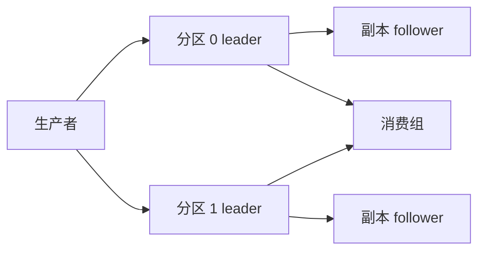

# 消息队列如何设计, Kafka 如何保证有序与可靠?

## 常见问题

- 简述 Kafka 的基本架构，如何用 Kafka 保证消息的有序性？
- 如何设计一个消息队列
- Design a message queue
- Kafka 发送消息是如何保证可靠性的？
- RabbitMQ 如何保证信息可靠性？

## 概念索引

- Broker: 存消息的服务节点;
- Partition: 分区, 并行与有序的边界, 内有单调 offset;
- 消费组: 分区在组内成员之间分配;
- ISR: 与 leader 保持同步的副本集合;
- 投递语义: 至多一次、至少一次、恰好一次;
- 幂等消费: 重复投递只产生一次业务效果, 是至少一次投递的收尾动作;

## Kafka 的基本架构是什么?



- 分区: 主题切成多个分区分散在不同 broker, 分区数决定最大消费并发;
- 副本: 每个分区一个 leader 加若干 follower, 读写都走 leader;
- 选主: controller 负责 leader 与 ISR 变更, KRaft 模式不再依赖 ZooKeeper;
- 存储: 消息顺序追加到段文件, 稀疏索引定位, 顺序写远快于随机写;
- 位点: 消费进度存在 `__consumer_offsets`, 与消息数据分离;

## 如何保证消息有序?

- 范围: 只保证单分区内有序, 不保证主题级全局有序;
- 同键同分区: 生产端按 key 哈希选分区, 同一订单号必然进同一分区;
- 单消费者: 一个分区同时只被组内一个消费者持有, 消费端别自己开线程乱序处理;
- 重试乱序: 开幂等生产者时 `max.in.flight.requests.per.connection` 不超过 5 仍保序, 关掉幂等要设成 1;
- 全局有序: 只能单分区, 代价是放弃并行, 一般不用;

```text
同 key -> 同一分区 -> 同一消费者 -> 顺序处理
```

## 如何设计一个消息队列?

- 存储: 顺序追加日志加分段加索引, 是高吞吐的根基;
- 复制: leader 与 follower 组成 ISR, 写入需多数派确认才算成功;
- 消费: 拉模式加位点, 消费者按自己的能力取, 空轮询用长轮询压掉;
- 语义: 至少一次加消费端幂等, 恰好一次只在明确范围内成立;
- 功能: 死信、延迟、回溯、重平衡, 运维盯积压与最老消息年龄;
- 保护: 有界队列加背压, 队满返回繁忙而不是无限堆积;

## 可靠性靠哪几个开关?

| 环节 | 配置 | 作用 |
| --- | --- | --- |
| 生产 | acks=all | leader 等 ISR 全部落盘才确认 |
| 生产 | 幂等加 retries | 重试不产生重复消息 |
| 主题 | replication.factor=3 | 允许挂掉一台 broker |
| 主题 | min.insync.replicas=2 | ISR 不足时拒写, 不静默降级 |
| 集群 | unclean.leader.election=false | 不让落后副本当 leader |
| 消费 | 手动提交位点 | 处理完才提交, 避免丢消息 |

- 默认值: 3.0 起生产端默认开启幂等且 acks=all, 仍要检查主题侧参数;
- 端到端: 消费失败要重试或进死信, 直接提交位点等于丢消息;
- 边界: 恰好一次只在 Kafka 事务内成立, 外部副作用仍要幂等;

## RabbitMQ 怎么保证可靠?

- 队列: 交换机与队列都声明 durable;
- 消息: 发送时设 delivery_mode 为 2, 即持久化;
- 生产端: 开 publisher confirm, 确认落盘后才算发送成功;
- 消费端: 手动 ack, 失败 nack 重回队列或进死信;
- 复制: 用 quorum queue 基于 Raft 复制, 4.0 起已移除 classic mirrored queue;
- 顺序: 只到单队列单消费者, 不像 Kafka 能按分区并行且保序;
