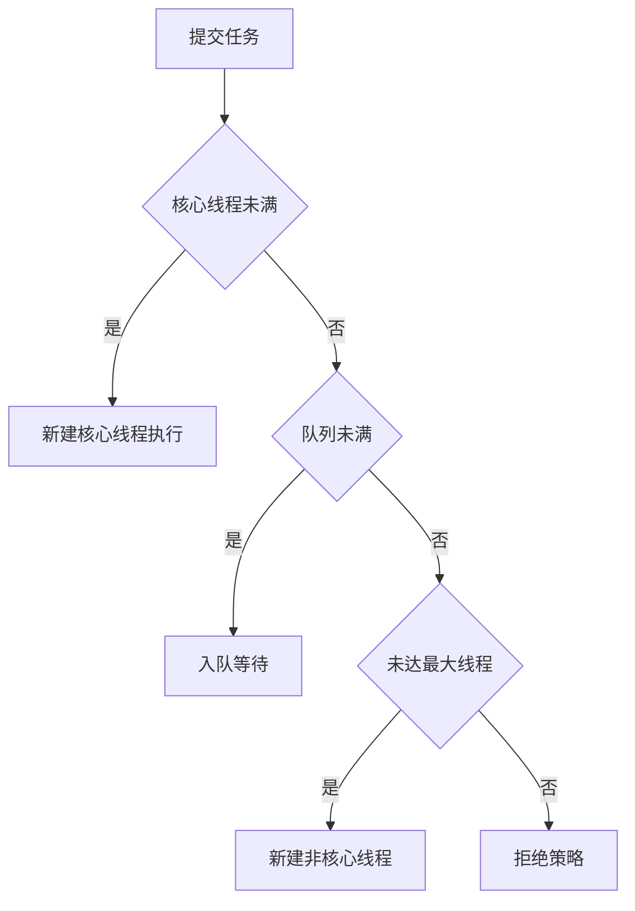
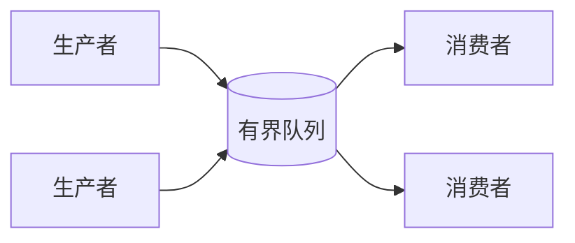

# 线程池参数怎么定, 阻塞队列与生产者消费者模型如何设计?

## 常见问题

- 如何设计一个线程池
- 高并发情景下，核心线程池该如何设置参数？
- 设计一个阻塞队列
- 阻塞队列都有哪几种，有什么区别？
- 简述生产者消费者模型

## 概念索引

- 核心线程: 常驻线程, 默认不回收;
- 阻塞队列: 存放待执行任务的有界缓冲;
- 最大线程: 队列满后才扩容的上限;
- 拒绝策略: 线程与队列都满时的兜底;
- 容量: CPU 密集取核数加 1, IO 密集按阻塞系数放大;
- 背压: 有界队列让上游被迫变慢, 是队列与线程池共同的保护手段;

## 线程池怎么运转?



- 七参数: 核心数、最大数、空闲存活、时间单位、队列、线程工厂、拒绝策略;
- 顺序: 核心, 队列, 最大, 拒绝, 队列一满就跳到最大, 不会先扩容;
- 回收: 非核心线程空闲超 keepAlive 被回收, 核心线程要开 allowCoreThreadTimeOut 才回收;
- 线程工厂: 起名并挂异常处理器, 否则线上排查无线索;

## 参数怎么推导?

- CPU 密集: 线程数约为核数加 1, 多出的一个顶住偶发缺页;
- IO 密集: 线程数约为核数乘以 (1 加 等待 / 计算), 8 核与九成等待约 80 线程;
- 为什么不是一个数就够: 阻塞系数随接口变化, 快慢任务混在一个池里会互相拖死;
- 隔离: 查库、调 RPC、算价各用一个池, 一个下游抖动不拖垮全部;
- 队列: 必须有界, 无界队列会吃光内存并把过载藏起来;
- 拒绝: 核心链路用 CallerRuns 让调用方变慢, 非核心直接丢弃并打点;

## 阻塞队列怎么实现?

```java
final ReentrantLock lock = new ReentrantLock();
final Condition notFull = lock.newCondition();
final Condition notEmpty = lock.newCondition();

void put(T x) throws InterruptedException {
  lock.lock();
  try {
    while (count == items.length) notFull.await();
    items[tail] = x;
    tail = (tail + 1) % items.length;
    count++;
    notEmpty.signal();
  } finally {
    lock.unlock();
  }
}
```

- 判定: 入队等队列未满, 出队等队列非空, 条件都用 while 而不是 if, 防虚假唤醒;
- 两把锁: 头尾各一把可以让生产与消费并行, 代价是计数要原子;
- 无锁: 环形数组加 CAS 序号, 适合超高吞吐场景;
- 容量: 有界是背压的前提, 无界队列等于把过载换成 OOM;

## JDK 里有哪些阻塞队列?

| 队列 | 结构 | 特点 |
| --- | --- | --- |
| ArrayBlockingQueue | 数组 | 有界, 单锁两条件 |
| LinkedBlockingQueue | 链表 | 默认容量极大, 双锁 |
| PriorityBlockingQueue | 堆 | 无界, 按优先级出队 |
| DelayQueue | 堆加延迟 | 到期才可取, 做定时任务 |
| SynchronousQueue | 不存储 | 生产者必须等到消费者 |
| LinkedTransferQueue | 链表 | 支持直接交接 |
| LinkedBlockingDeque | 双向链表 | 两端进出, 适合工作窃取 |

- 配合: 线程池配 SynchronousQueue 时任务是直接交给线程, 适合短任务;
- 陷阱: 配无界队列时最大线程数形同虚设, 永远不会扩容;

## 生产者消费者模型解决什么?



- 解耦: 生产者不必知道消费者是谁, 双方各自按节奏推进;
- 削峰: 突发流量先落队列, 消费者按固定速率处理;
- 背压: 队列满时生产者阻塞或拒绝, 过载不往下游传;
- 代价: 队列带来额外延迟并成为新的故障点, 要盯深度与最老消息年龄;
