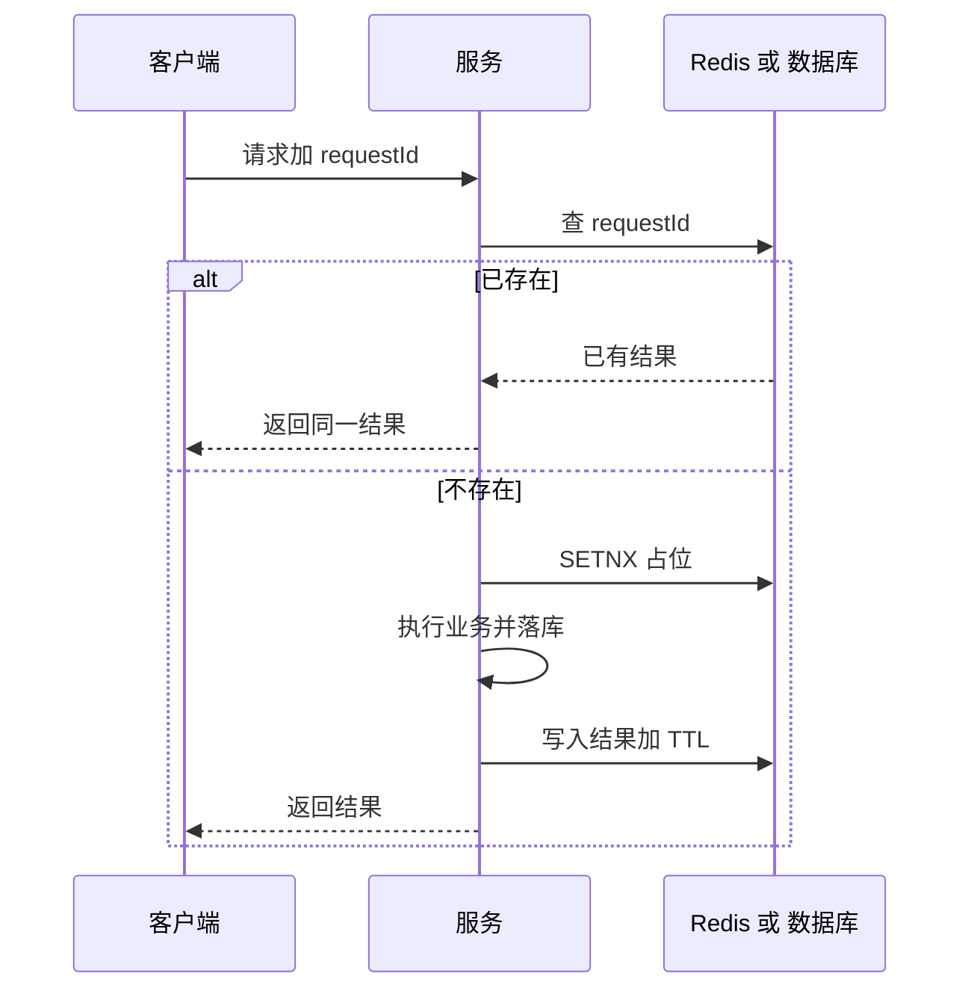

# 如何设计 API 让重复请求只生效一次?

## 常见问题

- 如何设计 API 接口使其实现幂等性？

## 概念索引

- 幂等: 同一请求执行多次, 业务效果只发生一次;
- 唯一键: 用业务单号或请求号去重;
- 幂等 token: 一次性凭证, 用过即失效;
- 条件更新: 用状态或版本做 CAS;
- 天然幂等: 赋值与删除本身就可重复;
- 结果缓存: 重复请求返回首次的响应;

## 哪些方法和语义天然幂等?

| 方法 | 幂等 | 说明 |
| --- | --- | --- |
| GET | 是 | 只读, 不改状态 |
| HEAD | 是 | 只读元数据 |
| PUT | 是 | 整体覆盖, 同值重复写结果相同 |
| DELETE | 是 | 删两次结果一样 |
| POST | 否 | 每次创建新资源 |
| PATCH | 不一定 | 增量修改可能累加 |

- 语义不等于实现: `PUT` 覆盖余额是幂等, `POST /balance/add` 累加就不是;
- 真实场景: 客户端超时重试时, 服务端可能已经执行成功;
- 结论: 写接口要显式设计幂等键, 不能指望调用方只发一次;

## 常见落地手段有哪些?

| 手段 | 做法 | 适用 |
| --- | --- | --- |
| 去重表 | 业务单号加唯一索引, 插入失败即重复 | 创建类接口 |
| 幂等 token | 先取 token, 提交时 SETNX 消费 | 表单与下单 |
| 状态机 | 带状态条件的更新, 影响 0 行即已处理 | 订单流转 |
| 版本号 | 带 version 的乐观锁更新 | 并发编辑 |
| 消息去重 | 按 message_id 记表或记 Redis | 消费端 |
| 结果表 | 首次结果落库, 重复直接返回 | 耗时操作 |

- 首选: 有自然业务单号就用唯一索引, 最简单也最可靠;
- 组合: 入口幂等 token 挡住重复提交, 下游唯一索引兜底;

## 一次请求怎么走?

- 原子性: 占位与业务要么同事务, 要么占位失败就回滚, 否则会永久挡住重试;
- 并发: 先查后插有两步窗口, 靠唯一索引兜底, 不要只靠 GET 判断;
- 响应一致: 重试返回首次的响应体与状态码, 而不是报重复请求;

## 哪些细节容易漏?

- TTL: 去重记录要覆盖最大重试窗口, 太长占空间, 太短会重复生效;
- 锁的边界: 分布式锁只防并发, 锁释放后重试仍会执行, 幂等最终落在唯一约束;
- 幂等键来源: 取自业务单号比取自消息 id 更稳, 重投时业务单号不变;
- 部分失败: 扣款成功但写结果失败时, 要用对账或补偿把状态收敛;
- 可观测: 记录命中幂等的次数, 突然升高往往意味着上游在疯狂重试;
