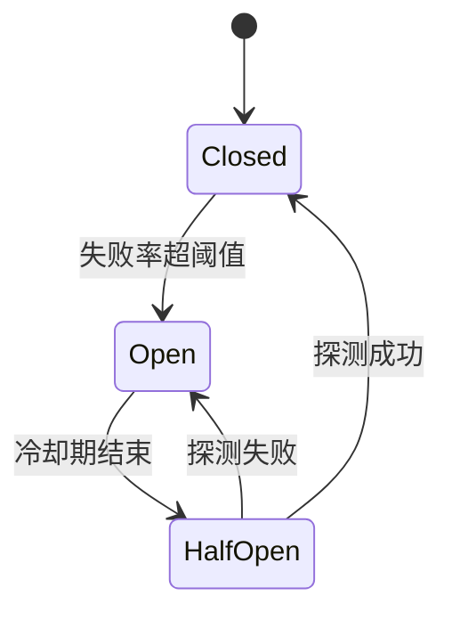

# 限流与熔断如何实现, 中间件削峰用在哪?

## 常见问题

- 简述中间件削峰和限流的使用场景
- 熔断与限流是如何实现的？
- 常用的限流算法有哪些？简述令牌桶算法原理

## 概念索引

- 削峰: 用队列把突发流量摊平到消费能力;
- 限流: 主动限制单位时间的请求量;
- 固定窗口: 每窗一个计数器, 简单但边界能过双倍;
- 漏桶: 恒定速率流出, 只整形不突发;
- 令牌桶: 按速率发令牌, 允许积攒的突发;
- 熔断: 依赖持续失败时快速失败, 恢复靠半开探测, 与限流互补;

## 削峰与限流各管什么?

- 削峰: 写多且可延迟的场景, 秒杀下单先入队再异步处理;
- 限流: 保护自身或下游不超过容量, 网关按用户、接口、IP 设阈值;
- 区别: 削峰把请求排队延后, 限流直接拒绝超额;
- 组合: 入口限流, 队列缓冲, 消费端按自己能力拉取;
- 前提: 队列必须有界, 否则削峰只是把过载挪到内存里;

## 四种限流算法的判定条件

| 算法 | 状态 | 判定 | 突刺 |
| --- | --- | --- | --- |
| 固定窗口 | 窗口起点加计数 | 计数小于限额则放行 | 边界可过近两倍 |
| 滑动日志 | 请求时间戳队列 | 窗口内条数小于限额 | 无突刺, 内存高 |
| 滑动窗口计数 | 当前窗计数加前窗计数 | 当前加前窗乘重叠比小于限额 | 近似, 误差小 |
| 漏桶 | 队列加下次流出时间 | 队列未满则入队 | 完全平滑, 有排队延迟 |
| 令牌桶 | 令牌数与上次补充时间 | 令牌够 1 个则扣减放行 | 允许 B 个的突发 |

```text
// 固定窗口, 每秒限额 10
if now - windowStart >= 1s: windowStart = now, count = 0
allow = count < 10; if allow: count += 1

// 滑动窗口计数, 窗口 60s, 已过 elapsed 秒
weighted = count + prevCount * (60 - elapsed) / 60
allow = weighted < 10

// 漏桶, 速率 r, 容量 cap
if queue.size() < cap: queue.push(req)
if now - lastLeak >= 1 / r: queue.pop(), lastLeak = now

// 令牌桶, 速率 r, 桶容量 B
tokens = min(B, tokens + (now - last) * r), last = now
allow = tokens >= 1; if allow: tokens -= 1
```

- 参数: r 是长期平均速率, B 是允许的突发量, 两者独立可调;
- 漏桶: 流出速率与队列容量决定排队上限, 满了直接拒绝;

## 空闲后突发时几种算法差在哪?

限额 10 个每秒, 空闲 10 秒后瞬间来 100 个请求:

| 算法 | 第一秒放行 | 原因 |
| --- | --- | --- |
| 固定窗口 | 最多 20 | 跨窗口边界各 10 个 |
| 滑动日志 | 10 | 按时间戳精确裁掉旧请求 |
| 滑动窗口计数 | 约 10 到 11 | 加权近似 |
| 漏桶 | 10 加排队 | 其余排队或拒绝 |
| 令牌桶 B 为 20 | 30 | 20 个存量加本秒 10 个 |

- 选择: 要绝对平滑用漏桶, 要允许突发用令牌桶, 要低成本用固定窗口;
- 取舍: 平滑用延迟换稳定, 突发把压力推到瞬间;

## 熔断如何实现?



- 统计: 滑动窗口里的失败率或慢调用比例, Resilience4j 默认失败率到 50% 起熔断;
- 最小请求数: 样本太少不熔断, 避免偶发失败误伤;
- 降级: 返回缓存、默认值或排队提示, 结果必须业务可接受;
- 配合: 超时给熔断提供失败信号, 重试要有上限与退避;

## 分布式限流怎么做?

- 单机: 令牌桶放在进程内, 简单但总额度等于单机额度乘以台数;
- 集中: Redis 加 Lua 原子取令牌, 多节点共享同一份额度;
- 分层: 网关做粗粒度, 服务做细粒度, 两层都用令牌桶;
- 失效: 限流服务不可用时选本地放行还是拒绝, 要提前定清楚;
