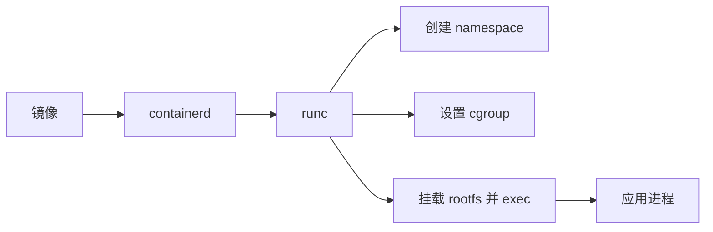

# 容器化的基本原理是什么?

## 常见问题

- 容器化了解吗？它的基本原理是什么？

## 概念索引

- 容器: 被隔离并限制资源的普通进程;
- namespace: 让进程看到独立的系统视图;
- cgroup: 限制进程能用多少资源;
- 镜像: 分层只读的文件系统快照;
- 联合挂载: 把多层叠加成一个根目录;
- 运行时: 按 OCI 规范创建容器进程;

## 容器到底是什么?

- 本质: 宿主机上的一组进程, 加上隔离视图与资源上限, 没有自己的内核;
- 对比虚拟机: 虚拟机虚拟硬件并跑完整客户机内核, 容器直接复用宿主内核;
- 启动: 少一次内核启动, 秒级甚至百毫秒级就绪;
- 密度: 没有内核与系统进程的固定开销, 同规格机器能跑更多实例;
- 交付: 镜像把依赖固化, 换来环境一致;

## 隔离靠什么?

| namespace | 隔离内容 |
| --- | --- |
| pid | 进程号, 容器内应用是 1 号进程 |
| net | 网卡、IP、端口、路由表 |
| mnt | 挂载点与根目录 |
| uts | 主机名与域名 |
| ipc | 信号量、共享内存、消息队列 |
| user | 用户与 UID 映射 |
| cgroup | cgroup 视图 |
| time | 时钟偏移, 较新内核才有 |

- 视角: 隔离是让进程看不见, 不是拿不到, 内核仍然共享;
- 演示: `unshare --pid --net --mount --fork bash` 就能看到最小隔离效果;
- 组合: 各 namespace 拼起来才像一个独立的机器;

## 资源限制靠什么?

- cgroup v2: 用 `cpu.max`、`memory.max`、`pids.max` 写上限;
- CPU: `cpu.max` 写 `200000 100000` 表示最多用 2 个核;
- 内存: 超过上限触发 OOM kill, 表现为进程被杀而不是变慢;
- 联动: 容器内 JVM 要按 limit 设堆, 否则会被内核直接干掉;
- 观测: 读 `/sys/fs/cgroup` 下的 `cpu.stat` 与 `memory.current`;

## 镜像与文件系统怎么组织?

- 分层: 每条 Dockerfile 指令一层, 层按内容哈希寻址, 可复用;
- 联合挂载: overlayfs 用 lowerdir 叠只读层, upperdir 收写入, 呈现合并视图;
- 写时复制: 改文件先复制到上层, 所以容器删了改动就没了;
- 构建缓存: 变化少的层放前面, 依赖安装与源码拷贝分开写;
- 体积: 用多阶段构建, 只把产物拷进运行镜像;

## 从镜像到进程走哪几步?

- OCI: 镜像规范与运行时规范分开, 所以 containerd、CRI-O、Podman 可互换;
- runc: 只负责创建, 建好就退出, 容器进程由宿主内核直接调度;
- 安全: 共享内核意味着内核漏洞可逃逸, 要用 rootless、seccomp、capabilities 收窄;
- 边界: 多租户强隔离仍要虚拟机或 gVisor、Kata 这类沙箱;
