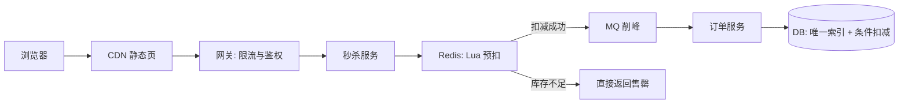

# 电商秒杀怎样在瞬时高并发下不超卖？

## 常见问题

- 电商系统中，如何实现秒杀功能？如何解决商品的超卖问题？

## 概念索引

- 秒杀: 库存在极短时间内被集中争抢的促销场景;
- 超卖: 实际卖出数量超过真实库存;
- 预扣: 在缓存里先原子占用一份库存;
- 削峰: 用队列把瞬时写请求排队处理;
- 幂等: 同一请求重试多次只生效一次;
- 兜底: 幂等之后仍要靠数据库条件更新守库存;

## 需求与规模假设

- 商品: 1000 件库存, 10 万人预约, 活动持续 5 秒;
- 点击: 每人平均点 3 次, 共 30 万次请求;
- 峰值 QPS: 30 万 / 5 s = 6 万;
- 有效订单: 1000 单, 99% 以上的请求应被前置拦截;
- 读请求: 详情页走 CDN 与静态化, 不进秒杀服务;

## 容量估算

| 项目 | 算式 | 结果 |
| --- | --- | --- |
| 库存数据 | 1000 SKU 各一个计数 | 不足 1 MB 内存 |
| 订单落库 | 1000 行 × 300 B | 300 KB |
| 网关机器 | 6 万 QPS / 单机 3000 QPS | 20 台, 再留 50% 余量 |
| 入口带宽 | 6 万 × 2 KB | 120 MB/s, 约 960 Mbps |
| 队列消息 | 只有预扣成功的请求入队 | 千条量级 |

- 瓶颈: 6 万 QPS 全部打到数据库必然击穿, 必须在入口分层拦截;
- 取舍: 库存只有 1000, 99% 的请求注定失败, 越早拒绝越省资源;

## 组件与数据流



- 前端: 按钮置灰、倒计时校准、答题或滑块抬高刷单成本;
- 网关: 按用户与 IP 做令牌桶限流, 超限直接 429;
- 服务: 只做鉴权与预扣, 不查商品、不算价格;
- 队列: 把 1000 条有效下单请求异步落库, 顺带重试;

## 库存预扣为什么必须原子？

- 读改写: 先 GET 再 DECR 的两步之间会被其他请求插入;
- 结果: 两个请求都读到 1, 都扣成 0, 卖出两件;
- 单命令: DECR 本身原子, 但少了先判断库存的步骤;
- 脚本: Redis 用 Lua 把判断与扣减合并成一次执行;

```lua
local stock = tonumber(redis.call('GET', KEYS[1]))
if stock == nil or stock <= 0 then return 0 end
if redis.call('SADD', KEYS[2], ARGV[1]) == 0 then return 2 end
redis.call('DECR', KEYS[1])
return 1
```

- 返回值: 0 售罄, 1 抢到, 2 重复请求, 由调用方分别处理;
- 顺序: 先判重再扣减, 保证同一用户的重复点击不消耗库存;

## 数据库怎样兜住最后一道库存？

```sql
UPDATE stock SET qty = qty - 1
WHERE sku_id = ? AND qty > 0;

INSERT INTO orders (user_id, sku_id, status)
VALUES (?, ?, 'created');
```

- 条件更新: 影响行数为 0 说明库存已空, 直接丢弃这条消息;
- 唯一索引: 在 `(user_id, sku_id)` 上加唯一约束, 重放不会生成第二单;
- 事务: 扣库存与建订单放同一事务, 失败一起回滚;
- 对账: 定时比对 Redis 余量与 DB 库存, 差异走人工或补偿;
- 边界: 缓存预扣成功但落库失败时宁可少卖, 也不能补卖;

## 库存分片如何分散热点？

- 单键瓶颈: 一个 SKU 的请求都打同一个 key, 单键约 10 万 QPS 就见顶;
- 拆桶: 1000 件拆成 10 个桶, 每桶 100 件, 按 user_id 取模落桶;
- 效果: 写压力分散到 10 个 key, 单键只承担十分之一;
- 尾部分配: 某桶先空时用户会看到售罄, 需要跨桶重试或按余量再平衡;
- 汇总: 总余量是各桶之和, 展示层允许短暂不准;

## 瓶颈与取舍

- 少卖与超卖: 宁可少卖, 因为超卖的赔付与口碑成本更高;
- 一致性: 缓存与数据库是最终一致, 用对账和补偿收敛;
- 冷热: 活动前预热库存与页面, 避免开抢瞬间缓存穿透;
- 降级: Redis 故障时直接关闭入口, 不要让流量落到数据库;
- 验证: 压测 6 万 QPS、断网重试、重复点击与超时重发;
