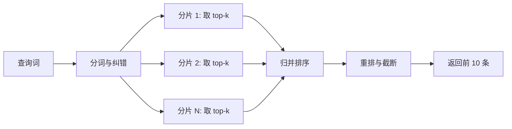

# 搜索引擎与输入框自动补全分别怎样实现？

## 常见问题

- 如何实现百度搜索功能？
- Design typeahead system
- Design an autocomplete system

## 概念索引

- 倒排索引: 从词指向包含它的文档列表;
- 分词: 把文本切成可索引的词项;
- BM25: 按词频与稀有度给文档打分的函数;
- 分片: 按词把索引拆到多台机器;
- 前缀树: 按字符前缀组织候选词的结构;
- 防抖: 前缀树查询之前先减少无效请求;

## 规模假设与估算

- 文档: 1 亿篇, 平均 1 KB 文本, 原文共 100 GB;
- 索引: 倒排表约为原文的 30%-50%, 约 30-50 GB;
- 搜索量: 1 亿次/日 → 1 亿 / 86400 ≈ 1160 QPS;
- 峰值: 1160 × 5 ≈ 6000 QPS;
- 补全量: 按日均 2 亿次计 → 2 亿 / 86400 ≈ 2300 QPS;
- 词典: 100 万词 × 每词 top-10 ≈ 1000 万条候选;

## 一次搜索怎样完成？



- 建索引: 抓取 → 正文抽取 → 分词 → 写倒排表;
- 查询: 分词后按词取 posting list, 求交集或并集;
- 打分: BM25 综合词频、逆文档频率与文档长度;
- 归并: 每个分片返回本地 top-k, 协调节点合并后再取全局 top-k;

```text
term: 手机
postings: [(doc1, tf=3), (doc7, tf=1), (doc9, tf=2)]
BM25 = Σ idf(t) · tf·(k1+1) / (tf + k1·(1-b+b·dl/avgdl))
```

## 索引为什么要分片？

- 单机上限: 100 GB 索引单机可放, 但查询与重建都受 CPU 限制;
- 按词分片: 同一词的所有文档在同一分片, 查询只需带词去找;
- 扇出成本: N 个分片就要 N 次内部请求, 取 top-k 后归并;
- 副本: 每个分片配副本, 兼顾读容量与故障切换;
- 更新: 近实时刷新有秒级延迟, 发布成功不等于立刻可搜;

## 自动补全靠什么结构？

- 需求: 输入 3 个字符就要在 100 ms 内给出 10 条候选;
- 前缀树: 每个节点存该前缀的 top-k, 查到时直接返回;
- 代价: 写入要回溯更新祖先节点的 top-k, 更新变重;
- 替代: 前缀直接做 Redis key, 或用前缀哈希分片;
- 排序: 候选按搜索热度、时效与个人历史加权;

```ts
class TrieNode {
  children = new Map<string, TrieNode>();
  top: string[] = [];
}

function insert(root: TrieNode, word: string) {
  let node = root;
  for (const ch of word) {
    if (!node.children.has(ch)) node.children.set(ch, new TrieNode());
    node = node.children.get(ch)!;
    if (node.top.length < 10) node.top.push(word);
  }
}
```

- 边界: 前缀命中不到就退化为模糊匹配或直接不补全;

## 延迟预算与瓶颈

| 环节 | 预算 | 手段 |
| --- | --- | --- |
| 网络往返 | 20 ms | 就近接入、HTTP/2 |
| 补全查询 | 20 ms | 内存前缀索引、结果缓存 |
| 搜索检索 | 100 ms | 分片并行、top-k 剪枝 |
| 重排 | 50 ms | 只对前 100 条做复杂打分 |

- 交互: 前端防抖 200 ms, 新请求发出时取消旧请求;
- 缓存: 热门前缀结果放 CDN 或 Redis, 长尾回源;
- 热点词: 明星、突发新闻会形成单 key 热点, 用本地缓存兜;
- 长尾: 大量只出现一次的词让倒排表稀疏, 用压缩编码;
- 一致性: 删除的内容要从索引移除, 也要从补全候选移除;
