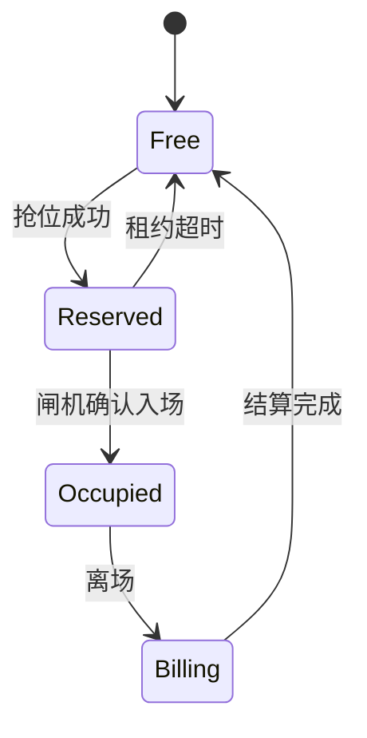

# 有限车位被多车争抢时, 怎样保证不重复占用并按停留时长计费？

## 常见问题

- Design Parking System
- 停车场有有限个车位，有多个车来抢车位，设计一个系统需要根据车辆进入和离开停车场的时间进行计费
- Design Bicycle Rental System

## 概念索引

- 车位: 同一时刻只能被一个用户占用的资源;
- 抢占: 多个请求同时竞争同一车位;
- 条件更新: 带上状态条件再写, 用影响行数判断胜负;
- 会话: 一次入场到离场之间的过程;
- 计费规则: 按停留时长分段计算价格;
- 幂等结算: 计费规则对同一会话只落一次账;

## 规模假设与估算

- 规模: 5000 个车位, 日均 1 万车次, 平均停 2 小时;
- 平均入场: 1 万 / 86400 ≈ 0.12 次/s;
- 早高峰: 500 辆集中在 10 分钟 ≈ 0.83 次/s;
- 在场车辆: 1 万 × 2 h / 24 h ≈ 833 辆;
- 记录: 1 万条 × 300 B = 3 MB/日, 5 年约 5.5 GB;
- 结论: 量小, 正确性与计费一致比吞吐重要;

## 抢车位怎样保证只有一个赢家？

```sql
UPDATE spot SET status = 'taken', session_id = ?
WHERE id = ? AND status = 'free';
-- 影响行数为 0 表示已被别人抢走
```

- 原子性: 判断与写入在一条语句里, 数据库保证不会同时成功两次;
- 状态机: `free → taken → free` 之外不允许跳转;
- 唯一约束: 同一辆车不能同时占用两个车位, 用部分唯一索引兜;
- 高并发: 车位争抢激烈时用 Redis Lua 预先占位, 再异步落库;
- 超时释放: 预占带 5 分钟租约, 未真正入场自动回收;



## 计费怎样算准？

- 记录: 入场时间、离场时间、车牌、车位 ID;
- 时长: 按分钟向上取整, 避免秒级抖动造成价格跳变;
- 规则: 首小时 10 元, 之后每小时 5 元, 24 小时封顶 80 元;
- 金额: 以分为单位存整数, 不用浮点;
- 口径: 时间以闸机为准, 前 15 分钟免费, 允许人工校正;

```ts
function fee(minutes: number, cap = 8000): number {
  const hours = Math.ceil(minutes / 60);
  if (hours <= 1) return Math.min(1000, cap);
  return Math.min(1000 + (hours - 1) * 500, cap);
}
```

- 边界: 跨天停车按每 24 小时重新封顶, 规则要写进配置;

## 结算为什么必须幂等？

- 重放: 闸机断网重试、支付平台回调重复都会触发多次结算;
- 唯一索引: 账单表在 `session_id` 上加唯一约束;
- 状态推进: 只允许 `unpaid → paid → closed`, 旧事件不能回退;
- 回调: 以服务端事件为准, 不信浏览器跳回的成功页;
- 对账: 每日比对账单、支付流水与实际出场记录;

## 共享单车租借有什么不同？

- 资源: 车辆可以在站点之间移动, 位置本身会变;
- 状态: `available → in_use → available` 或 `maintenance`;
- 开锁: 扫码后服务端校验车辆可用并下发指令, 失败要回滚状态;
- 计费: 按分钟计, 起步价加时长费, 与停车场的分段规则同构;
- 调度: 站点容量有上下限, 需要预测潮汐并安排搬运;

## 瓶颈与取舍

- 一致性: 车位与订单跨库时用预占加补偿, 不做分布式强事务;
- 热点: 单个热门停车场可独立分库, 天然按场地隔离;
- 离线: 闸机断网要能本地放行并补传, 事后核对避免漏单;
- 体验: 计费误差用人工减免处理, 比卡住出口更划算;
