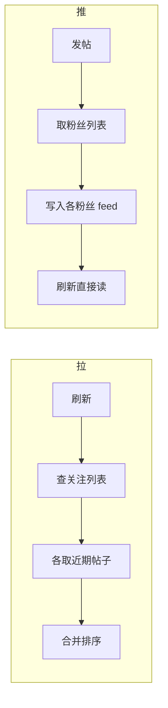

# 社交信息流和视频平台分别靠什么撑住海量读写？

## 常见问题

- Design twitter
- Design Netflix

## 概念索引

- 扇出: 一条内容被投递到多个接收方的过程;
- 拉模型: 读的时候再合并关注对象的内容;
- 推模型: 写的时候就把内容放进粉丝的信息流;
- 信息流: 按用户维度组织的内容列表;
- 转码: 把源视频转成多档码率与分辨率;
- 自适应码率: 播放器按网络挑选转码产物;

## 规模假设与估算

| 项目 | 算式 | 结果 |
| --- | --- | --- |
| 发帖量 | 2 亿 DAU × 5 条 | 10 亿条/日 |
| 平均写入 | 10 亿 / 86400 | 约 1.16 万条/s |
| 刷新量 | 2 亿 × 10 次 | 20 亿次/日, 约 2.3 万次/s |
| 扇出量 | 10 亿 × 平均 200 粉丝 | 2000 亿条索引/日 |
| 扇出存储 | 2000 亿 × 16 B | 约 3.2 TB/日 |
| 播出带宽 | 10 亿次 × 100 MB / 86400 | 约 1.16 TB/s |
| 上传量 | 500 万 × 100 MB | 500 TB/日 |

- 读放大: 一次刷新要取 20 条, 20 亿次刷新就是 400 亿条索引读取;
- 结论: 写入便宜、读取昂贵, 优化的核心是把合并成本前移或缓存;

## 拉模型与推模型怎么选？

- 拉: 不写无效数据, 但关注 1000 人时一次刷新要发 1000 次查询;
- 推: 读只需一次, 但一个千万粉账号发帖就是千万次写;
- 混合: 普通作者推, 大 V 只存源帖, 读时再合并;
- 阈值: 按粉丝数与发布频率估算写放大, 用实测负载定;
- 语义: 这里的推是写服务端索引, 不等于给每台手机发推送;

## 信息流还有哪些环节？

- 候选: 预生成的 feed 与大 V 近期内容合并去重;
- 排序: 亲密度 × 内容权重 × 时间衰减, 再按互动反馈调参;
- 分页: 用稳定游标而不是 offset, 否则新帖插入会漏项;
- 删除: 原帖删除后转发也要失效, 不能靠副本绕过权限;
- 故障: 扇出失败可重试, 重试要幂等, 积压时先给旧视图;

## 视频链路与成本在哪？

- 转码: 1 个源文件生成 4K/1080p/720p/480p 四档, 存储约放大 3 倍;
- 出站: 播放是主要成本, 100 MB × 10 亿次 = 100 PB/日;
- CDN: 命中率 95% 时回源只剩 5%, 即约 58 GB/s;
- 分片: 按 6 秒切段并生成清单, 播放器按段请求;
- 专用 CDN: 把热门内容预放到离用户更近的节点, 缩短路径;

## 播放体验如何权衡？

- 码率: 低码率少卡顿, 高码率画质好, 网络波动时优先不断流;
- 起播: 先给低码率首段, 缓冲够了再升档;
- 续播: 按用户与视频存 offset, 周期上报而不是每帧写库;
- 多设备: 新旧设备上报要带版本, 不能无条件互相覆盖;
- 降级: 搜索、推荐、统计故障不应阻断已授权的播放;
