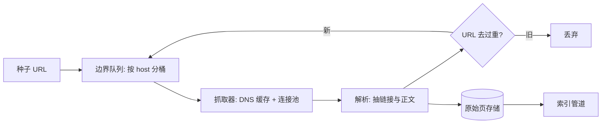

# 网络爬虫与限流器各自要解决哪些工程问题？

## 常见问题

- Design a web crawler
- Design a rate limiter

## 概念索引

- 种子: 爬取的起始 URL 集合;
- 边界队列: 待抓 URL 的优先级队列;
- 去重: 判断 URL 或内容是否已处理;
- 礼貌: 控制对单个站点的请求频率;
- 令牌桶: 按速率补令牌、按请求消耗;
- 限流维度: 决定令牌桶的额度包含哪些主体;

## 爬虫: 规模与估算

- 目标: 10 亿 URL, 每天抓 1 亿页, 每页 100 KB;
- 抓取速率: 1 亿 / 86400 ≈ 1160 页/s;
- 带宽: 1160 × 100 KB ≈ 116 MB/s, 约 930 Mbps;
- 原始存储: 1 亿 × 100 KB = 10 TB/日, 30 天约 300 TB;
- 去重空间: 10 亿 URL 用布隆过滤器, 1% 误判约 1.2 GB;
- 算式: m = -n·ln p / (ln 2)^2, k = (m/n)·ln 2 ≈ 7;

## 爬虫: 组件与数据流



- 分桶: 同一 host 的 URL 进同一桶, 天然串行, 便于控制频率;
- 优先级: 按更新频率、站点权重与深度排, 新闻类优先;
- 检查点: 队列定期快照, 崩溃后从快照续跑;
- 重试: 5xx 与超时退避重试, 4xx 直接放弃;

## 爬虫: 礼貌与内容去重

- robots: 按 host 缓存 robots.txt, 遵守 Disallow 与 Crawl-delay;
- 频率: 单站点默认 1 QPS, 429 或 503 时指数退避;
- 身份: 请求带可识别的 UA 与联系邮箱, 便于站点封禁而非误伤;
- 内容去重: 正文算 simhash, 汉明距离小于阈值视为重复;
- 陷阱: 日历、无限参数与蜘蛛网会生成无限 URL, 用深度与参数规则剪枝;
- 边界: 布隆过滤器只会误判为已存在, 不会漏抓新 URL;

## 限流器: 四种算法怎么选？

| 算法 | 状态 | 特点 |
| --- | --- | --- |
| 固定窗口 | 每窗一个计数器 | 简单, 窗口边界可放过两倍额度 |
| 滑动日志 | 保存请求时间戳 | 精确, 存储成本高 |
| 滑动计数 | 当前窗 + 前窗加权 | 近似, 成本低 |
| 令牌桶 | 令牌数 + 上次补充时间 | 允许受控突发, 最常用 |

- 漏桶: 输出速率恒定, 适合整形, 代价是排队延迟;
- 令牌桶: 速率 r 决定长期均值, 容量 B 决定可容忍的突发;
- 参数: 稳态 1000 QPS、允许 1 秒突发 → r = 1000/s, B = 1000;
- 响应: 超限返回 429, 带 `Retry-After` 与剩余额度;

```lua
local now = tonumber(ARGV[1])
local rate, burst = tonumber(ARGV[2]), tonumber(ARGV[3])
local tokens = tonumber(redis.call('GET', KEYS[1]) or burst)
local last = tonumber(redis.call('GET', KEYS[2]) or now)
tokens = math.min(burst, tokens + (now - last) * rate)
if tokens < 1 then return 0 end
redis.call('SET', KEYS[1], tokens - 1)
redis.call('SET', KEYS[2], now)
return 1
```

## 限流器: 分布式与取舍

- 本地计数: 10 台机器各放 100 次, 全局就成了 1000 次;
- 精确: 计数放 Redis, 用 Lua 保证补充与扣减原子;
- 近似: 每台预领 10 个额度, 用完再领, 减少往返但会短暂超额;
- 维度: 按用户、API Key、IP、接口分别限, 维度决定公平性;
- 降级: 限流服务不可用时选拒绝还是放行, 必须提前定;
- 时钟: 多节点依赖本地时间会漂移, 统一用服务端时间或 Redis TIME;
