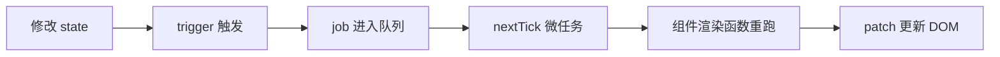

# Vue 的双向数据绑定和 Vuex 是怎么实现的？

## 常见问题

- Vue 中双向数据绑定的实现原理是怎样的？
- 简述 Vuex 的实现原理

## 概念索引

- v-model: 语法糖, 等价于绑定值加监听更新事件;
- 响应式: 读写数据时被拦截, 变化能被感知;
- 依赖收集: 渲染时记下用到了哪些响应式数据;
- 派发更新: 数据变了, 通知依赖它的渲染函数重跑;
- 调度队列: 同一轮多次修改合并, 在微任务里批量刷新;
- Vuex: 把全局状态放进同一套响应式系统, 再约束修改通道;

## v-model 编译成了什么？

```vue
<template>
  <input v-model="msg" />
</template>
<!-- 等价于 -->
<template>
  <input :value="msg" @input="msg = $event.target.value" />
</template>
```

- 本质: 属性绑定加事件监听的语法糖, 没有魔法通道;
- 表单差异: checkbox 用 checked 与 change, select 用 change;
- 组件: Vue 3 用 modelValue 与 update:modelValue;
- Vue 2 组件: 用 value 与 input, 想改名要配 model 选项;
- 修饰符: .lazy 改成 change 同步, .number 转数字, .trim 去空格;

## Vue 2 的响应式怎么做？

```js
function defineReactive(obj, key, val) {
  const dep = new Dep()
  Object.defineProperty(obj, key, {
    get() {
      if (Dep.target) dep.depend() // 收集
      return val
    },
    set(next) {
      if (next === val) return
      val = next
      dep.notify() // 通知
    },
  })
}
```

- 核心: Object.defineProperty 把属性改成 getter 与 setter;
- 收集: getter 里把当前 Watcher 塞进 Dep;
- 通知: setter 里调 dep.notify(), 让 Watcher 排队更新;
- 数组: 重写 push、pop、shift、unshift、splice、sort、reverse;
- 缺陷: 新增属性、删除属性、下标赋值都检测不到, 要 Vue.set;

## Vue 3 的响应式怎么做？

```js
const targetMap = new WeakMap()
let activeEffect = null

function track(target, key) {
  if (!activeEffect) return
  let deps = targetMap.get(target) ?? new Map()
  targetMap.set(target, deps)
  let set = deps.get(key) ?? new Set()
  deps.set(key, set)
  set.add(activeEffect)
}

function trigger(target, key) {
  targetMap.get(target)?.get(key)?.forEach((fn) => fn())
}

function reactive(obj) {
  return new Proxy(obj, {
    get(t, k) {
      track(t, k)
      return t[k]
    },
    set(t, k, v) {
      t[k] = v
      trigger(t, k)
      return true
    },
  })
}
```

- 核心: Proxy 代理整个对象, 拦截 get 与 set;
- 收集: track 把当前 effect 记进依赖表;
- 触发: trigger 找出依赖, 交给调度器排队;
- 优势: 新增属性、删除、数组下标都能感知;
- 惰性: 嵌套对象在访问时才递归代理;
- 版本: 3.4 减少 computed 的无效重算, 3.5 再降内存;

版本行为以 [Vue 3.4 公告](https://blog.vuejs.org/posts/vue-3-4) 与 [Vue 3.5 公告](https://blog.vuejs.org/posts/vue-3-5) 为准。

## 一次修改怎么走到 DOM？



- 合并: 同步改十次, 也只渲染一次;
- 排序: 队列按组件 id 升序, 父组件先于子组件;
- 异步: 更新在微任务里, 所以改完立刻读 DOM 还是旧值;
- 等更新: await nextTick() 之后再读;

## Vuex 是怎么实现的？

```js
function createStore({ state, mutations, actions }) {
  const store = {
    state: reactive(state), // Vue 3, Vue 2 是 new Vue({ data: { state } })
    commit(type, payload) {
      mutations[type](store.state, payload)
    },
    dispatch(type, payload) {
      return actions[type]({ commit: store.commit, state: store.state }, payload)
    },
  }
  return store
}
```

- state: 放进响应式系统, 组件渲染时自动收集依赖;
- getters: 用 computed 包装, 依赖不变就复用结果;
- mutations: 唯一的同步修改入口, 便于 devtools 记录快照;
- actions: 处理异步, 内部再 commit;
- 注入: Vue 2 混入挂 $store, Vue 3 用 provide 与 inject;
- 严格模式: 深度 watcher 检测绕过 mutation 的修改, 开发期报错;
