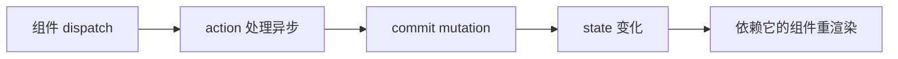

# Vue 组件之间怎么通信，Vuex 有哪些常用属性？

## 常见问题

- Vue 组件间是如何进行通信的？
- 组件通信有哪几种方式？
- Vuex 有哪些常用属性？

## 概念索引

- props: 父向子传数据的正规通道;
- emit: 子向父上报事件;
- v-model: props 与 emit 组合成的双向语法糖;
- provide/inject: 跨层级传值, 跳过中间组件;
- 模板引用: 父直接拿到子组件实例或 DOM;
- 事件总线: 用独立的发布订阅对象解耦任意组件;
- Vuex: 集中存放跨组件共享状态的容器;

## 父子和兄弟之间怎么传？

```vue
<!-- 父 -->
<Child :title="title" @change="onChange" />
<!-- 子 -->
<script setup>
const props = defineProps({ title: String })
const emit = defineEmits(['change'])
emit('change', 1)
</script>
```

- 父传子: props 声明类型、默认值与校验;
- 子传父: emit 抛事件, 父用 @change 接收;
- 双向: v-model 或 Vue 2 的 .sync;
- 兄弟: 提升到共同父组件, 或交给状态管理;
- 插槽: 父把模板片段交给子渲染, 属于内容分发;
- 约束: props 单向数据流, 子组件不要直接改;

## 跨层级与实例访问怎么做？

| 方式 | 方向 | 耦合 | 典型场景 |
| --- | --- | --- | --- |
| props 与 emit | 父子 | 低 | 表单、列表项 |
| provide 与 inject | 祖先到后代 | 中 | 主题、i18n、表单上下文 |
| attrs 透传 | 父到深层子 | 低 | 包装第三方组件 |
| ref 与 expose | 父到子实例 | 高 | 调用子组件方法、测量 DOM |
| 事件总线 | 任意 | 低但难追踪 | 一次性通知 |

- provide/inject: 传 ref 或 reactive 才有响应性;
- attrs: 未声明的属性, Vue 3 用 v-bind="$attrs" 批量透传;
- expose: defineExpose 决定子组件对外暴露什么;
- 事件总线: Vue 3 移除了 $on 与 $emit, 要改用 mitt;
- 选择: 层级浅用 props, 层级深用 provide, 全局共享用 Pinia;

## Vuex 的常用属性有哪些？

| 属性 | 作用 | 说明 |
| --- | --- | --- |
| state | 唯一数据源 | 响应式, 组件只读 |
| getters | 派生状态 | 相当于 store 的 computed |
| mutations | 同步修改 | 唯一能改 state 的地方 |
| actions | 异步逻辑 | 内部再 commit mutation |
| modules | 业务拆分 | 加 namespaced 隔离命名 |
| plugins | 扩展 | 持久化、日志、devtools |

```js
const store = createStore({
  state: () => ({ count: 0 }),
  getters: { double: (s) => s.count * 2 },
  mutations: { inc(s, n) { s.count += n } },
  actions: {
    async incAsync({ commit }, n) {
      await sleep(100)
      commit('inc', n)
    },
  },
})
```

- 辅助函数: mapState、mapGetters、mapMutations、mapActions;
- 组合式: useStore() 拿到 store, 再配合 computed;
- 命名空间: 模块内的 action 要写全路径, 如 cart/add;

## 一次更新的数据流是什么？



- 单向: 组件不直接改 state, 只发 action 或 commit;
- 严格模式: 开发期检测绕过 mutation 的直接赋值;
- 好处: 修改集中, 便于记录快照与时间旅行;
- 代价: 模板代码多, TypeScript 推导弱;
- 迁移: Pinia 去掉 mutation, 直接改 state, 对 TS 更友好;

## 该选哪种通信方式？

- 一两层父子: props 与 emit 足够, 不要过度设计;
- 跨三四层: provide 与 inject, 避免层层透传;
- 全局共享: Pinia 或 Vuex, 按业务拆模块;
- 一次通知: mitt 事件总线, 用完记得解绑;
- 反面: 滥用事件总线, 数据来源难以追踪;
